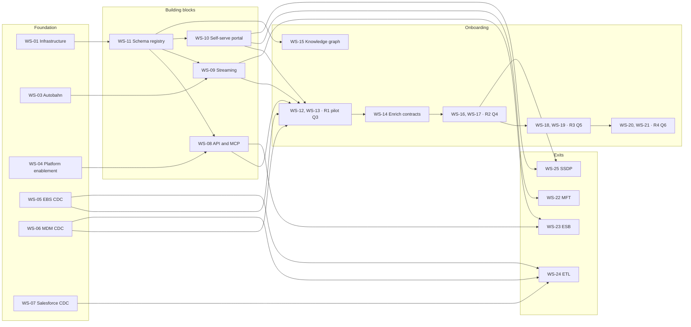

# PLANNING.md

This is the project plan for the Unified Integration Fabric (UIF). It has four parts, and they answer different questions. The **delivery roadmap** covers what the programme ships over seven quarters — shared infrastructure, the reusable building blocks, the component layer those outcomes are built from, four capability onboarding waves, and the platform exits that follow them. The **dependency model** is what the plan exists for: what moves if something slips, including the nine programmes outside UIF that consume its milestones. The **resource model** records the team ramp and the Phase 0 onboarding shortfall that Q1 inherited. The **foundation** section covers standing up this repository as the Engineering Operating System that the roadmap is executed through; most of it is done.

**Reconciled against `UIF Project Plan v2.xlsx` on 2026-09-08.** That workbook plans the same programme on a different calendar, a different work breakdown and different release numbering. Where the two disagreed, the deviation is recorded rather than smoothed over — see the open items, which grew from ten to eighteen as a result, and the reconciliation note at the end.

Read this after `README.md` and `CLAUDE.md`. A Product Manager uses it to create the Jira structure; an FDE uses the workstream IDs to find the work that belongs to their domain; the UIF assistant in Rovo uses the same IDs to answer dependency questions. The definitive capability definitions are in `jira/capability-model.md`.

## How to read this plan

**Every workstream has a stable ID** (`WS-01` … `WS-37`). That ID is the join key across all four surfaces — this file, the Jira epic, the Confluence dashboard, and the Rovo assistant. Reference a workstream by ID, not by name; names get rewritten and IDs don't. `WS-01`…`WS-30` are the outcome workstreams from the Enterprise Blueprint roadmap; `WS-31`…`WS-37` are the component layer added 2026-09-08.

**Quarters are programme-relative** (Q1 … Q7), not calendar quarters, and they are anchored to real dates. **Q1 starts 2026-08-01**; each quarter is three calendar months, so the programme runs **1 August 2026 → 30 April 2028**.

| | Q1 | Q2 | Q3 | Q4 | Q5 | Q6 | Q7 |
|---|---|---|---|---|---|---|---|
| **Starts** | 2026-08-01 | 2026-11-01 | 2027-02-01 | 2027-05-01 | 2027-08-01 | 2027-11-01 | 2028-02-01 |
| **Ends** | 2026-10-31 | 2027-01-31 | 2027-04-30 | 2027-07-31 | 2027-10-31 | 2028-01-31 | 2028-04-30 |
| **Release** | R0 | R1 | R2 | R3 | R4 | R5 | Decommission |

**Q7 was added 2026-09-08** when this plan was reconciled against `UIF Project Plan v2.xlsx`, which
carries a seventh quarter for legacy decommissioning after the last go-live. The programme is one
quarter longer than previously recorded here.

**Two other calendars are in circulation and neither matches this one.** `UIF Project Plan v2.xlsx`
schedules delivery on **fiscal quarters** (`Q3'26` = Jul–Sep 2026, `Q4'26` = Oct–Dec, and so on) and
takes its baseline from **2026-07-20**, eleven days before Q1 opens here, with a further *"+5 days
re-phase from the locked roadmap"* already banked. Programme-relative quarters straddle fiscal ones —
Q1 (Aug–Oct 2026) spans the back of `Q3'26` and the front of `Q4'26` — so a date quoted in one scheme
never maps cleanly onto the other. **When quoting a date, say which scheme it is in.** The fiscal
labels are what the OCTO roadmap slide uses; the programme-relative ones are what the Jira epics use.

These dates are on the Jira epics as Start date and Due date, which is what draws the timeline and makes the dependency links visible. A workstream's bar covers its **delivery** quarters only — `BAU` quarters are excluded, because BAU is steady-state stewardship rather than project work.

**Phase names** are canonical here: `Foundation`, `Building blocks`, `Go Live R2`–`R5`, `Decommission`.

**Release numbering was corrected 2026-09-08.** This plan previously numbered the four onboarding
waves `R1`–`R4`, taken from the source roadmap's `Phase` column. `UIF Project Plan v2.xlsx` inserts a
**Release 0** at Q1 (platform enablement, ten reusable assets, no reduction yet) and a **Release 1**
at Q2 (building blocks, 128 reusable APIs/MCP/event streams, still no reduction), which shifts every
later label up by one. The v2 numbering is adopted here because it is what the Enterprise Blueprint
and the OCTO roadmap use:

| Quarter | Release | Content | Legacy replaced |
|---|---|---|---|
| Q1 | **R0** | Foundation, platform enablement | 0 |
| Q2 | **R1** | Building blocks; 109 integrations begin dual-running on UIF | 0 |
| Q3 | **R2** | Employee + Warehouse + Stock live | 35 |
| Q4 | **R3** | Customer + Analytics live | 109 |
| Q5 | **R4** | Product + Sales live, MFT exit | 206 |
| Q6 | **R5** | Assessments + Sales live, ESB + ETL + SSDP exit | 435 |
| Q7 | — | Decommission completes | — |

This closes the two oldest open items in this document. The old open item 2 recorded that section
headings called Q4 "Release 1 Go Live" while the `Phase` column called it `Go Live R2` — both were
correct about different schemes, and the headings were using v2's. The old open item 1 recorded that
`CLAUDE.md` claims the reduction target is reached at "Release 3 Go Live" where ESB, ETL and SSDP are
exited, while this roadmap put those exits in Q6. **Under the corrected numbering the exits and the
66% target both land at Release 5 in Q6, so `CLAUDE.md` is the document that is wrong** and needs
amending.

**Onboarded is not retired.** v2 separates the two and this plan now follows it: an integration
counts as *onboarded* when it runs on UIF, and as *retired* only when its legacy path is switched
off. The 109 Product/Pricing/Royalties and Sales/Subscription integrations begin dual-running from
October 2026 (R1) with legacy exits starting Q3, which is why R0 and R1 show reduction of zero while
real delivery is happening. A `LIVE` cell in the tables below means onboarded, not retired.

**Cell values** mean: a named milestone is work planned in that quarter; `LIVE` is the go-live quarter; `BAU` is steady-state stewardship after delivery, not project work.

**Scope of this document.** This plan tracks execution and dependencies. Cumulative integration-reduction targets and financial benefit cases are deliberately out of scope — they belong to the Enterprise Blueprint, which is their source of record. Per-wave legacy integration counts are retained here because they size the work.

---

## Delivery roadmap

### Shared infrastructure and security — provisioned once, shared by every outcome

| ID | Workstream | Q1 | Q2 | Q3 | Q4 | Q5 | Q6 | Owner |
|---|---|---|---|---|---|---|---|---|
| WS-01 | Infrastructure provisioning | Provision environments | BAU | BAU | BAU | BAU | BAU | Platform Eng + API/Integration Eng |
| WS-02 | Observability (New Relic + OTel) | Instrument baseline | Extend to APIs | Extend to streams, portal | BAU | BAU | BAU | Platform Eng + API/Integration Eng |
| WS-03 | Autobahn event + data streaming | Configure queues, routing, topics | Event/contract designs agreed | Data streams live | BAU | BAU | BAU | Platform Eng + API/Integration Eng |
| WS-04 | Platform enablement (MuleSoft Anypoint + API Portal, Autobahn event bus, AWS, governance tooling) | Configure platform | BAU | BAU | BAU | BAU | BAU | Platform Eng + API/Integration Eng |
| WS-05 | Oracle EBS — CDC + Zero-ETL | Enable CDC | Test CDC in sandbox | CDC live | BAU | BAU | BAU | Oracle DBA + Network Eng + API/Integration Eng |
| WS-06 | Oracle MDM — CDC + Zero-ETL | Enable CDC | Test CDC in sandbox | CDC live | BAU | BAU | BAU | Oracle DBA + Network Eng + API/Integration Eng |
| WS-07 | Salesforce — CDC enablement | Enable CDC | Test CDC in sandbox | CDC live | BAU | BAU | BAU | Salesforce Admin + API/Integration Eng |

- **WS-01** delivers cloud environments with Zero-Trust security, RBAC, and an observability baseline. Done in Q1 and reused by every capability in every later phase.
- **WS-02** delivers full-stack monitoring across pipeline stages, distributed API tracing, and integration health dashboards — so failures are alerted in minutes rather than reported by business teams.
- **WS-05**/**WS-06** replace the point-to-point ETL jobs that currently poll Oracle EBS and Oracle MDM (Product Hub, Customer Hub) with GoldenGate change capture landing in the Bronze S3 staging layer. **WS-07** gives Salesforce CRM event-driven sync to the MDM golden record. Together these are the `ETL → Zero-ETL` transformation named in `CLAUDE.md`.

### Building blocks — APIs, streaming, self-serve, schema registry

| ID | Workstream | Q1 | Q2 | Q3 | Q4 | Q5 | Q6 | Owner |
|---|---|---|---|---|---|---|---|---|
| WS-08 | API & MCP (solution design → build) | Solution design, observability | Simplify landscape, schema register | Enrich contracts | Enrich contracts | Enrich contracts | Enrich contracts | API/Integration Eng |
| WS-09 | Data streaming and events (topics, queues, message types) | Solution design, observability | Build topics and publish | Enrich streams | Enrich streams | Enrich streams | Enrich streams | API/Integration Eng |
| WS-10 | Self-serve portal | Solution design, observability | Portal build | Portal build continued | BAU | BAU | BAU | API/Integration Eng |
| WS-11 | Schema definition / registry | Define schemas | Publish to registry | Publish to registry | Publish to registry | Publish to registry | Publish to registry | Data Architecture |

- **WS-08** delivers the reference architecture, API design standards, MCP/A2A connector patterns, API documentation, and policy-driven governance. It is the foundation every onboarding wave draws on. Repo standards: `capabilities/api/guidelines.md`, `capabilities/mcp/guidelines.md`.
- **WS-09** delivers topic taxonomy and event envelope standards, consolidated on Autobahn. Repo standards: `capabilities/event/guidelines.md`, `capabilities/event/streaming.md`.
- **WS-10** replaces manual MFT file exchanges with governed, auditable self-service: portal UI for file transfer, routing and template library, environment config, and schema registry lookup for partners and finance teams. It removes the central-team dependency from partner onboarding, consolidating roughly 40 partner integrations into one MCP-enabled portal. It is the precondition for the MFT exit (WS-22).
- **WS-11** delivers canonical data contracts for the Product, Customer, Learner, and Financial Entity domains, then continuous schema enhancement and performance optimisation. **The source roadmap marks this a blocker for all pipeline and API work** — it is the most heavily depended-on workstream in the programme. Repo standards: `stacks/apicurio/standards/`, `capabilities/data/guidelines.md`.

### Platform delivery — the component layer

The workstreams above name **outcomes**, because that is what the source roadmap tracked. They do not
name the **components** those outcomes are built from, and that is where the engineering work
actually sits — four RELAY stacks (`stacks/echo`, `stacks/beacon`, `stacks/harbor`,
`stacks/apicurio`) and the three medallion pipeline layers. This section closes that gap. Nothing
here is new scope: every row implements a workstream already committed above. The IDs continue the
same `WS-*` sequence so the join key stays single, and the **Source** column records provenance,
because these rows come from UIF engineering decisions rather than from the Enterprise Blueprint.

| ID | Component | Implements | Repo | Jira | Source |
|---|---|---|---|---|---|
| WS-31 | RELAY Echo — control-plane UI + platform API/MCP | WS-08, WS-10 | `stacks/echo/` | UIFPE-88, 272, 274, 283, 290 | ADR-0009 |
| WS-32 | Apicurio — schema registry, governance BFF/UI, CDC | WS-11 | `stacks/apicurio/` | UIFPE-303 … 307 | ADR-0011 |
| WS-33 | RELAY Harbor | WS-10 | `stacks/harbor/` | **none — gap** | ADR-0009 |
| WS-34 | RELAY Beacon — gold-to-partner exports and feeds | WS-10, WS-22 | `stacks/beacon/` | UIFPE-3, 112, 166 | ADR-0010 |
| WS-35 | Replicate — Bronze→Silver ingestion, Oracle GoldenGate | WS-05, WS-06, WS-07 | `domains/*/src/` | UIFPE-159, 246, 247 | ADR-0003 |
| WS-36 | Transform — Silver→Gold runtime and gold control plane | WS-11, WS-15 | `domains/*/src/` | UIFPE-25, 96, 248 | ADR-0001, 0004, 0005, 0008 |
| WS-37 | Eventing — EventBridge architecture, five DynamoDB tables, replay | WS-03, WS-09 | `domains/*/src/events/` | UIFPE-4, 132 | ADR-0007 |

- **WS-32 builds the registry that WS-11 publishes into.** WS-11 delivers canonical contracts; WS-32
  delivers the Apicurio instance, its governance surface, and the CI that enforces compatibility.
- **WS-35, WS-36 and WS-37 are the medallion layers.** Bronze staging arrives via CDC (WS-05…07),
  Replicate lands Silver, Transform produces Gold, Eventing publishes changes to consumers. The
  `ETL → Zero-ETL` transformation named in `CLAUDE.md` is delivered by these three rows, not by the
  CDC workstreams alone.
- **WS-33 has a repository stack and no Jira epic.** `stacks/harbor/` exists on `develop`; nothing
  tracks it. Either it needs an epic or the stack is premature — a framework-owner call.
- **Silver does not currently meet the Medallion standard** — dedup-only mirror, no cleansing
  (UIFPE-242, Critical, open). That is a defect against WS-35, upstream of every Gold consumer.

### How work gets delivered — agentic waves

`UIF Project Plan v2.xlsx` groups the workstreams above into three delivery streams and runs each as
a sequence of **waves**. Every wave follows the same eight steps, and the pattern is the programme's
actual delivery method:

`solution architecture` → `spec & agent context pack authoring` → `agentic build sprint` →
`human review, hardening & eval pass` → `Show & Tell` → `partner test` → `UAT` → `promote LIVE`

| Delivery stream | Window | Waves | Workstreams covered |
|---|---|---|---|
| Data Abstraction (Real-Time Access) | 2026-07-20 → 2027-02-26 | Micro-Batch → Oracle CDC (EBS + MDM) → Salesforce CDC | WS-05, WS-06, WS-07, WS-35 |
| Streaming, APIs & AI Enablement | 2026-07-20 → 2027-02-26 | APICURIO + Product/Pricing APIs → Eventing & Event Bus → MCP & AI + Knowledge Graph | WS-03, WS-08, WS-09, WS-11, WS-15, WS-32, WS-37 |
| RELAY / Self-Service Portal | 2026-07-01 → 2027-05-28 | MFT Engine → Portal + Data Export → Data Import → Partner onboarding at scale | WS-10, WS-22, WS-33, WS-34 |

Two things follow from the wave structure that the outcome tables above cannot express.

**`partner test` is a real gate with a named external consumer**, not an internal check. A wave does
not promote to LIVE until the consuming programme has exercised it — see the downstream consumers
table in the dependency model below.

**Micro-Batch Replication is a delivery stage this plan did not previously contain.** It is Data
Abstraction's first wave, an interim step before GoldenGate CDC consumed by the IPM and Finance
dashboards, and it is the programme's nearest milestone. It has no workstream ID yet; assigning one
is open item 4 below.

### Capability onboarding — Go Live R2 (pilot, Q3)

| ID | Workstream | Q3 | Q4 | Q5 | Q6 | Integrations in scope | Owner |
|---|---|---|---|---|---|---|---|
| WS-12 | Stock and warehouse onboarding | LIVE | BAU | BAU | BAU | 21 | API/Integration Eng |
| WS-13 | Employee and HR onboarding | LIVE | BAU | BAU | BAU | 14 | API/Integration Eng |
| WS-14 | Enrich API / contracts | Enrich from pilot | Continued | Continued | Continued | — | API/Integration Eng |
| WS-15 | Knowledge graph and unified access interface | Build | Enrich | Enrich | Enrich | — | Data Architecture + API/Integration Eng |

Each onboarding workstream delivers the same three things for its domain: APIs published and live via MCP, self-serve portal access enabled, and real-time event streams and data feeds active.

- **WS-12** and **WS-13** run in parallel in the same sprint with different engineers. Together they are the pilot — the early proof of value, replacing 35 legacy integrations.
- **WS-14** captures schema enhancements learned from the pilot, establishes contract versioning, and enables A2A on demand.
- **WS-15** puts all seven entities into a production graph with a vector layer ready for autonomous agents. Repo standards: `capabilities/knowledge-graph/`, `capabilities/a2a/`.

### Capability onboarding — Go Live R3 (Q4): customer and analytics

| ID | Workstream | Q4 | Q5 | Q6 | Integrations in scope | Owner |
|---|---|---|---|---|---|---|
| WS-16 | Customer capability onboarding | LIVE | BAU | BAU | 59 | API/Integration Eng |
| WS-17 | Analytics capability onboarding | LIVE | BAU | BAU | 109 | API/Integration Eng |

WS-16 is the headline executive use case. WS-17 consolidates the analytics integration estate and is the largest single wave by count before Q6.

### Capability onboarding — Go Live R4 (Q5): product and sales

| ID | Workstream | Q5 | Q6 | Integrations in scope | Owner |
|---|---|---|---|---|---|
| WS-18 | Product, pricing and royalties onboarding | LIVE | BAU | 78 | API/Integration Eng |
| WS-19 | Sales and subscription onboarding | LIVE | BAU | 41 | API/Integration Eng |

WS-19 covers sales order, subscription, and treasury.

**These two start dual-running nine months before this quarter.** v2 has both onboarding onto UIF
from **2026-10-01** as Release 1, dependent on the registry and APIs being live 30 September, with
legacy exits beginning Q3 and completing here in Q5 as Release 4. So the `LIVE` cells above are the
*retirement* point, not first use. v2 also sizes Product/Pricing/Royalties at **68 integrations
against the 78 recorded here** — a ten-integration difference nobody has reconciled; v2's Release 1
total of 109 is 68 + 41. Which figure is right is open item 6 below.

### Capability onboarding — Go Live R5 (Q6): assessments and suppliers

| ID | Workstream | Q6 | Integrations in scope | Owner |
|---|---|---|---|---|
| WS-20 | Assessments and access onboarding | LIVE | 12 | API/Integration Eng |
| WS-21 | Suppliers onboarding | LIVE | 101 | API/Integration Eng |

The final onboarding wave. WS-21 consolidates suppliers, payables, and related integrations.

**WS-21 is not in v2 at all.** `UIF Project Plan v2.xlsx` describes this quarter as *"Assessment +
Sales live"* — suppliers appears in no sheet, no task and no milestone. The largest single wave in
the programme, at 101 integrations, has no plan, no repository domain and no Jira epic. It was either
dropped, folded into "Sales", or lost in the restructure. **Nothing downstream of Q6 can be sized
until this is answered** — it is open item 5 below and the single largest unquantified risk in this
document.

### Placeholders — Q6, unscoped

These five domains are scaffolded in the repository but carry no work: README placeholders only, no code, no tests, no schemas. They are not in the source roadmap. They are recorded here as Q6 placeholders so they are visible in the plan rather than invisible outside it, and so nobody assumes silence means they are already covered.

| ID | Workstream | Repository domain | Q6 | Integrations in scope | Owner |
|---|---|---|---|---|---|
| WS-26 | SKU onboarding | `domains/sku/` | Placeholder | Not sized | Unassigned |
| WS-27 | Finance onboarding | `domains/finance/` | Placeholder | Not sized | Unassigned |
| WS-28 | Legal onboarding | `domains/legal/` | Placeholder | Not sized | Unassigned |
| WS-29 | Identity onboarding | `domains/identity/` | Placeholder | Not sized | Unassigned |
| WS-30 | Tax onboarding | `domains/tax/` | Placeholder | Not sized | Unassigned |

**`Placeholder` is not a commitment.** It means the domain exists, the work is unscoped, and Q6 is where it sits until someone scopes it. Each one needs an integration count, an owner, and a dependency review before it can be treated as a plan item. Until then it should not be counted toward any quarter's capacity.

These placeholders inherit the same building-block dependencies as every onboarding wave — WS-08, WS-09, WS-10, WS-11 — but the edges are deliberately not recorded below, because recording dependencies for unscoped work implies a delivery shape that has not been decided.

### Platform exits — Decommission

| ID | Workstream | Q5 | Q6 | Owner |
|---|---|---|---|---|
| WS-22 | MFT exit | Complete | — | API/Integration Eng |
| WS-23 | ESB exit | Kickoff | Complete | API/Integration Eng |
| WS-24 | ETL exit | Kickoff | Complete | API/Integration Eng |
| WS-25 | SSDP exit | — | Complete | API/Integration Eng |

Each exit means the platform is fully decommissioned: infrastructure deactivated and the repository archived. An exit cannot start before the workstreams that replace its traffic are live — see the dependency model below. These four exits are what make the transformation irreversible; until they complete, the legacy estate is still running and still costing.

---

## Dependency model

This is the part the plan exists for. Two kinds of edge are recorded, and the distinction matters when someone challenges a date:

- **Stated** — asserted in the source roadmap.
- **Inferred** — a consequence of the delivery logic that the source roadmap implies but does not spell out. Every inferred edge is a claim that should be confirmed by the owning engineer, not treated as settled.

### Blocking relationships

| Workstream | Is blocked by | Basis | Why |
|---|---|---|---|
| WS-08 API & MCP | WS-11 | Stated | Schema registry is marked a blocker for all API work; contracts are registered before implementation (Schema Registry First). |
| WS-09 Streaming | WS-11, WS-03 | Stated / inferred | Same registry blocker; event topics need the Autobahn substrate configured. |
| WS-10 Portal | WS-11 | Inferred | Portal offers schema registry lookup as a feature, so the registry must exist first. |
| WS-12 Stock & WHS | WS-08, WS-09, WS-10, WS-11, WS-05, WS-06 | Inferred | An onboarding wave publishes APIs via MCP, activates streams, and enables portal access — all four building blocks — and needs source CDC live to feed them. |
| WS-13 Employee & HR | WS-08, WS-09, WS-10, WS-11 | Inferred | As above. HR sources are not named in the CDC workstreams, which is an open question below. |
| WS-14 Enrich contracts | WS-12, WS-13 | Stated | Explicitly "enrich based on pilot" — it consumes pilot learnings and cannot precede them. |
| WS-15 Knowledge graph | WS-11 | Inferred | The graph is built over registered canonical entities. |
| WS-16, WS-17 (R2) | WS-08, WS-09, WS-10, WS-11, WS-14 | Inferred | Later waves inherit the contract improvements made in WS-14; running R2 without them repeats the pilot's mistakes. |
| WS-18, WS-19 (R3) | Same building blocks, plus WS-16/WS-17 lessons | Inferred | Same reasoning, one wave later. |
| WS-20, WS-21 (R4) | Same building blocks | Inferred | Same reasoning. |
| WS-22 MFT exit | WS-10 | Inferred, high confidence | The portal is stated to replace all manual MFT file exchanges. MFT cannot be switched off until it does. |
| WS-23 ESB exit | WS-08, WS-09, and every onboarding wave routing through the ESB | Inferred | The ESB carries traffic until APIs and events replace it. |
| WS-24 ETL exit | WS-05, WS-06, WS-07 | Stated in substance | CDC/Zero-ETL is explicitly the replacement for the point-to-point ETL jobs. |
| WS-25 SSDP exit | WS-10, WS-17 | Inferred | Self-serve data platform consumers move to the portal and the analytics onboarding. |

### Graph



### The critical path

`WS-11` → `WS-08`/`WS-09`/`WS-10` → `WS-12`/`WS-13` → `WS-14` → `WS-16`/`WS-17` → `WS-18`/`WS-19` → `WS-20`/`WS-21` → `WS-23`/`WS-24`/`WS-25`.

**WS-11 is the single point of failure.** It is stated as a blocker for all pipeline and API work, it feeds all four building blocks, and every onboarding wave sits downstream. It is also the only workstream on the critical path owned outside API/Integration Engineering. Schema slippage in Q1 does not cost Q1 — it moves the pilot, which moves every wave and every exit behind it.

### Contested: is WS-11 really the gate?

**v2 disagrees, and the conflict is unresolved.** Under Schema-Registry-First — the principle in
`CLAUDE.md` and `architecture-design/principles/` — contracts are registered before implementation,
so nothing precedes WS-11. But v2 delivers **APICURIO inside Streaming Wave 1, in parallel with the
Product and Pricing APIs it is supposed to precede**, not before them.

v2's actual gate is a different task entirely:

> **Agentic engineering setup** — agent harness, repo context packs, guardrails, eval framework, CI.
> 15 days, due 2026-08-14.
> Blocks: *"All Data Abstraction waves; reusable by Streaming/APIs and Partner Connectivity modules."*

Streaming's and RELAY's *module context pack* tasks both declare it as their predecessor, so **one
fifteen-day task gates all three delivery streams.** Nothing in this document records it.

These cannot both be the single point of failure, and the difference is not cosmetic: it changes what
you protect, what you staff first, and what a slip costs. It needs an architectural decision — open
item 3 below.

### Downstream consumers — dependencies that leave the programme

v2 records nine consuming programmes with hard dependencies on UIF milestones. **This document
previously named none of them**, which meant a slip inside UIF looked internally contained when it is
not. Delivery of these is owned by the programmes themselves; UIF owns only the milestone they
consume.

| Programme | Depends on | From |
|---|---|---|
| Customer 360 | Oracle CDC live, then Salesforce CDC live | Q4'26; Customer live Q2'27 |
| Platinum | APICURIO + Product/Pricing APIs partner test (PMC/PDZ event consumption) | Sep 2026 → Q4'27 |
| SMS Deleverage 6 | Product & Pricing APIs live | Sep 2026 → Q1'27 |
| Digital Twin | Knowledge Graph build; entity-model alignment checkpoint 2026-12-18 | Q4'26 |
| Business Assurance Agent | MCP/AI agent-ready APIs | mid-Aug 2026, scope TBC |
| Release 1 Migration | Registry + APIs live 2026-09-30 | 2026-10-01 |
| New Programmes & Initiatives | Event Bus live; RELAY Portal live; partner onboarding GA | Q4'26 |
| IPM / Finance | Micro-Batch Replication live | Sep 2026 |
| MFT exit (WS-22) | All 40 manual exchanges migrated to RELAY, 2027-05-28 | Q3'27 |

The last row **confirms an edge this document had marked inferred**: WS-22 is blocked by WS-10, and
v2 makes it precise — the exit needs all forty exchanges migrated onto the RELAY MFT engine before
estate decommissioning begins.

### Known defect: the RELAY dependency chain in v2 is inverted

v2's `Predecessors` column numbers tasks as *sheet row minus one*. Under that rule the Data
Abstraction and Streaming streams resolve correctly — each task points at the one before it. **The
RELAY stream does not.** All twenty-four of its predecessor entries are **+2 too high**, so every
task points at the task *after* itself:

| Task | Should depend on | Actually points at |
|---|---|---|
| RW1: Spec | RW1: Solution architecture | RW1: Agentic build sprint 1 |
| RW1: Partner test | RW1: Human review | **itself** |
| RW4: All 40 exchanges migrated | RW4: Onboarding waves B/C | Enterprise Blueprint (a different track) |

Three entries are self-references — all of them "Partner test" — and one escapes the stream
altogether. **The RELAY critical path, and with it the MFT exit date, is therefore unreliable.** The
fix is mechanical: subtract 2 from every RELAY predecessor value. Recorded here so the defect is not
silently inherited when v2 is next revised.

---

## Resource model and the onboarding delay

Added 2026-09-08 from the `Resource Headcount` sheet of `UIF Project Plan v2.xlsx`. This document
previously carried no resource dimension at all, which is why it could not explain why Q1 slipped.

### The ramp

| Month | Internal UK | Internal US | Internal IN | External IN | External UK | PM | Total |
|---|---|---|---|---|---|---|---|
| **Jul 2026** | 0 | 1 | 0 | **0** | 1 | 0 | **2** |
| Aug 2026 | 1 | 1 | 4 | 5 | 1 | 0 | 12 |
| Sep 2026 – Dec 2026 | 1 | 1 | 4 | 8 | 1 | 0 | 15 |
| Jan 2027 – Mar 2027 | 1 | 1 | 4 | 7 | 1 | 0 | 14 |
| Apr 2027 – Sep 2027 | 1 | 1 | 5 | 5 | 1 | 0 | 13 |
| Oct 2027 – Dec 2027 | 1 | 1 | 6 | 5 | 1 | 0 | 14 |
| Jan 2028 – Mar 2028 | 1 | 1 | 7 | 2 | 1 | 0 | 12 |

**IBM is the external delivery partner.** External headcount peaks at nine of fifteen people. This
document had no record of a delivery partner; its owner column names internal roles only.

### Phase 0 was staffed at a fifth of what it required

Both the Data Abstraction and Streaming streams open Phase 0 on **2026-07-20**, and v2 states their
own demand: Data Abstraction needs 2 FDE + 1 Architect + 1 DBA (4 people), Streaming needs 4 FDE +
1 Lead + 1 SRE (6 people). **Combined demand from 2026-07-20 is 10 people. July had 2.**

Phase 0 is a twenty-working-day task that had 20% of its required capacity for its first eight
working days. It is not late — **it was never resourced to start on the date it was given.**

Three consequences, and the third is the one that matters:

- **External onboarding was scheduled to finish before the people existed.** The task *"External
  resource onboarding — IBM access, environments, security"* runs 2026-07-20 → 2026-08-07, but
  external headcount is 0 in July, 5 in August and 8 in September. The full complement lands a month
  after the task was due to complete.
- **No project manager is funded in any of the twenty-one months**, though the plan's own role
  summary calls for one. A 127-task programme with committed dates to nine external consumers has
  nobody accountable for keeping the plan current — which is the most likely cause of the status
  drift recorded in the reconciliation note below.
- **The shortfall is not recoverable by adding people later.** Phase 0's outputs — the high-level
  architecture, the ARB review, and the agentic harness that gates all three streams — are
  sequential prerequisites, not parallelisable work. Headcount sits at or barely above demand from
  August onward, so there is **no surge capacity to absorb the delay**. Every downstream date
  inherits it, and the two 30 September go-lives inherit it first.

### Four of six streams have no named owner

From the workbook's stream-to-resource mapping:

| Stream | Named resource |
|---|---|
| Echo | unassigned / Reyas |
| APICURIO | **unassigned** |
| Beacon | Karthik and Shameer |
| Harbour | Karthik and Shameer |
| Event | **unassigned** |
| API | **unassigned** |

APICURIO is unassigned while being Streaming Wave 1 and half of the 30 September go-live. Event and
API are unassigned while carrying WS-09 and WS-08. Note this is a different and more current gap than
the Jira assignees, which were filled on 2026-08-21 — the epics have owners; the streams do not.

## Jira model

Traceability runs top to bottom (see `jira/jira-workflow.md`). A delivery issue has exactly **one owning parent — its Domain epic** (where it ships); Capability is always a label. Capability Foundation Epics exist only for pre-domain platform groundwork:

```
JPD Initiative  (WHY)
   ├── Capability (label: capability:<x>)  → Foundation Epic → Story   (pre-domain groundwork only)
   └── Domain epic (label: domain:<name>)  → Story (labelled capability:<x>) → Task / Sub-task   (delivery work, the common case)
   Spike (investigation)  ·  Bug (defect)  ·  JSM (operate)
```

**JPD Initiative:** Unified Integration Fabric — the AI-assistive integration platform / Engineering Operating System.

Workstreams from the roadmap above are represented as Jira issues carrying their `WS-nn` ID in the summary, with dependencies modelled as native `Blocks` / `Is blocked by` issue links. That link type is what makes the dependency model queryable — by a person in JQL, and by the UIF assistant in Rovo, which can read Jira but cannot read this repository.

### Capabilities (all thirteen)

Defined in full in `jira/capability-model.md`. Note the deliberate split of **Data** (information modelling) from **Schema** (representation). Architecture & Design is **not** one of these thirteen — it's the frame they sit in (`architecture-design/`), tracked as a program concern (`program:architecture-design`), never a `capability:*` label.

| # | Capability | Layer | Foundation Epic | Roadmap workstreams |
|---|---|---|---|---|
| 1 | API | Integration Channel | API Foundation | WS-08, WS-14 |
| 2 | Event | Integration Channel | Event Foundation | WS-03, WS-09 |
| 3 | Data | Information Models | Canonical & Semantic Data Modelling Foundation | WS-05, WS-06, WS-07 |
| 4 | Schema | Representation Models | Schema Registry & Representation Foundation | WS-11 |
| 5 | Semantics | Meaning Layer | Semantics Foundation | WS-15 |
| 6 | Knowledge Graph | Relationship Layer | Knowledge Graph Foundation | WS-15 |
| 7 | MCP | Context & Tool Connectivity | MCP Foundation | WS-08, WS-10 |
| 8 | A2A | Agent Communication | A2A Foundation | WS-14, WS-15 |
| 9 | Agent | Intelligence & Automation | Agent Framework Foundation | WS-15 |
| 10 | Infrastructure | Platform Foundation | Cloud Platform Foundation | WS-01, WS-04 |
| 11 | Security | Platform Foundation | Security Foundation | WS-01 |
| 12 | Observability | Platform Foundation | Observability Foundation | WS-02 |
| 13 | Delivery | Platform Foundation | Delivery Foundation | WS-22 … WS-25 |

### Roadmap workstream to repository domain

The onboarding waves name business capabilities; the repository is organised by domain. They do not map one-to-one, and the gaps are real work rather than a naming mismatch:

| Workstream | Repository domain | Status |
|---|---|---|
| WS-12 Stock and warehouse | `domains/stock/` | Domain exists. Warehouse has no domain. |
| WS-13 Employee and HR | `domains/hr/` | Domain exists, core scaffold only. |
| WS-16 Customer | `domains/customer/` | Domain exists. |
| WS-17 Analytics | none | `beacon` is a deployable stack (`stacks/beacon/`, ADR-0010), not a domain — never a real candidate mapping. Genuinely no domain exists for this workstream. Needs a decision. |
| WS-18 Product, pricing, royalties | `domains/product/`, `domains/price/` | Both exist. Royalties has no domain. |
| WS-19 Sales and subscription | `domains/orders/`, `domains/subscriptions/` | Both exist. Treasury has no domain. |
| WS-20 Assessments and access | `domains/assessments/` (to be scaffolded) | The retirement is **reversed** — decided 2026-08-20. Domain not yet stamped. |
| WS-21 Suppliers | none | No domain. The largest single wave at 101 integrations. |
| WS-26 SKU | `domains/sku/` | Scaffold only. Q6 placeholder, unscoped. |
| WS-27 Finance | `domains/finance/` | Scaffold only. Q6 placeholder, unscoped. |
| WS-28 Legal | `domains/legal/` | Scaffold only. Q6 placeholder, unscoped. |
| WS-29 Identity | `domains/identity/` | Scaffold only. Q6 placeholder, unscoped. |
| WS-30 Tax | `domains/tax/` | Scaffold only. Q6 placeholder, unscoped. |

**`domains/program/` is the exception in the other direction.** It is not in the source roadmap and has no workstream ID, but it is not a placeholder either: it carries ten registered schemas, the gold-layer mapping manifest and SQL, four test suites, a pipeline overlay, and two dedicated CI workflows. It is delivering now, outside the plan. **Resolved 2026-08-31:** no WS-* actually names the Program catalog entity, so it is labelled `program:building-block` rather than forced onto a workstream that isn't real — see the Reconciliation note. Was open item 9 below.

---

## Foundation — standing up the Engineering Operating System

Largely complete. This is the repository work that makes the roadmap executable: the operating model, the capability standards, the domain shape, and the CI gates. It is recorded here as five phases because that is how it was delivered.

| Phase | Scope | State |
|---|---|---|
| 1 — Planning & Jira foundation | Capability model, Foundation Epics, starter stories, Four-in-a-Box, FDE workflow, JPD/Jira/JSM alignment | Done |
| 2 — Architecture foundation | The `architecture-design/` frame; API · Event · Data · Schema · Semantics · Knowledge Graph standards | Done for API, Event, Schema, Data, Infrastructure |
| 3 — AI & integration foundation | MCP · A2A · Agent standards, making the fabric agent-native | MCP and Agent done; A2A open |
| 4 — Platform foundation | Infrastructure · Security · Observability · Delivery — buildable, secure, observable, shippable | Infrastructure and Delivery done; Security and Observability open |
| 5 — Pilot domain | Prove the model end-to-end on one real domain slice | In flight across `product` and `beacon` |

### Sprint 0 — first stories

Full acceptance criteria in `jira/backlog-seed.md`.

| Story | Foundation Epic / Capability | Done when |
|---|---|---|
| Stand up the Apicurio schema registry (dev) | Schema / Schema Registry & Representation | Registry runs in dev; an FDE can register and fetch a schema. |
| Publish CI workflow template | Delivery | `.github/workflows/` builds, tests, scans, and validates schemas on PR. |
| Publish CD workflow | Delivery | `.github/workflows/domain-cd.yml` promotes a domain image Development → UAT → Production. |
| Define canonical data model + data contract for pilot | Data | Pilot domain canonical model and producer/consumer contract published. |
| Build the pilot API end-to-end | API | `domains/product/src/api/` designed, schema registered, implemented, tested, shipped to dev. |
| Build a reference MCP server | MCP | A tool exposed over MCP with tests. |

**Spikes:** evaluate MCP framework/SDK choice; select the Knowledge Graph store (feeds WS-15).

## Definition of Done (domain level)

A Story is done when: schema is registered first (`domains/<domain>/src/schemas/`); code is under `domains/<domain>/src/` with tests + quality strategy in `qe/`; `src/Dockerfile` builds the one container image; `infrastructure/` carries `terraform/`, `kubernetes/`, `helm/`, and `observability/`; CI (build/test/scan/schema-validate) is green; it deploys through the root `.github/workflows/domain-cd.yml` to the target environment on AWS/Kubernetes; and operational ownership is registered in JSM. Security and observability are designed in, not added after (`architecture-design/principles/README.md`). Each domain's `DOMAIN-CHECKLIST.md` is the enforceable gate.

Every commit and pull request must also pass the delivery gates — commit author identity, Smart Commit format, and PR reviewability. See `capabilities/delivery/jira-github-integration.md`.

## Open items

These are unresolved and each one can move a date. They are listed rather than silently resolved.

1. ~~**When the reduction target lands.**~~ **RESOLVED 2026-09-08** by the v2 reconciliation — the
   exits and the 66% target both land at **Release 5 in Q6** under the corrected numbering, so
   `CLAUDE.md`'s "Release 3 Go Live" claim is the error. **`CLAUDE.md` still needs amending**; that
   edit is outstanding work, not an open question.
2. ~~**Release numbering is ambiguous in the source.**~~ **RESOLVED 2026-09-08** — v2 inserts a
   Release 0 at Q1, which shifts every later label up by one. The headings and the `Phase` column
   were each correct about a different scheme. This document now uses v2's numbering throughout.
3. **Is the gate WS-11 or the agentic harness?** This document says the schema registry is the
   single point of failure; v2 ships APICURIO in parallel with the APIs it should precede and gates
   all three streams on the agentic engineering setup instead. Both cannot be true. Needs an
   architectural decision, not a merge — see *Contested: is WS-11 really the gate?* above.
4. **Micro-Batch Replication has no workstream ID.** It is Data Abstraction's first wave and the
   programme's nearest go-live, and it exists nowhere in this plan's ID space. Needs a `WS-*`.
5. **WS-21 suppliers is absent from v2.** 101 integrations — the largest single wave — with no plan,
   no domain and no epic. Dropped, renamed, or folded into "Sales"? Until answered, Q6 cannot be
   sized.
6. **Product/pricing/royalties is sized 78 here and 68 in v2.** A ten-integration difference on a
   wave that begins dual-running in October 2026. One of the two counts is wrong.
7. **The v2 status column does not reflect reality.** All 96 leaf tasks read "Not started, 0%" while
   the repository carries shipped Apicurio Terraform and governance CI, ADR-0007 eventing at scale,
   the Echo and Harbor stacks, and 21 issues in an open sprint. Sixteen tasks are past their end
   date on paper. **Actuals must be re-baselined by inspection before any reforecast**, because the
   plan is currently unreliable in both directions.
8. **Neither 30 September go-live is credible on the plan as written.** Micro-Batch Replication and
   APICURIO + Product/Pricing APIs both promote on 2026-09-30 with their feeding build sprints
   recorded as not started. The registry milestone also gates Release 1's 2026-10-01 start and two
   external programmes.
9. **No project manager is funded** in any of the twenty-one months, though the plan calls for one.
10. **Echo, APICURIO, Event and API streams have no named owner** — see the resource model above.
11. **Assessments needs re-scaffolding.** Decided 2026-08-20: the Assessment domain retirement is reversed, because WS-20 onboards assessments in Q6 and a roadmap wave with no domain has nowhere to ship. `domains/assessments/` has to be stamped with `create-domain.sh` and given a Domain epic; UIFPE-53 stays SKU. Not a decision any more — outstanding work.
12. **Suppliers has no domain.** WS-21 is the largest single wave at 101 integrations with no repository domain scaffolded.
13. **Analytics has no stated domain, and now definitively no candidate.** `beacon` was previously read as "the closest fit" — as of ADR-0010, `beacon` is a deployable stack (`stacks/beacon/`), not a schema-owning domain, so it was never actually a candidate. WS-17 has no domain mapping at all.
14. **HR source systems are not named.** WS-13 onboards employee and HR data in Q3, but the three CDC workstreams cover Oracle EBS, Oracle MDM and Salesforce only.
15. **WS-11 has a single owner outside the delivery team.** The most-depended-on workstream in the programme is owned by Data Architecture while everything downstream is owned by API/Integration Engineering. That handoff is the programme's largest schedule risk.
16. **Ten of the fourteen inferred dependency edges are unconfirmed.** They are marked `Inferred` above and need the owning engineer to accept or reject them.
17. ~~**`program` is delivering outside the plan.**~~ **Resolved 2026-08-31** — `domains/program/` has schemas, tests, a pipeline overlay and its own CI workflows, but no workstream in the source roadmap genuinely names the Program catalog entity (checked against every onboarding WS-*). Labelled `program:building-block` on UIFPE-116 rather than forced onto a workstream that isn't real; see the Reconciliation note.
18. **WS-26 to WS-30 are unscoped.** Five scaffolded domains sit in Q6 as placeholders with no integration count, no owner and no dependency review. Until each has all three they cannot be counted toward Q6 capacity, and Q6 is already carrying three platform exits.

## Reconciliation note

**Fixed (2026-08-04):** `jira/capability-model.md`, `jira/backlog-seed.md`, `jira/jira-workflow.md`, and this file were realigned to the domain-oriented monorepo — thirteen capability Foundation Epics, Architecture & Design reframed as a program/foundation concern (`program:architecture-design`), and `modules/` produces-paths updated to `domains/<domain>/src/`.

**Fixed (2026-08-04, Jira-side, PM sign-off given):** created the seven Domain epics in **UIFPE** — UIFPE-51 (Product), 52 (Customer), 53 (Assessment), 54 (Finance), 55 (HR), 56 (Legal), 57 (Identity) — each labelled `domain:<name>`, no parent. Reparented UIFPE-39 and UIFPE-40 under UIFPE-51. UIFPE-36/37/38 and UIFPE-41 stayed under their Foundation Epics as genuinely pre-domain platform groundwork.

**Fixed (2026-08-10, domain-model expansion, Jira-side):** the domain set grew from seven to ten. UIFPE-53 was retired as "Assessment" and renamed **Domain: SKU** (`domain:sku`). Three new top-level Domain epics were created: UIFPE-109 (Orders), UIFPE-110 (Tax), UIFPE-111 (Subscriptions).

**Fixed (2026-08-20, Jira-side):** UIFPE-150 (Domain: Income) **cancelled** — the `income` domain was scaffolded and removed on 2026-08-14, so the epic tracked a domain that does not exist. No child issues, nothing orphaned.

**Decided (2026-08-20):** the Assessment domain retirement is reversed (open item 3). `domains/assessments/` is to be stamped and given its own Domain epic; UIFPE-53 remains **Domain: SKU**.

**Fixed (2026-08-20, calendar anchor):** Q1 is anchored to **2026-08-01**, closing the open item that said nothing could be tracked as early or late. Start and Due dates were written to all seventeen workstream epics (UIFPE-175…191) so the Jira timeline renders bars and the `Blocks` links become visible dependency arrows. The onboarding waves that live on the Domain epics (WS-12, WS-13, WS-16…WS-21) are **not yet dated** — those epics have children, and a label-propagation Automation rule currently overwrites child labels when a parent epic is edited.

**Fixed (2026-08-31, Jira-side, framework-owner request):** `stock` and `price` retrofitted with Domain epics — UIFPE-234 (Domain: Price, `domain:price` + `ws:WS-18`) and UIFPE-235 (Domain: Stock, `domain:stock` + `ws:WS-12`). Prompted by checking whether recent domain work (categories column, program, price, stock) actually ties back to the Enterprise Blueprint's integration-reduction count — it didn't, for these two; both now trace to the same workstream sizing every other product/pricing/stock Story uses. UIFPE-116 (Program) labelled `domain:program` + `program:building-block` (open item 9, above) in the same pass.

**Still open (Jira-side):**
- UIFPE-8 still models "Architecture & Design" as a Capability — left as-is per the existing "superseded, do not parent new work here" note.
- `beacon` carries real code with no Domain epic (correctly — it's a deployable stack, not a schema-owning domain, ADR-0010), and `suppliers` (WS-21, 101 integrations) has neither domain nor epic. The suppliers gap is the framework owner's call, not scripted here.

**Correlated (2026-09-08) against `UIF Project Plan v2.xlsx`** — 127 tasks across four sheets, read
against this file and the 69 live UIFPE epics. The two documents turned out to be **two plans of the
same programme**, not two versions of one: different calendars, different work breakdown, different
release numbering. Neither was a superset of the other. What changed here as a result:

- **Q7 added** and the programme window extended to 2028-04-30.
- **Release numbering shifted by one** (Release 0 inserted at Q1), closing open items 1 and 2.
  `CLAUDE.md` is now the document carrying the wrong release for the reduction target.
- **The component layer `WS-31`…`WS-37`** was added, mapping the four RELAY stacks and three
  medallion layers onto the outcome workstreams they implement.
- **The agentic wave delivery method** was documented — the eight-step pattern every wave follows.
- **Nine downstream consuming programmes** were added to the dependency model. This file previously
  named none of them, which made a UIF slip look internally contained when it is not.
- **A resource model section** was added, recording the ramp, the July Phase 0 shortfall (10 needed,
  2 available), IBM as delivery partner, and the unfunded PM line.
- **Two defects in v2 were recorded rather than inherited**: the RELAY predecessor chain is inverted
  (all 24 entries +2 too high, three self-referencing), and the status column reads 0% across all 96
  leaf tasks while the repository carries shipped Apicurio, eventing, Echo and Harbor work.

**Not changed, deliberately.** The `WS-01`…`WS-30` grid, the quarter-level shape and the dependency
model remain the plan of record; v2's wave detail sits beneath them rather than replacing them,
because the WS IDs are already wired into the Jira labels, the Confluence dashboard and the Rovo
assistant. Financial and cumulative-reduction figures from the workbook were not imported — per the
scope note above, they belong to the Enterprise Blueprint.

`jira/capability-model.md` remains the definitive capability model.
