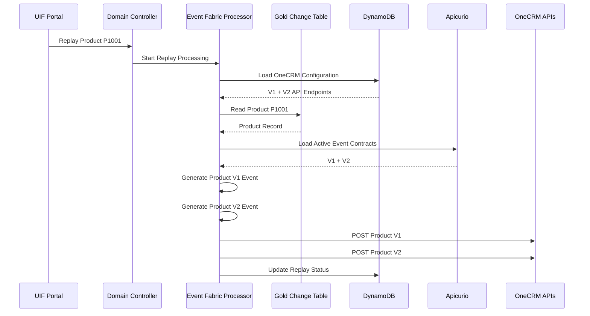
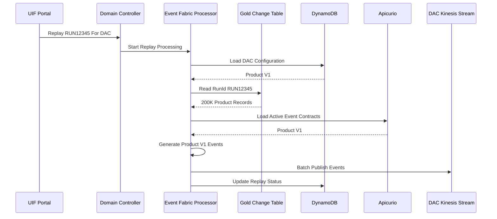

# Replay Framework

## Overview

UIF Event Fabric provides a flexible replay mechanism that allows operations teams and consumers to regenerate and republish events from historical Gold Change Table records.

Replay uses:

- Existing Domain Controller Lambda
- Existing Event Fabric Processor
- Existing Gold Change Table
- Existing Consumer Configuration

No separate replay engine is required.

---

# Replay Principles

## Gold Change Table as Source of Truth

The Gold Change Table retains delta records for 90 days.

Each record is associated with:

```text
RunId
Domain
Business Identifier
```

Example:

```text
RunId = RUN12345
Domain = Product
PPID = P1001
```

The replay framework regenerates events directly from Gold records.

---

## Consumer Aware Replay

Replay respects the consumer configuration stored in DynamoDB.

Example:

```text
OneCRM -> V1 + V2 -> API

DAC -> V1 -> Kinesis
```

Each consumer receives only the versions and delivery channels configured for them.

---

## Version Aware Replay

Replay can:

- Use currently active versions
- Use a specifically requested version

---

# Supported Replay Types

| Replay Type | Description |
|------------|-------------|
| Full Run | Replay an entire RunId |
| Consumer Replay | Replay a RunId for a single consumer |
| Version Replay | Replay a specific version |
| Item Replay | Replay a single item |
| Batch Item Replay | Replay multiple selected items |

---

# Example 1 - OneCRM Item Replay

## Consumer Configuration

```json
{
  "consumerId": "OneCRM",
  "domain": "product",
  "deliveryChannels": [
    {
      "version": "v1",
      "transport": "API",
      "target": "/product/v1"
    },
    {
      "version": "v2",
      "transport": "API",
      "target": "/product/v2"
    }
  ]
}
```

OneCRM currently receives:

```text
Product V1
Product V2
```

events through APIs.

---

## Business Scenario

Product:

```text
PPID = P1001
```

failed to process in OneCRM.

Operations user wants to replay only that specific product.

---

## UIF Portal Request

```json
{
  "replayType": "ITEM",
  "domain": "product",
  "itemId": "P1001",
  "consumerId": "OneCRM"
}
```

---

## Replay Flow



---

## Events Generated

### Product V1

```json
{
  "domain": "product",
  "schemaVersion": "v1",
  "replay": true,
  "payload": {
    "ppid": "P1001",
    "description": "AWS Architecture",
    "brand": "Pearson",
    "copyrightYear": 2026
  }
}
```

### Product V2

```json
{
  "domain": "product",
  "schemaVersion": "v2",
  "replay": true,
  "payload": {
    "ppid": "P1001",
    "description": "AWS Architecture",
    "brand": "Pearson"
  }
}
```

Result:

```text
Only Product P1001 is replayed.
Only OneCRM receives it.
V1 and V2 are republished.
```

---

# Example 2 - DAC Full Batch Replay

## Consumer Configuration

```json
{
  "consumerId": "DAC",
  "domain": "product",
  "deliveryChannels": [
    {
      "version": "v1",
      "transport": "KINESIS",
      "target": "dac-product-stream"
    }
  ]
}
```

DAC currently receives:

```text
Product V1
```

through Kinesis.

---

## Business Scenario

Original run:

```text
RUN12345
```

generated:

```text
200,000 Product Delta Records
```

DAC experienced downstream issues and requests:

```text
Replay entire RUN12345
```

---

## UIF Portal Request

```json
{
  "replayType": "FULL_RUN",
  "runId": "RUN12345",
  "domain": "product",
  "consumerId": "DAC"
}
```

---

## Replay Flow



Result:

```text
200,000 Product Records regenerated

Product V1 events published

Delivered only to DAC

No impact to OneCRM or other consumers
```

---

# Replay Using Specific Version

Operations users may request replay using a specific version.

Example:

```json
{
  "replayType": "VERSION",
  "runId": "RUN12345",
  "consumerId": "OneCRM",
  "version": "v2"
}
```

Result:

```text
Only Product V2 events are regenerated.
```

---

# Batch Item Replay

Example:

```json
{
  "replayType": "ITEM_BATCH",
  "domain": "product",
  "consumerId": "OneCRM",
  "items": [
    "P1001",
    "P1002",
    "P1003"
  ]
}
```

Result:

```text
Only selected products are replayed.
Only configured versions are generated.
Only requested consumer receives the events.
```

---

# Operational Benefits

✅ Full Run Replay

✅ Consumer Replay

✅ Version Replay

✅ Item Replay

✅ Batch Item Replay

✅ Consumer-Aware Delivery

✅ Version-Aware Generation

✅ Uses Existing Event Fabric Processor

✅ Uses Existing Domain Controller Lambda

✅ Uses Existing Gold Change Table

✅ No Separate Replay Platform Required
