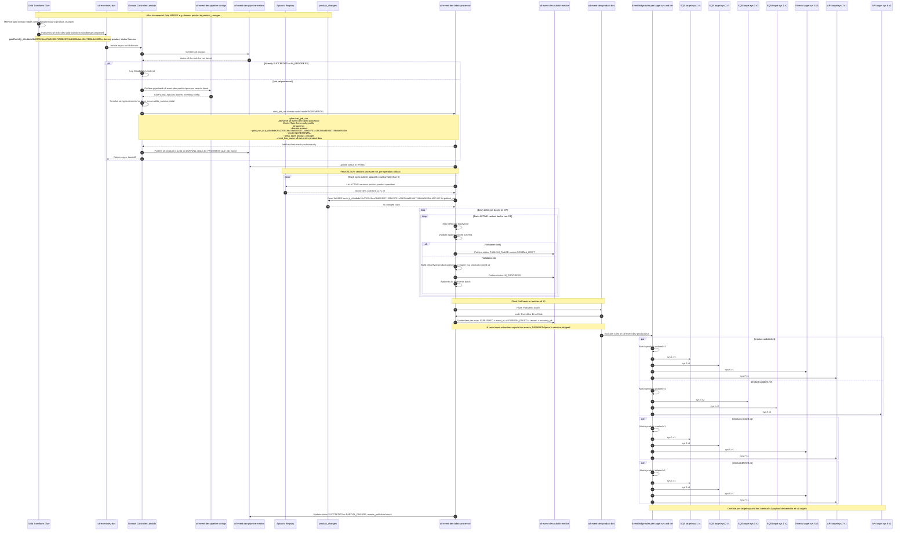

# Event-centric incremental publish — canonical reference

**Status:** design reference (current)
**Supersedes:** [`sequence-and-operations.md`](sequence-and-operations.md) for naming, source conventions, and JSON examples

> **Capacity ADR:** [`decisions/0015-eventbridge-event-centric-architecture-and-capacity.md`](decisions/0015-eventbridge-event-centric-architecture-and-capacity.md)
> **Narrative walkthrough:** [`README.md`](README.md)

---

## Architecture at a glance

```text
Gold MERGE → product_changes (+ OP column)
  → PutEvents GoldMergeCompleted (uif-event-dev-bus, Source = the publishing gold Glue job)
       detail: goldRunId, goldId (the entity), domain, status
  → EventBridge rule → Domain Controller Lambda
       GetItem uif-event-dev-pipeline-configs
       Idempotency check → uif-event-dev-pipeline-metrics
       glue.start_job_run.  **Future scope** : (1–3 runs when split_by_operation)
  → Event Fabric Processor Glue (uif-event-dev-fabric-processor)
       Apicurio ACTIVE schemas once per run (per operation artifact)
       read delta → map → validate → PutEvents on uif-event-dev-{domain}-bus
  → EventBridge rules (1 per subscription = customer × detail-type, 1 target per rule)
  → SQS / Kinesis / API destination
  → retry 3× → DLQ → uif-event-dev-delivery-metrics → UI redrive (direct to subscription target)

Processor/bus failures (schema drift, PutEvents entry errors) are logged to
uif-event-dev-publish-metrics and replayed via the Recovery Glue job
(uif-event-dev-fabric-recovery) — see replay-publish-failures.md.
```
## Naming standards

Follow these patterns when creating any new table, AWS resource, or eventing artifact in this system. Consistency here is load-bearing — EventBridge `source`/`detail-type` matching is exact-string, so any drift silently breaks routing (see [Source namespace](#source-namespace) below).

| Category | Pattern | Example |
|---|---|---|
| **EventBridge bus — control/default** | `uif-event-{env}-bus` | `uif-event-dev-bus` |
| **EventBridge bus — domain** | `uif-event-{env}-{domain}-bus` | `uif-event-dev-product-bus` |
| **Glue job — processor** | `uif-event-{env}-fabric-processor` | `uif-event-dev-fabric-processor` |
| **Glue job — recovery** | `uif-event-{env}-fabric-recovery` | `uif-event-dev-fabric-recovery` |
| **DynamoDB — glue run metrics** | `uif-event-{env}-pipeline-metrics` | `uif-event-dev-pipeline-metrics` |
| **DynamoDB — domain config** | `uif-event-{env}-pipeline-configs` | `uif-event-dev-pipeline-configs` |
| **DynamoDB — publish metrics** | `uif-event-{env}-publish-metrics` | `uif-event-dev-publish-metrics` |
| **DynamoDB — failed deliveries** | `uif-event-{env}-delivery-metrics` | `uif-event-dev-delivery-metrics` |
| **Apicurio artifact** | `{domain}.{domain}.{operation}` | `product.product.created` |
| **EventBridge DetailType** | `{domain}.{operation}.v{n}` | `product.created.v2` |
| **Gold-trigger source** (control plane) | the publishing job name, `uif-{stack}-{env}-[layer]-{operation}` | `uif-echo-dev-gold-transform` |
| **Control-plane DetailType** (job/run lifecycle events, not domain data) | PascalCase, `{Subject}{PastTenseVerb}` | `GoldMergeCompleted` |

**Rules of thumb:**
- `{env}` is always `dev` / `uat` / `prod` (or equivalent) — never abbreviated or omitted.
- Table and Glue-job names are hyphen-separated; Apicurio artifacts and DetailTypes are dot-separated; tier suffixes are always lowercase `v{n}`, never `V{n}`.
- Business/domain events use dot-notation (`product.created.v2`); control-plane/operational events use PascalCase (`GoldMergeCompleted`) — don't mix the two conventions.
- When introducing a new table, bus, or job, add it to this table before merging — this list should stay the single source of truth for naming across all docs in this repo.


### Component roles

| Component | Responsibility |
|-----------|----------------|
| **Gold Transform Glue** | MERGE, write `{DOMAIN}_DELTA` with `OP`, emit `GoldMergeCompleted` + `delta_summary` |
| **Domain Controller Lambda** | Idempotency, config lookup, skip logic, start processor Glue |
| **uif-event-dev-pipeline-configs** (DynamoDB) | Per-domain processor(**Future scope**), delta processing, pattern-based eventing, Glue profiles, batch settings |
| **Event Fabric Processor Glue** | Load Apicurio, read delta, map/validate/publish to `uif-event-dev-{domain}-bus` |
| **uif-event-dev-pipeline-metrics** (DynamoDB) | Processor run status (`STARTED` / `SUCCEEDED` / `FAILED` / `PARTIAL_FAILURE`) — written by Glue |
| **uif-event-dev-publish-metrics** (DynamoDB) | DC idempotency and handoff (`RUNNING`, runId → processor_job_runId); per-record processor/bus publish failures (schema drift, PutEvents errors) — read by Recovery Glue on replay |
| **Apicurio Registry** | Contract store; ACTIVE versions define emit tiers |
| **uif-event-dev-{domain}-bus** | Domain event stream (`uif-event-dev-product-bus`, `uif-event-dev-price-bus`, …) |
| **EventBridge rules** | Per-subscription routing — one rule per customer × detail-type, `detail-type` filter only. Provisioned by Terraform today; Subscription Lambda (ADR-0007 Table 5) is future scope |
| **uif-event-dev-delivery-metrics** (DynamoDB) | Failed target deliveries after retry exhaustion |
| **Event Replayer Lambda** | Triggers Recovery Glue (`--mode REPLAY`) for `PUBLISH_FAILED` rows in `uif-event-dev-publish-metrics` |
| **Event Handler Lambda** | Consumes subscription DLQs → inserts `FAILED` rows in `uif-event-dev-delivery-metrics`; serves the redrive API → `SendMessageBatch` directly to the subscription target |
| **uif-event-dev-subscription-configs** (DynamoDB) | One row per subscription (customer × detail-type × target): rule ARN, queue ARN, consumer principal, status. Read by Event Handler for `RULE_ARN → customer` and current target |


## Naming (product example)

| Logical | Example |
|---------|---------|
| Eventing artifacts | `product.product.created`, `product.product.updated`, `product.product.deleted` |
| Delta table | `product_changes` (`runId`, `OP` = `INSERT` \| `UPDATE` \| `DELETE`) |
| Trigger bus / source | `uif-event-dev-bus` / `uif-echo-dev-gold-transform` — the publishing job, so routing never filters on it |
| Publish bus / source | `uif-event-dev-product-bus` / `uif-event-dev-fabric-processor` |
| DetailType | `{domain}.{operation}.v{n}` — e.g. `product.created.v2`, `product.updated.v1` |
| DetailTypes per domain | **9** (3 ops × 3 tiers; typically 2 ACTIVE tiers during migration) |

### Operation resolution (pattern-based config)

| Delta `OP` | Suffix | Operation | Apicurio artifact | DetailType example |
|------------|--------|-----------|-------------------|--------------------|
| `INSERT` | `created` | `created` | `product.product.created` | `product.created.v2` |
| `UPDATE` | `updated` | `updated` | `product.product.updated` | `product.updated.v1` |
| `DELETE` | `deleted` | `deleted` | `product.product.deleted` | `product.deleted.v2` |

---

## Main publish sequence



---

## Phase 0 — Gold MERGE completes

Gold writes changed rows to `{domain}_changes` with `OP` and emits `GoldMergeCompleted` on **uif-event-dev-bus**.

> **The consumer is the authority for this contract**, not this document: `stacks/event/src/handler.py` reads `detail.goldRunId`, `detail.domain` and `detail.status` (and `detail.goldId` identifies WHICH gold entity merged - `goldId` is not the domain: marketing_copy's domain is product), and skips any run whose status is not `Success`. Change the handler and this section together. `Source` carries the publishing job name and varies by job, so the rule below deliberately does not match on it.

### PutEvents request (Gold → uif-event-dev-bus)

```json
{
  "Entries": [
    {
      "Source": "uif-echo-dev-gold-transform",
      "DetailType": "GoldMergeCompleted",
      "EventBusName": "uif-event-dev-bus",
      "Detail": "{\"goldRunId\":\"jr_d4cdbda26c230f416ea76d524507130fb28701a1862b4a449447198c6a565f5a\",\"goldId\":\"product\",\"domain\":\"product\",\"status\":\"Success\"}"
    }
  ]
}
```

### Full EventBridge envelope (Domain Controller receives)

```json
{
  "version": "0",
  "id": "6a7e8f9a-1234-5678-90ab-cdef12345678",
  "detail-type": "GoldMergeCompleted",
  "source": "uif-echo-dev-gold-transform",
  "account": "283556840805",
  "time": "2026-08-25T18:30:00Z",
  "region": "eu-west-1",
  "resources": [],
  "detail": {
    "goldRunId": "jr_d4cdbda26c230f416ea76d524507130fb28701a1862b4a449447198c6a565f5a",
    "goldId": "product",
    "domain": "product",
    "status": "Success"
  }
}
```

---

## Phase 1 — Domain Controller

### EventBridge rule (uif-event-dev-bus)

```json
{
  "detail-type": ["GoldMergeCompleted"],
  "detail": {
    "domain": ["product", "price", "customer"]
  }
}
```

### Controller steps

```text
1. Invoked async on GoldMergeCompleted (goldRunId, goldId, domain, status)
   → skip unless status == Success
2. Idempotency check
   → Query uif-event-dev-pipeline-metrics gsi_gold_run for this gold_run_id;
     skip if any row is IN_PROGRESS / STARTED / SUCCEEDED
   → if already processed: log to CloudWatch, exit (no further action)
3. Load configuration
   → GetItem uif-event-dev-pipeline-configs
   → retrieve Glue sizing profile, Apicurio artifact pattern, domain-specific config
   → derive delta_summary by counting <domain>_changes for this goldRunId
   → if delta_summary.total == 0 && skip_run_when.total_zero → SKIPPED
   → if no publishable ops (all op counts 0) && skip_run_when.no_publishable_ops → SKIPPED
4. Start Event Fabric Processor Glue job (**Future Scope** : 1–3 parallel runs based on publish_ops)
   → glue.start_job_run
        JobName: uif-event-dev-fabric-processor
        WorkerType / NumberOfWorkers / Timeout: from the matching glue.sizing_tiers entry
        Arguments:
          --domain <domain>
          --gold_run_id <gold_run_id>
          --mode INCREMENTAL
          --delta_table <domain>_changes
          --event_bus_name uif-event-dev-{domain}-bus
5. Return async handoff
   → does not wait for Glue job to complete
   → hands control back to the invoking event source
```

Domain Controller **does not** read delta rows, validate payloads, or publish to `uif-event-dev-product-bus`.

---

## Phase 1b — `uif-event-dev-pipeline-configs`

**Table:** `uif-event-{env}-pipeline-configs`
**Keys:** `pipelineid` (hash), `version` (range — use `latest`). `domain` is a plain attribute, not a key.

### Sample item — `product`

```json
{
  "pipelineid": "uif-event-dev-product-process",
  "domain": "product",
  "version": "latest",
  "enabled": true,

  "processor": {
    "glue_job_name": "uif-event-dev-fabric-processor",
    "mode": "INCREMENTAL"
  },

  "delta": {
    "table": "product_changes",
    "run_id_col": "run_id",
    "op_col": "OP"
  },

  "eventing": {
    "event_bus_name": "uif-event-dev-product-bus",
    "source": "uif-event-dev-fabric-processor",
    "detail_type_pattern": "product.{operation}",
    "operation_suffix_by_op": {
      "INSERT": "created",
      "UPDATE": "updated",
      "DELETE": "deleted"
    },
    "apicurio_artifact_pattern": "{domain}.{domain}.{operation}",
    "emit_all_active_tiers": true
  },

  "publish_ops": ["INSERT", "UPDATE", "DELETE"],

  "skip_run_when": {
    "total_zero": true,
    "no_publishable_ops": true
  },

  "glue": {
    "max_retries": 0,
    "sizing_tiers": [{
            "name": "small",
            "max_rows": 100000,
            "worker_type": "G.1X",
            "num_workers": 2,
            "timeout_minutes": 120
        }, {
            "name": "medium",
            "max_rows": 500000,
            "worker_type": "G.2X",
            "num_workers": 4,
            "timeout_minutes": 240
        }, {
            "name": "large",
            "max_rows": null,
            "worker_type": "G.4X",
            "num_workers": 6,
            "timeout_minutes": 600
        }
    ]
},

  "batch": {
    "putevents_batch_size": 10,
    "delta_chunk_size": 5000,
    "apicurio_fetch_once_per_run": true
  }
}
```

### Sizing tier selection

First tier in `glue.sizing_tiers` where `delta_summary.total ≤ max_rows` wins; `max_rows: null` is the catch-all.

| `delta_summary.total` | Tier | Sizing |
|---|---|---|
| ≤ 100,000 | `small` | G.1X × 2, timeout 120 |
| ≤ 500,000 | `medium` | G.2X × 4, timeout 240 |
| > 500,000 | `large` | G.4X × 6, timeout 600 |


### `split_by_operation` (≥ ~500k delta rows) - Future Scope

Domain Controller may start **1–3 parallel runs** of the same processor job, passing `--publish_ops=INSERT|UPDATE|DELETE` and skipping ops with `delta_summary` count **0**. Same bus volume; shorter Glue wall-clock.

---

## Phase 1c — Start Event Fabric Processor Glue

Sizing comes from `glue.sizing_tiers` — first tier where `delta_summary.total ≤ max_rows` wins;
`max_rows: null` is the catch-all.

For `delta_summary.total = 200000` (≤ 500,000 → **medium** tier):

```python
glue.start_job_run(
    JobName="uif-event-dev-fabric-processor",
    Arguments={
        "--domain": "product",
        "--gold_run_id": "jr_d4cdbda26c230f416ea76d524507130fb28701a1862b4a449447198c6a565f5a",
        "--mode": "INCREMENTAL",
        "--delta_table": "product_changes",
        "--event_bus_name": "uif-event-dev-product-bus",
    },
    WorkerType="G.2X",
    NumberOfWorkers=4,
    Timeout=240,
)
```

For `delta_summary.total = 600000` (> 500,000 → **large** tier):

```python
glue.start_job_run(
    JobName="uif-event-dev-fabric-processor",
    Arguments={
        "--domain": "product",
        "--gold_run_id": "jr_d4cdbda26c230f416ea76d524507130fb28701a1862b4a449447198c6a565f5a",
        "--mode": "INCREMENTAL",
        "--delta_table": "product_changes",
        "--event_bus_name": "uif-event-dev-product-bus",
    },
    WorkerType="G.4X",
    NumberOfWorkers=6,
    Timeout=600,
)
```

| Argument | Source |
|----------|--------|
| `--domain` | Event `domain` |
| `--gold_run_id` | Event `gold_run_id` |
| `--mode` | `processor.mode` (config) |
| `--delta_table` | Config `delta.table` |
| `--event_bus_name` | Config `eventing.event_bus_name` |
| `WorkerType` / `NumberOfWorkers` / `Timeout` | Matching entry in config `glue.sizing_tiers` |
---

## Phase 2 — Load Apicurio schemas (once per run)

```text
ops_to_process = config["publish_ops"]        # from uif-event-dev-pipeline-configs, e.g. ["INSERT","UPDATE","DELETE"]

For each op in ops_to_process:
  if delta_summary count for op == 0:
      skip op

  operation = operation_suffix_by_op[op]                      # created / updated / deleted
  artifact  = apicurio_artifact_pattern.format(domain, domain, operation)
              → product.product.created

  tiers = Apicurio.list_active_versions(artifact)
  for tier in tiers:
      schema_cache[op][tier] = Apicurio.fetch_schema(artifact, tier)
```
Example: 3 operations × 2 ACTIVE tiers ≈ **6 schema fetches** — not per delta row.

**Future Scope:**

```text
# Reserved for future use — e.g. split_by_operation, targeted recovery runs.
# When present, overrides config["publish_ops"] entirely.

if "publish_ops" param provided in job arguments:
    ops_to_process = parse(param["publish_ops"])              # e.g. ["UPDATE"]
else:
    fall back to Set 1 behavior

For each op in ops_to_process:
  if delta_summary count for op == 0:
      skip op

  operation = operation_suffix_by_op[op]
  artifact  = apicurio_artifact_pattern.format(domain, domain, operation)
              → product.product.updated

  tiers = Apicurio.list_active_versions(artifact)
  for tier in tiers:
      schema_cache[op][tier] = Apicurio.fetch_schema(artifact, tier)
```
Example: 1 operations × 2 ACTIVE tiers ≈ **2 schema fetches** — not per delta row.


---

## Phase 3 & 4 — Read delta, map, validate, publish

```text
ops_to_process = config["publish_ops"]        # e.g. ["INSERT","UPDATE","DELETE"]

Query product_changes WHERE run_id = :gold_run_id
Filter OP in ops_to_process
Chunk by batch.delta_chunk_size (5000)

For each row:
  For each ACTIVE tier for row.OP (from schema_cache[OP]):
    map row → payload
    validate vs schema_cache[OP][tier]
    DetailType = detail_type_pattern.format(operation) + ".v" + tier
                 → product.{operation}.v{tier}   e.g. product.created.v2
    Source     = eventing.source   (from config)

    if validation fails:
        PutItem uif-event-dev-publish-metrics: status = PUBLISH_FAILED, reason = SCHEMA_DRIFT, recovery_pk, payload
        continue
    PutItem uif-event-dev-publish-metrics: status = IN_PROGRESS, payload      (no recovery_pk)
    add entry to PutEvents batch

Flush PutEvents in batches of putevents_batch_size (10)
  For each entry in the response:
    EventId returned   → UpdateItem status = PUBLISHED, event_id, published_at
    ErrorCode returned → UpdateItem status = PUBLISH_FAILED, reason = ErrorCode, recovery_pk
```
**Future Scope:**

```text
if "publish_ops" param provided in job arguments:
    ops_to_process = parse(param["publish_ops"])       # e.g. ["UPDATE"] — single op when split_by_operation
else:
    ops_to_process = config["publish_ops"]              # fallback, e.g. ["INSERT","UPDATE","DELETE"]

Query product_changes WHERE run_id = :gold_run_id
Filter OP in ops_to_process
Chunk by batch.delta_chunk_size (5000)

For each row:
  For each live major for row.OP (from schema_cache[OP]):
    map row → payload
    validate vs schema_cache[OP][major]
    DetailType = detail_type_pattern.format(operation, major)
                 → product.{operation}.v{major}   e.g. product.created.v2
    Source     = eventing.source   (from config)

    if validation fails:
        PutItem uif-event-dev-publish-metrics: status = PUBLISH_FAILED, reason = SCHEMA_DRIFT, recovery_pk, payload
        continue
    PutItem uif-event-dev-publish-metrics: status = IN_PROGRESS, payload      (no recovery_pk)
    add entry to PutEvents batch

Flush PutEvents in batches of putevents_batch_size (10)
  For each entry in the response:
    EventId returned   → UpdateItem status = PUBLISHED, event_id, published_at
    ErrorCode returned → UpdateItem status = PUBLISH_FAILED, reason = ErrorCode, recovery_pk
```

### Sample PutEvents entry (processor → `uif-event-dev-product-bus`)

```json
{
  "Source": "uif-event-dev-fabric-processor",
  "EventBusName": "uif-event-dev-product-bus",
  "DetailType": "product.created.v2",
  "Detail": "{\"ppid\":\"A101703297180\",\"organizationCode\":\"03B\",\"description\":\"Pearson Baccalaureate: Standard Level Mathematics 2nd Edition\",\"longDescription\":\"A comprehensive standard level mathematics textbook designed for the IB Diploma Programme, covering all core topics with clear explanations and worked examples.\",\"inventoryItemStatus\":\"ACTIVE\",\"itemType\":\"Standard\",\"lineOfBusiness\":\"School\",\"disciplineLevel1\":\"Mathematics\",\"disciplineLevel2\":\"Pure Mathematics\",\"disciplineLevel3\":\"Calculus\",\"disciplineLevel4\":\"Differential Calculus\",\"language\":\"English\",\"languageLevel2\":\"British English\",\"learnerStage\":\"Secondary\",\"learnerStageLevel2\":\"Upper Secondary\",\"ndaFlag\":\"N\",\"digitalEffectiveStartDate\":\"2026-01-01\",\"digitalVersionNumber\":\"2.0\",\"unitWeight\":850,\"weightUomCode\":\"G\",\"qualificationLevel\":\"IB Diploma\",\"isbn13\":\"9781292431222\",\"isbn10\":\"1292431229\",\"parentProduct\":\"A103000409431\",\"owningSubsidiaryCountry\":\"GB\",\"owningSubsidiary\":\"Pearson Education Limited\",\"ipOwnerCategory\":\"Pearson\",\"copyrightYear\":2024,\"editionNumber\":2,\"productClassificationLevel1\":\"Textbook\",\"productClassificationLevel2\":\"Student Book\",\"deliveryMethod\":\"Print\",\"brand\":\"Pearson Baccalaureate\",\"subBrand\":\"Pearson Baccalaureate Standard Level\",\"digitalPlatform\":\"Pearson+\",\"finalPageCount\":384,\"durationType\":\"Subscription\",\"durationValue\":\"12\",\"durationUnit\":\"Months\",\"coverImageLarge\":\"https://images.pearson.com/products/9781292431222/cover-large.jpg\",\"coverImageRegular\":\"https://images.pearson.com/products/9781292431222/cover-regular.jpg\",\"fulfillmentOrgDetails\":{\"returnClass\":\"Returnable\",\"sellingRestrictionCode\":\"OPEN\",\"discountCode\":\"TRADE\",\"titleStatusCode\":\"Active\",\"regionalPublicationDate\":\"2024-03-15\",\"imprint\":\"Pearson Education\",\"productTaxClassification\":\"STANDARD\",\"relevanceValue\":\"60\"},\"contributors\":[{\"contributorId\":\"C-00123\",\"type\":\"Author\",\"rank\":\"1\",\"preTitle\":null,\"givenName\":\"Ibrahim\",\"additionalName\":null,\"familyName\":\"Wazir\",\"postTitle\":null,\"affiliationType1\":\"University\",\"affiliation1\":\"University of Manchester\"},{\"contributorId\":\"C-00124\",\"type\":\"Author\",\"rank\":\"2\",\"preTitle\":null,\"givenName\":\"Tim\",\"additionalName\":null,\"familyName\":\"Garry\",\"postTitle\":null,\"affiliationType1\":null,\"affiliation1\":null}],\"webConsumingSystem\":[\"Pearson+\",\"VitalSource\"],\"programPpid\":[\"P2100245\"],\"standardComponents\":[{\"ppid\":\"A101701639969\",\"sequenceNumber\":10,\"componentQuantity\":1,\"effectiveDate\":\"2024-01-01\",\"finalPageCount\":416,\"discountType\":\"TRADE\",\"discountValue\":0,\"disabledDate\":null}],\"customComponents\":[{\"ppid\":\"A101702995290\",\"originalWorkPercent\":60,\"customWorkPercent\":40,\"effectiveDate\":\"2024-01-01\",\"finalPageCount\":128,\"overridePercentage\":null,\"disabledDate\":null}]}\"}
}
```


### Volume (250k delta, 2 ACTIVE tiers)

```text
bus_events      = 250k × 2 = 500k
putevents_calls = 500k / 10 = 50k
```

Adding subscribers does **not** increase PutEvents — only matching-rule **invocations**. See ADR-0005.

---

## Phase 5 — Subscriber fan-out

### Platform policy (required)

| Rule | Value |
|------|-------|
| Rules per subscription |  **1** (one per customer x detail-type)   |
| Targets per rule | **1** (SQS **or** Kinesis **or** API) |
| `detail-type` filter | One value per rule |
| `source` filter | **`uif-event-dev-fabric-processor`**(processor), **`uif-event-dev-fabric-recovery`**(recovery) on domain bus |
| Rule Owner | Subscription Lambda (ADR-0007 Table 5) |
| Max customers per domain bus | it's customers × detail-types against the quota **~300** (AWS rules/bus quota) |

### Example — Customer ABC (SQS)

Subscribes to **`product.created.v2`** and **`product.updated.v1`** only:

rule: uif-event-dev-on-product-product-updated-v1-customer-abc
```json
{
    "detail-type": ["product.updated.v1"]
}
```
rule: uif-event-dev-on-product-product-created-v2-customer-abc
```json
{
    "detail-type": ["product.created.v2"]
}
```

| Published DetailType | Delivered to ABC? |
|----------------------|-------------------|
| `product.created.v1` | No |
| `product.created.v2` | **Yes** |
| `product.updated.v1` | **Yes** |
| `product.updated.v2` | No |
| `product.deleted.*` | No |

**Version migration:** new subscription (new rule + queue) for the new major, then delete the old — see ADR-0007 Case 2

### Terraform sketch - One Subscription (customer × detail-type)

> Today these resources are provisioned per subscription via Terraform, exactly in
> the shape shown. Automated provisioning by the **Subscription Lambda** (ADR-0007 Table 5,
> Cases 1–3 — `PENDING → ACTIVE`, teardown on unsubscribe) is **future scope**.

```hcl
# One subscription = customer × detail-type.
# Everything below is per subscription: rule, queue, DLQ, queue policy, target.

locals {
  env             = "dev"
  domain          = "product"
  customer_id     = "pmc"
  detail_type     = "product.created.v1"
  detail_type_dsh = replace(local.detail_type, ".", "-")          # product-created-v1

  subscription_id = "8f3c1e2a-4b7d-4c19-9a55-2e6f0d1b7c34"
  policy_sid      = "uif${replace(local.subscription_id, "-", "")}"

  bus_name   = "uif-event-${local.env}-${local.domain}"
  rule_name  = "uif-event-${local.env}-on-${local.domain}-${local.detail_type_dsh}-${local.customer_id}"
  queue_name = "uif-event-${local.env}-${local.customer_id}-${local.domain}-${local.detail_type_dsh}"

  redrive_role_arn       = "arn:aws:iam::444455556666:role/uif-event-${local.env}-redrive-lambda"
  consumer_principal_arn = "arn:aws:iam::111122223333:role/pmc-event-consumer"   # supplied by customer

  max_retry_attempts   = 3
  max_event_age_seconds = 900
}

# ── DLQ (per subscription) ────────────────────────────────────────────────────
resource "aws_sqs_queue" "subscription_dlq" {
  name                      = "${local.queue_name}-dlq"
  sqs_managed_sse_enabled   = true
  message_retention_seconds = 1209600            # 14 days — max; DLQ Lambda drains it
}

# ── Subscription queue ────────────────────────────────────────────────────────
resource "aws_sqs_queue" "subscription" {
  name                       = local.queue_name
  sqs_managed_sse_enabled    = true
  message_retention_seconds  = 345600            # 4 days
  visibility_timeout_seconds = 60

  redrive_policy = jsonencode({
    deadLetterTargetArn = aws_sqs_queue.subscription_dlq.arn
    maxReceiveCount     = 5                      # consumer-side failures → DLQ (separate from EventBridge delivery DLQ)
  })
}

# ── Rule: exactly one detail-type, suffixed with customer_id ──────────────────
resource "aws_cloudwatch_event_rule" "subscription" {
  name           = local.rule_name               # must be ≤ 64 chars — validated by the Subscription Lambda
  event_bus_name = local.bus_name

  event_pattern = jsonencode({
    "detail-type" = [local.detail_type]
    # No `source` filter: recovery publishes with a different source than the processor,
    # and the domain bus carries only our events. detail-type alone is sufficient.
  })
}

# ── Queue policy: three statements, one Sid prefix ────────────────────────────
resource "aws_sqs_queue_policy" "subscription" {
  queue_url = aws_sqs_queue.subscription.id

  policy = jsonencode({
    Version = "2012-10-17"
    Statement = [
      {
        # EventBridge delivery — only via this rule
        Sid       = local.policy_sid
        Effect    = "Allow"
        Principal = { Service = "events.amazonaws.com" }
        Action    = "sqs:SendMessage"
        Resource  = aws_sqs_queue.subscription.arn
        Condition = { ArnEquals = { "aws:SourceArn" = aws_cloudwatch_event_rule.subscription.arn } }
      },
      {
        # Redrive Lambda — direct SendMessage, bypasses the bus
        Sid       = "${local.policy_sid}r"
        Effect    = "Allow"
        Principal = { AWS = local.redrive_role_arn }
        Action    = "sqs:SendMessage"
        Resource  = aws_sqs_queue.subscription.arn
      },
      {
        # Customer consumer — cross-account read; never SendMessage
        Sid       = "${local.policy_sid}c"
        Effect    = "Allow"
        Principal = { AWS = local.consumer_principal_arn }
        Action = [
          "sqs:ReceiveMessage",
          "sqs:DeleteMessage",
          "sqs:ChangeMessageVisibility",
          "sqs:GetQueueAttributes",
          "sqs:GetQueueUrl",
        ]
        Resource = aws_sqs_queue.subscription.arn
      },
    ]
  })
}

# ── Target: one per rule, DLQ + retry policy from target_config ───────────────
resource "aws_cloudwatch_event_target" "subscription" {
  rule           = aws_cloudwatch_event_rule.subscription.name
  event_bus_name = local.bus_name
  target_id      = local.subscription_id         # == PutTargets Id; used by RemoveTargets on unsubscribe
  arn            = aws_sqs_queue.subscription.arn

  # No input_path: deliver the full EventBridge envelope so redrive can send an
  # identical shape (id, detail-type, time, detail). If you set input_path = "$.detail"
  # here, redrive must send the bare Detail too — choose one and apply to both.

  retry_policy {
    maximum_retry_attempts       = local.max_retry_attempts
    maximum_event_age_in_seconds = local.max_event_age_seconds
  }

  dead_letter_config {
    arn = aws_sqs_queue.subscription_dlq.arn
  }
}
```

---

## Operational notes

- **Apicurio** holds versions and lifecycle; no separate contract-metadata DynamoDB.
- **ACTIVE schemas** fetched **once per processor run** per operation artifact — not per delta row.
- **SCHEMA_DRIFT** fails that record closed (logged to `uif-event-dev-publish-metrics`); does not necessarily fail the whole run — see `replay-publish-failures.md` for partial-failure handling.
- **Fan-out** is EventBridge rules only; Rules are never edited in place — subscribe creates a rule + queue per detail-type, unsubscribe removes them; version migration is a new subscription followed by deleting the old one (ADR-0007 Case 2).
- **`idempotency_key`** on every event — consumers must dedupe on replay. **Future Scope**
- **No ordering** on EventBridge — design for at-least-once delivery.
- **Internal EventBridge usage** (schedulers, Glue triggers) shares account invocation quota with fan-out.

---

## Failure handling — two paths, two tables, two Lambdas

| | Recovery (publish failure) | Redrive (delivery failure) |
|---|---|---|
| What failed | `PutEvents` rejected the entry — never reached the bus | Bus accepted it; EventBridge couldn't deliver to the customer's target |
| Table | `uif-event-dev-publish-metrics` (ADR-0007 Table 3) | `uif-event-dev-delivery-metrics` (ADR-0007 Table 4) |
| Lambda | **Event Replayer** — triggers Recovery Glue | **Event Handler** — writes DLQ failures, serves redrive |
| Re-send path | Recovery Glue → `PutEvents` to the bus → all subscription rules | Event Handler → `SendMessageBatch` directly to the one subscription target |
| Consumer impact | first delivery — no duplicates | first delivery — no duplicates |
| Initiated by | steward | customer (or steward) via UI |

---

## Publish failures — recovery (Event Replayer → Recovery Glue)

Schema, `gsi_recovery`, write rules and the replay flow are defined in
[ADR-0007 — Table 3](decisions/0007-five-dynamodb-tables-for-eventing.md#table-3--uif-event-env-publish-metrics)
and its [Recovery flow](decisions/0007-five-dynamodb-tables-for-eventing.md#recovery-flow--replaying-a-publish_failed-row).

| | |
|---|---|
| Grain | one row per publish attempt — domain × Gold run × record × operation × version |
| Key | `pk = {domain}#{gold_run_id}#{primary_key}#{operation}#{version}` (no sort key) |
| Failure marker | `status = PUBLISH_FAILED` + sparse `recovery_pk = {domain}#{gold_run_id}` → row appears in `gsi_recovery` |
| Written by | Processor (one `BatchWriteItem` per `PutEvents` batch) · Recovery Glue (flips to `PUBLISHED`, `REMOVE recovery_pk`, `ADD attempt_count`) |
| Payload | stored as sent; recovery re-publishes **this** row's `payload` — never re-reads Gold |
| Trigger | **Event Replayer Lambda** → `start_job_run(uif-event-dev-fabric-recovery, --mode REPLAY, --gold_run_id …)` → run row in `pipeline-metrics` (`mode = REPLAY`) |
| Scope | re-sends only rows that never reached the bus |

---

## Delivery failures — redrive (Event Handler)

When EventBridge delivery to a customer target fails, the **processor is not notified**. Each subscription's target owns retry + DLQ handling.

### Flow — recording the failure

1. Processor publishes to `uif-event-dev-{domain}-bus`; subscription rules fan out.
2. Target retries per the subscription's `retry_policy` (default 3 attempts / 900 s).
3. After exhaustion → the **subscription's DLQ** (`…-dlq`).
4. **Event Handler Lambda** (SQS trigger on every subscription DLQ) resolves `RULE_ARN` → subscription,
   copies the `payload` from the DLQ message, and inserts a `FAILED` row in
   `uif-event-dev-delivery-metrics` (no `ttl`).

### Flow — UI redrive

1. Customer (or steward) lists `FAILED` rows.
2. UI calls `POST /redrive/failed-deliveries` → **Event Handler Lambda**.
3. Lambda resolves the **current** target from `uif-event-dev-subscription-configs`
   (`pk = customer_id, sk = {domain}#{detail_type}`); requires `status ∈ {ACTIVE, SUSPENDED}`.
4. Decompresses the row's stored `payload`, wraps it in an EventBridge-shaped envelope,
   `SendMessageBatch` **directly** to that target — never `PutEvents` to the bus (a bus republish
   would fan out to every other subscriber and duplicate).
5. Row → `status = REPLAYED`, `ttl` set (`replayed_at` + 90 d); run row in `pipeline-metrics`
   (`mode = REDRIVE`, `worker_type = LAMBDA`, `started_by = customer_id`).

<<TBD — link to Replay-subscriber-failure.mmd>>

### Redrive API (Event Handler)

```
GET  /failed-deliveries?domain=product&customer_id=customer-abc&status=FAILED
     → rows from uif-event-dev-delivery-metrics, pk = product#customer-abc, filter status = FAILED
       (UI attributes only; error_msg sanitised)

POST /redrive/failed-deliveries
     {
       "domain": "product",
       "customer_id": "customer-abc",
       "redriven_by": "ops@customer-abc.com",
       "items": [
         "2026-09-06T06:03:12Z#5e8b2d7a-c391-4f16-a204-9d3e6f1b7c48",
         "2026-09-06T06:03:15Z#9f13c6e2-4a7d-4b58-8c0e-1e5a2d7f9b63"
       ]
     }
     → 202 { "redrive_run_id": "rd_0d9e7c2a-4b1f-4e6a-9c3d-8f2a1b7e5c04", "accepted": 2 }

POST /redrive/failed-deliveries        # redrive everything outstanding for one subscription
     { "domain": "product", "customer_id": "customer-abc",
       "detail_type": "product.updated.v1", "redriven_by": "ops@customer-abc.com" }
```

### DynamoDB: `uif-event-dev-delivery-metrics`

Schema, indexes, write rules and worked examples are defined in
[ADR-0007 — Table 4](decisions/0007-five-dynamodb-tables-for-eventing.md#table-4--uif-event-env-delivery-metrics).

| | |
|---|---|
| Grain | one row per failed delivery — customer × record × operation × version × Gold run |
| Key | `pk = {domain}#{customer_id}`, `sk = {failed_at}#{event_id}` |
| Written by | **Event Handler Lambda** only — insert on DLQ (`FAILED`, no `ttl`), update on redrive (`REPLAYED`, sets `ttl`) |
| Payload | copied in at DLQ time — redrive re-sends **this** row's `payload`, never re-reads Gold |
| Target | resolved at redrive time from `uif-event-dev-subscription-configs`; the row's `target_arn` is audit only |
| UI-visible | `primary_key`, `operation`, `detail_type`, `event_id`, `status`, `reason`, `error_msg` (sanitised), `failed_at`, `redrive_count`, `redriven_by`, `replayed_at` |
---

---

## Quick reference card

| Item | Value |
|------|-------|
| Trigger bus | `uif-event-dev-bus` |
| Trigger source | `uif-echo-dev-gold-transform` (the publishing job — not matched by the rule) |
| Trigger DetailType | `GoldMergeCompleted` |
| Publish bus | `uif-event-dev-product-bus` |
| Publish source | `uif-event-dev-fabric-processor` (processor) · `uif-event-dev-fabric-recovery` (recovery) |
| Publish DetailType | `{domain}.{operation}.v{major}` |
| Apicurio artifacts | `product.product.{created\|updated\|deleted}` (+ `.vN` siblings for majors ≥ 2) |
| Delta table | `product_changes` |
| Config table | `uif-event-dev-pipeline-configs` |
| Run metrics table | `uif-event-dev-pipeline-metrics` |
| Publish metrics table | `uif-event-dev-publish-metrics` |
| Failed deliveries table | `uif-event-dev-delivery-metrics` |
| Subscription table | `uif-event-dev-subscription-configs` |
| Processor job | `uif-event-dev-fabric-processor` |
| Recovery job | `uif-event-dev-fabric-recovery` |
| Event Replayer Lambda | triggers recovery for `PUBLISH_FAILED` rows |
| Event Handler Lambda | DLQ consumer + redrive API |
| PutEvents batch | 10 |
| Delta chunk | 5000 |
| Sizing tiers | ≤100k G.1X×2 · ≤500k G.2X×4 · >500k G.4X×6 |

---

## End-to-end chain

```text
uif-echo-dev-gold-transform + GoldMergeCompleted  →  uif-event-dev-bus  →  Domain Controller Lambda
  →  uif-event-dev-pipeline-configs  →  uif-event-dev-fabric-processor Glue
  →  product.created.v2  →  uif-event-dev-product-bus
  →  subscription rule (detail-type filter)  →  managed SQS queue (customer consumes cross-account)
```

## Related docs

| Document | Description |
|----------|-------------|
| [`sequence-and-operations.md`](sequence-and-operations.md) | Prior draft (superseded by this file) |
| [`replay-publish-failures.md`](replay-publish-failures.md) | Processor/bus failure replay via `uif-event-dev-publish-metrics` + Recovery Glue |
| [`README.md`](README.md) | Phase narrative and walkthrough |
| [`decisions/0015-eventbridge-event-centric-architecture-and-capacity.md`](decisions/0015-eventbridge-event-centric-architecture-and-capacity.md) | Capacity, limits, subscriber overlap |
| [`../diagrams/README.md`](../diagrams/README.md) | Mermaid diagram index |
