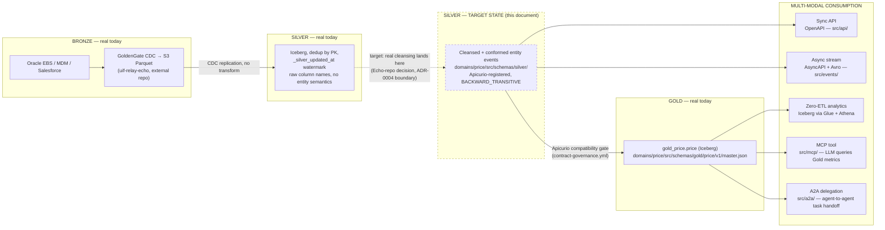

# Medallion + Agentic Consumption — Target-State Reference Architecture

**Status: target state, not current state.** This document designs where the Bronze → Silver → Gold pipeline and its consumers should end up — it does not describe what runs today. The gap is real and specific, not rhetorical: [`../decisions/0001-gold-layer.md`](../decisions/0001-gold-layer.md) states plainly that today's Silver is *"a faithful, deduplicated mirror of source tables... not safe to expose to business consumers"* — deduplicated and watermarked, but not cleansed, not conformed, no entity semantics. Bronze→Silver is owned by `uif-relay-echo`, an external repo outside this monorepo (ADR-0004) — implementing the cleansing this document designs is a decision for whoever owns that repo, not something this document can build unilaterally. What this document *can* do, and does: design the contract shapes, directory placement, and governance guardrails so that when real cleansing lands at Silver, every consumer (sync API, async stream, Zero-ETL lakehouse replication, MCP tool, A2A delegation) has a contract-first, versioned, compatibility-checked path to it from day one — not retrofitted after the fact.

**Placement decision, made deliberately.** This design does **not** introduce a new `domains/<domain>/contracts/{silver,gold,agents}/` taxonomy. [ADR-0011](../decisions/0011-apicurio-schema-governance.md) already investigated introducing a parallel contracts taxonomy, found a 40+ file blast radius against live pipelines, and closed that question — reopening it here would silently contradict a decision made the same week. Every artifact below lives inside the **existing, settled** domain shape (`src/api/`, `src/events/`, `src/schemas/`, `src/mcp/`, `src/agents/`, `src/a2a/`); the one new element is a `src/schemas/silver/` sibling to the existing, real `src/schemas/gold/` — additive, not a parallel structure.

**Lakehouse target: Iceberg via Glue + Athena, not Redshift.** Every real Zero-ETL path in this repo lands in Iceberg (`glue_catalog.eds_dev_gold_product.product` is a real, working reference this session verified) — no `aws_redshift_*` resource exists anywhere in this repo's Terraform. This design does not introduce Redshift.

Worked example domain throughout: **`price`** — chosen because it already has real, Apicurio-registered contracts from today's session (`domains/price/src/schemas/events/price-created-data.json`, `domains/price/src/schemas/gold/price/v1/master.json`) to build on top of, so every field below is real, not invented.

---

## 1. End-to-end architecture



**What crosses each boundary, and what enforces it:**
- **Bronze → Silver (today):** CDC replication only, no transform — Echo's own boundary (ADR-0004), out of this repo's control.
- **Silver (today) → Silver (target):** the gap this document names but cannot close alone — a decision for Echo's owning team.
- **Silver (target) → Gold:** an Apicurio compatibility gate (`.github/workflows/contract-governance.yml`'s `compatibility-check` job, already built and running this session) — a breaking Silver schema change is rejected in CI before it can reach Gold or any downstream consumer.
- **Gold → every consumption mode:** all five modes read the *same* registered Gold contract; none of them get a private, drifting copy.

---

## 2. Directory layout (additive to the existing shape)

```
domains/price/src/
├── api/openapi.yaml                          existing — sync REST over Gold
├── events/asyncapi.yaml                      existing (extend for the Silver stream, §3.1)
├── schemas/
│   ├── silver/                                 ★ NEW — the one addition this design makes
│   │   └── price-list-entry/v1/
│   │       ├── price-list-entry-cleansed.avsc    Avro schema (§3.1)
│   │       └── README.md                          states this is target-state, not live
│   ├── gold/price/v1/master.json               existing, real
│   ├── mapping/price/v1/price.mapping.json     existing, real
│   └── events/price-created-data.json          existing, real
├── mcp/mcp-manifest.yaml                      ★ NEW — Gold query tool for LLMs (§3.2)
└── agents/agent-card.json                     ★ NEW — Pricing Agent's A2A advertisement (§3.3)

domains/product/src/a2a/
└── product-routing.json                       ★ NEW — Commerce (Product) delegates to Pricing (§3.3)
```

No `contracts/` folder anywhere. `src/schemas/silver/` is the only new leaf; everything else is either already real or slots into an already-settled location.

---

## 3. Production contract templates (worked against `price`, no placeholders)

### 3.1 Silver domain event — AsyncAPI 3.0 + Avro

**Why this grain, not Gold's grain.** Price's real driving table (`XXPSO_QP_VAT_PRICE_STG`, per `domains/price/CLAUDE.md`) is at `(PPID, PRICE_LIST_NAME)` grain — finer than Gold's `ppid`-only grain, which fans every price-list row into one `priceSpecifications[]` array element. A cleansed Silver event should represent the *source* grain, deduplicated and type-correct, **before** that fan-out — that's what makes it independently reusable by a consumer who doesn't want Gold's specific array shape.

**Avro schema** (`domains/price/src/schemas/silver/price-list-entry/v1/price-list-entry-cleansed.avsc`):
```json
{
  "type": "record",
  "name": "PriceListEntryCleansed",
  "namespace": "com.pearson.price.silver",
  "doc": "Cleansed, deduplicated price-list entry at (ppid, priceListName) grain -- the Silver-layer entity event, one level finer than Gold's per-product priceSpecifications array. Target state: real cleansing (type casting, currency normalization, null handling) happens here, once, instead of being re-derived independently in every Gold mapping that reads this data.",
  "fields": [
    { "name": "ppid", "type": "string", "doc": "Pearson product identifier -- primary key component 1" },
    { "name": "priceListName", "type": "string", "doc": "Primary key component 2" },
    { "name": "listPrice", "type": ["null", { "type": "bytes", "logicalType": "decimal", "precision": 12, "scale": 2 }], "default": null, "doc": "Gross price, cast to decimal(12,2) here -- never a string past this point" },
    { "name": "netPrice", "type": ["null", { "type": "bytes", "logicalType": "decimal", "precision": 12, "scale": 2 }], "default": null },
    { "name": "vatPrice", "type": ["null", { "type": "bytes", "logicalType": "decimal", "precision": 12, "scale": 2 }], "default": null },
    { "name": "vatCountry", "type": ["null", "string"], "default": null, "doc": "ISO 3166-1 alpha-2, normalized to uppercase here -- Bronze/raw-Silver carries whatever case Oracle stored" },
    { "name": "currency", "type": ["null", "string"], "default": null, "doc": "ISO 4217 alpha-3, normalized here" },
    { "name": "startDate", "type": ["null", { "type": "int", "logicalType": "date" }], "default": null },
    { "name": "endDate", "type": ["null", { "type": "int", "logicalType": "date" }], "default": null, "doc": "null = open-ended" },
    { "name": "silverUpdatedAt", "type": { "type": "long", "logicalType": "timestamp-millis" }, "doc": "Watermark carried forward from raw Silver -- the one field that already existed pre-cleansing" },
    { "name": "sourceRecordHash", "type": "string", "doc": "Hash of the raw-Silver row this was cleansed from -- lets a consumer detect a cleansing-logic change even when the business values are unchanged" }
  ]
}
```

**AsyncAPI 3.0** (extends `domains/price/src/events/asyncapi.yaml`), registered under Apicurio group `price`, artifact `price-list-entry-cleansed`, compatibility `BACKWARD_TRANSITIVE` (§4):
```yaml
asyncapi: 3.0.0
info:
  title: Price Silver Events
  version: 1.0.0
  description: >
    Cleansed price-list-entry events, one per (ppid, priceListName) change.
    Target-state Silver layer -- see ../../../../architecture-design/reference-architectures/medallion-agentic-consumption.md.
x-registry:
  group: price
  artifact: price-list-entry-cleansed
  compatibility: BACKWARD_TRANSITIVE

defaultContentType: application/avro

channels:
  priceListEntryCleansedV1:
    address: com.pearson.price.price-list-entry.cleansed.v1
    x-partitionKey: ppid
    messages:
      priceListEntryCleansed:
        $ref: '#/components/messages/PriceListEntryCleansed'

operations:
  publishPriceListEntryCleansed:
    action: send
    channel:
      $ref: '#/channels/priceListEntryCleansedV1'
    summary: Published at-least-once whenever a cleansed price-list entry changes.
    messages:
      - $ref: '#/channels/priceListEntryCleansedV1/messages/priceListEntryCleansed'

components:
  messages:
    PriceListEntryCleansed:
      name: PriceListEntryCleansed
      contentType: application/avro
      payload:
        allOf:
          - $ref: 'https://schemas.pearson.com/uif/pearson-event-envelope/v1'
          - type: object
            properties:
              data:
                $ref: '../schemas/silver/price-list-entry/v1/price-list-entry-cleansed.avsc'
      x-dataSchema: ../schemas/silver/price-list-entry/v1/price-list-entry-cleansed.avsc
```

### 3.2 Gold semantic query — MCP tool manifest

An LLM queries **aggregated** Gold metrics — never row-level PII, never a raw table scan the model could misuse for something the tool wasn't scoped for.

`domains/price/src/mcp/mcp-manifest.yaml`:
```yaml
server:
  name: price-mcp-server
  transport: streamable-http
x-registry:
  group: price
  artifact: price-mcp-server
  compatibility: BACKWARD

tools:
  - name: get_price_list_metrics
    description: >
      Aggregate pricing metrics for a named price list across all products --
      count of products, average/min/max list price and net price. Read-only,
      aggregated: never returns a per-product row, so it cannot be used to
      exfiltrate an individual product's price.
    inputSchema:
      type: object
      required: [priceListName]
      properties:
        priceListName:
          type: string
          description: The price list to aggregate over, e.g. "US-Retail-2026".
        vatCountry:
          type: string
          description: Optional ISO 3166-1 alpha-2 filter.
    outputSchema:
      type: object
      required: [priceListName, productCount, avgListPrice, avgNetPrice]
      properties:
        priceListName: { type: string }
        productCount: { type: integer }
        avgListPrice: { type: number }
        minListPrice: { type: number }
        maxListPrice: { type: number }
        avgNetPrice: { type: number }
        currency: { type: string }
    annotations:
      readOnlyHint: true
      destructiveHint: false
      idempotentHint: true
      openWorldHint: false
```

`get_price_list_metrics`'s `outputSchema` is itself a registrable artifact (`price-price-list-metrics-output`, per `stacks/apicurio/standards/apicurio-governance.md` §2) — an agent's structured output is validated the same way an API response is, not trusted freeform.

### 3.3 A2A — Commerce Agent delegates to Pricing Agent

**Pricing Agent's AgentCard** (`domains/price/src/agents/agent-card.json`) — the public advertisement:
```json
{
  "name": "price-pricing-agent",
  "description": "Answers pricing questions by querying aggregated Gold price metrics. Never exposes a single product's price to a caller that hasn't authenticated for that scope.",
  "url": "https://price-pricing-agent.internal/a2a",
  "skills": [
    {
      "id": "get_price_list_metrics",
      "name": "Get price list metrics",
      "description": "Aggregated pricing metrics for a named price list.",
      "tags": ["price", "metrics", "read-only"]
    }
  ],
  "authentication": { "schemes": ["oauth2"] }
}
```

**Commerce Agent's delegation scope** (`domains/product/src/a2a/product-routing.json`) — Product hosts the "Commerce" identity in this repo; it declares which skill it may delegate out for, by skill name, never by hardcoding Pricing's URL:
```json
{
  "domain": "product",
  "agent": "product-commerce-agent",
  "delegatesTo": [
    {
      "skill": "get_price_list_metrics",
      "onCompletionOf": "summarize_catalog_pricing",
      "scope": ["price.metrics.read"]
    }
  ]
}
```

**JSON-RPC 2.0 task delegation — the actual wire contract**, per the A2A protocol's `message/send` method. Commerce Agent's request:
```json
{
  "jsonrpc": "2.0",
  "id": "req-7f3c2a1e",
  "method": "message/send",
  "params": {
    "message": {
      "role": "user",
      "parts": [
        {
          "kind": "data",
          "data": {
            "skill": "get_price_list_metrics",
            "input": { "priceListName": "US-Retail-2026" }
          }
        }
      ],
      "messageId": "msg-4b1d9e00",
      "taskId": "task-c92e7710"
    }
  }
}
```
Pricing Agent's response — `completed`, one of the protocol's real lifecycle states, never a UIF-invented one:
```json
{
  "jsonrpc": "2.0",
  "id": "req-7f3c2a1e",
  "result": {
    "id": "task-c92e7710",
    "status": { "state": "completed" },
    "artifacts": [
      {
        "artifactId": "artifact-1",
        "parts": [
          {
            "kind": "data",
            "data": {
              "priceListName": "US-Retail-2026",
              "productCount": 4821,
              "avgListPrice": 42.15,
              "minListPrice": 4.99,
              "maxListPrice": 349.00,
              "avgNetPrice": 38.70,
              "currency": "USD"
            }
          }
        ]
      }
    ]
  }
}
```
If Pricing Agent needs clarification (e.g. an ambiguous price-list name matching two lists), the protocol's `input-required` state applies — Commerce Agent's caller code must handle that path, not just `completed`/`failed` (`capabilities/a2a/guidelines.md` §2, "task lifecycle is the contract, not the payload shape alone").

---

## 4. Zero-ETL & compatibility guardrails

**The rule:** a Silver schema change is evaluated against `BACKWARD_TRANSITIVE` before it can reach Gold, a Zero-ETL Iceberg consumer, or an agent tool binding — enforced mechanically, not by review discipline.

**How it actually runs, using tooling already built:**
1. A PR changing `price-list-entry-cleansed.avsc` triggers `.github/workflows/contract-governance.yml`'s `compatibility-check` job, which calls `delivery-lab/reference-implementations/schema-governance/scripts/check_apicurio_compatibility.py` against the artifact's declared `x-registry.compatibility: BACKWARD_TRANSITIVE`.
2. **BACKWARD_TRANSITIVE**, specifically — not plain `BACKWARD` — because a Silver event has two classes of consumer with different replay needs: a live stream consumer only needs the *previous* version (`BACKWARD` suffices), but a Zero-ETL Iceberg table is a long-lived, queryable historical record — a query spanning months of data must resolve *every* historical version, not just the last one. `BACKWARD_TRANSITIVE` is the mode that guarantees that.
3. On merge, `register_to_apicurio.py` publishes the new version; `sync_to_glue_schema_registry.py` (the Dual-Sync Bridge, `stacks/apicurio/standards/apicurio-governance.md` §4) immediately mirrors it into **AWS Glue Schema Registry** under the equivalent compatibility mode (`BACKWARD_ALL`, per this repo's real Apicurio→Glue mapping table in that script) — so a Kinesis/MSK consumer validating via Glue's SerDe is checked against the identical rule Apicurio just enforced, never a second, independently-authored copy.
4. **What this actually blocks:** removing a required field, narrowing a type (e.g. `string` → `int` on `priceListName`), or changing a field's meaning without renaming it. **What it allows:** adding an optional field, widening a type, adding a new price-list-entry variant via a new event type (never a new required field bolted onto the existing one).
5. **The agent-tool-binding case, specifically:** `get_price_list_metrics`'s `outputSchema` is *also* a registered artifact (§3.2). The same compatibility gate applies to it — an LLM tool binding is not exempt from Schema Registry First just because its consumer is a model instead of a service. A breaking change to the output shape fails the same PR check that would fail for an API response schema.

**What this design does not (yet) enforce:** the Zero-ETL Iceberg replication step itself (Silver/Gold → Iceberg table) has no automated schema-drift check of its own in this repo today — the guardrail above stops a bad schema from being *registered*, but nothing currently re-validates that the live Iceberg table's actual columns still match the registered schema after replication runs. That's a real gap worth a follow-up Story, not something this design should claim is already closed.
