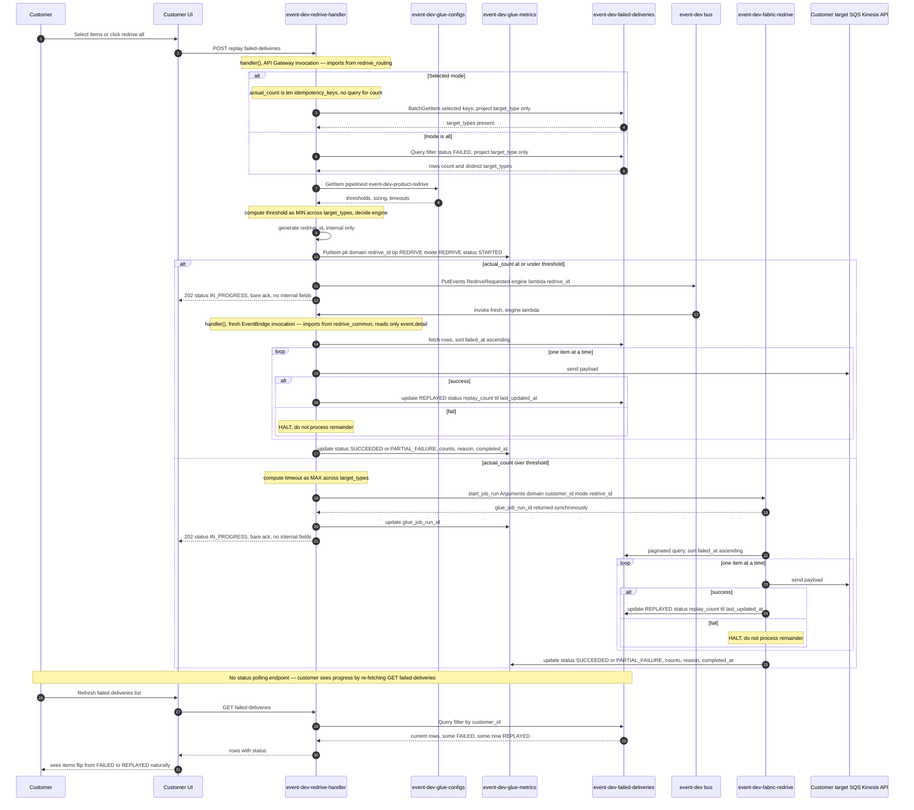

# Redrive from `event-dev-failed-deliveries`

How to **redeliver failed subscriber deliveries** when EventBridge has exhausted its retries against a customer's own target (SQS, Kinesis, or an API destination) — directly to that same target, either as **selected items** or **all of a customer's outstanding failures at once**. This flow is **self-service**: the customer triggers it from their own UI, scoped to their own failures only.

**Scope:** Subscriber/target delivery failures only (event **reached** `event-dev-{domain}`, matched the customer's rule, but the **target itself** rejected or never accepted it after 3 retries). For processor/bus publish failures (schema drift, PutEvents entry errors — the event never reached the bus at all), see [`replay-publish-failures.md`](replay-publish-failures.md) — a separate flow, steward-only, not self-service.

**Related:** [ADR-0007](decisions/0007-five-dynamodb-tables-for-eventing.md) (Table 4 schema and samples), [ADR-0017](decisions/0017-glue-job-type-for-failed-deliveries-redrive.md) (Python Shell vs PySpark decision, dual-execution rationale)

---

## Naming standards used throughout this flow

| Category | Pattern | Exact name |
|---|---|---|
| DynamoDB — failed deliveries table | `event-{env}-failed-deliveries` | `event-dev-failed-deliveries` |
| DynamoDB — domain config table | `event-{env}-glue-configs` | `event-dev-glue-configs` |
| Glue job — redrive engine | `event-{env}-fabric-{purpose}` | `event-dev-fabric-redrive` (Python Shell) |
| Config `pipelineid` — redrive | `event-{env}-{domain}-redrive` | `event-dev-product-redrive` |
| Lambda — single function, all phases | `event-{env}-redrive-handler` | `event-dev-redrive-handler` |
| Lambda entry point | — | `def handler(event, context):` — the sole dispatch point |
| Shared module — imported by **both** the Lambda and the Glue job | — | `redrive_common` (`fetch_and_sort_rows()`, `process_ordered_rows()`, `send_to_target()`) |
| Lambda-only helper module — imported by the Lambda, never by Glue | — | `redrive_routing` (`get_actual_count_and_target_types()`, `get_redrive_config()`, `decide_engine()`) |
| Control-plane event | PascalCase, `{Subject}{PastTenseVerb}` | `RedriveRequested` |
| Control-plane bus | `event-{env}` | `event-dev` |
| Idempotency key format | `{domain}:{env}:{record_id}:{org_id}:{run_id}:{operation}:{tier}` | `product:dev:P010:100:jr_12345:updated:v2` |
| DynamoDB — glue run metrics (reused, not a new table) | `event-{env}-glue-metrics` | `event-dev-glue-metrics` |
| Redrive tracking key inside `event-dev-glue-metrics` | `pk: {domain}#{redrive_id}`, `operation: "REDRIVE"` | `pk: "product#rdv_9f3a2b1c"`, `operation: "REDRIVE"` |

**No new naming pattern was introduced.** The Lambda, Glue job, and config `pipelineid` all extend the exact same `event-{env}-{purpose}[-role]` shape already used by the processor and recovery pipelines.

There is deliberately **no separate `-trigger`/`-worker`/`-glue-starter` Lambda.** One deployable function, `event-dev-redrive-handler`, is invoked in two different contexts (API Gateway, or EventBridge) and dispatches internally depending on which context invoked it.

---

## Table — `event-dev-failed-deliveries`

**Keys:**
```
pk (hash):  {domain}#{customer_id}
sk (range): {failed_at}#{event_id}
```

**Two-phase TTL policy:**

| Row state | `ttl` present? | Counts forward from |
|---|---|---|
| `FAILED` (initial write) | **No** — omitted entirely | N/A — the row never auto-expires while unresolved |
| `REPLAYED` (after redrive) | **Yes** — set for the first time here | `replayed_at`, not `failed_at` — 90 days |

**Why:** setting `ttl` at initial failure time would let an unresolved, unnoticed failure silently expire before the customer ever sees it, and would leave only a shrinking window to view the `REPLAYED` confirmation if the fix came late in that window. Omitting `ttl` until redrive removes both problems.

---

## Starting state — a row is created

### EventBridge rule target retry policy (Terraform, already deployed)

```hcl
resource "aws_cloudwatch_event_target" "customer_abc_sqs" {
  rule           = aws_cloudwatch_event_rule.customer_abc_product_events.name
  event_bus_name = "event-dev-product"
  target_id      = "CustomerAbcSqs"
  arn            = aws_sqs_queue.customer_abc.arn
  input_path     = "$.detail"

  retry_policy {
    maximum_retry_attempts       = 3
    maximum_event_age_in_seconds = 3600
  }

  dead_letter_config {
    arn = aws_sqs_queue.event_target_dlq_customer_abc.arn
  }
}
```

### DLQ message — what EventBridge writes after 3 exhausted retries

```json
{
  "Records": [
    {
      "messageId": "5fea7756-0ea4-451a-a703-a558b933e274",
      "body": "{\"version\":\"0\",\"id\":\"6a7e8f9a-1234-5678-90ab-cdef12345678\",\"detail-type\":\"product.updated.v2\",\"source\":\"event-dev-fabric-processor\",\"account\":\"283556840805\",\"time\":\"2026-08-26T12:10:00Z\",\"region\":\"eu-west-1\",\"resources\":[],\"detail\":{\"product_id\":\"P010\",\"org_id\":\"100\",\"operation\":\"UPDATED\",\"schema_version\":\"v2\",\"run_id\":\"jr_12345\",\"idempotency_key\":\"product:dev:P010:100:jr_12345:updated:v2\"}}",
      "attributes": { "ApproximateReceiveCount": "1", "SentTimestamp": "1756209005000" },
      "messageAttributes": {
        "RULE_ARN": { "stringValue": "arn:aws:events:eu-west-1:283556840805:rule/event-dev-product/event-dev-customer-abc-product-events" },
        "TARGET_ARN": { "stringValue": "arn:aws:sqs:eu-west-1:283556840805:customer-abc-product" },
        "ERROR_CODE": { "stringValue": "AccessDenied" },
        "ERROR_MESSAGE": { "stringValue": "events.amazonaws.com is not authorized to perform sqs:SendMessage" },
        "RETRY_ATTEMPTS": { "stringValue": "3" }
      },
      "eventSource": "aws:sqs",
      "eventSourceARN": "arn:aws:sqs:eu-west-1:283556840805:event-target-dlq-customer-abc"
    }
  ]
}
```

### Resulting row (written by the DLQ writer Lambda)

```json
{
  "pk": "product#customer-abc",
  "sk": "2026-08-26T12:10:05Z#evt-7c3d9a1b",
  "customer_id": "customer-abc",
  "domain": "product",
  "gold_run_id": "jr_12345",
  "glue_run_id": "jr_glue_abc123",
  "detail_type": "product.updated.v2",
  "idempotency_key": "product:dev:P010:100:jr_12345:updated:v2",
  "target_type": "sqs",
  "target_arn": "arn:aws:sqs:eu-west-1:283556840805:customer-abc-product",
  "rule_name": "event-dev-customer-abc-product-events",
  "attempt_count": 3,
  "last_error": "AccessDenied: events.amazonaws.com is not authorized to perform sqs:SendMessage",
  "event_detail": {
    "product_id": "P010", "org_id": "100", "operation": "UPDATED",
    "schema_version": "v2", "run_id": "jr_12345",
    "idempotency_key": "product:dev:P010:100:jr_12345:updated:v2"
  },
  "status": "FAILED",
  "replay_count": 0,
  "failed_at": "2026-08-26T12:10:05Z",
  "last_updated_at": "2026-08-26T12:10:05Z"
}
```

---

## Flow at a glance

```
Customer POST /replay/failed-deliveries
  → handler() count check → GetItem event-dev-glue-configs
  → engine = Lambda (small batch) or Glue (large batch)
  → PutItem event-dev-glue-metrics (REDRIVE, STARTED)
  → Lambda: PutEvents RedriveRequested  |  Glue: start_job_run directly
  → process_ordered_rows() → send to target_arn (SQS / Kinesis / API)
  → UpdateItem event-dev-failed-deliveries (REPLAYED), halt on first failure
  → UpdateItem event-dev-glue-metrics (SUCCEEDED / PARTIAL_FAILURE)
  → Customer refreshes GET /failed-deliveries → sees FAILED rows flip to REPLAYED
```

---

## Architecture — one Lambda, one entry point, two engines

```
event-dev-redrive-handler                    (single deployable Lambda function)
  lambda_function.py — def handler(event, context): dispatches by invocation source

  redrive_routing.py     (imported ONLY by this Lambda)
    — count check, event-dev-glue-configs lookup, engine decision

  redrive_common.py      (imported by BOTH this Lambda AND the Glue job)
    — fetch_and_sort_rows(), process_ordered_rows(), send_to_target()

event-dev-fabric-redrive                      (Glue Python Shell job, engine=glue only)
  redrive_job.py — imports the same redrive_common, runs the same send-loop
```

**`redrive_common` is the one module shared beyond this Lambda** — packaged into both this Lambda's deployment and the Glue job's script package, so the ordering/halt-on-failure logic is defined in exactly one place regardless of which engine executes it. `redrive_routing` is never shared with Glue, since Glue never makes a routing decision.

**Why Glue is triggered directly, without EventBridge:** `glue.start_job_run()` is itself non-blocking — it returns immediately. EventBridge's decoupling is only needed for the Lambda path, since one Lambda invocation cannot both respond to the customer quickly *and* keep running a potentially minutes-long send-loop — it has to hand off to a second, independent invocation of itself.

**Why the two `handler` invocations never share state:** they're separate Lambda executions of the same deployed function. The second one only ever reads `event.detail`, re-deriving everything else from scratch — which keeps the send-loop path independently testable and safe to re-trigger manually.

**On the routing threshold specifically:**
- **`ProjectionExpression: target_type`** keeps the `mode: all` count check cheap — DynamoDB still evaluates the filter across the whole partition, but only `target_type` strings come back, not full `event_detail` payloads.
- **The threshold is per-`target_type`, taking the minimum across whatever types are present** in this batch — a mixed SQS+HTTP request is judged by its slowest type, so it never gets routed to Lambda just because SQS's own threshold is generous.
- **Timeout (Glue branch only) uses the same logic in reverse — the maximum** across target types present, so the job has enough budget for the slowest one.

### Config entry — `event-dev-product-redrive`

```json
{
  "pipelineid": "event-dev-product-redrive",
  "domain": "product",
  "version": "latest",
  "enabled": true,
  "processor": {
    "glue_job_name": "event-dev-fabric-redrive",
    "job_type": "PYTHON_SHELL"
  },
  "glue": {
    "max_retries": 1,
    "max_capacity": 0.0625,
    "max_concurrent_runs": 20,
    "timeout_minutes_by_target_type": {
      "sqs": 360,
      "kinesis": 360,
      "http": 2880
    },
    "timeout_minutes_default": 720
  },
  "redrive": {
    "lambda_max_count_by_target_type": {
      "sqs": 8000,
      "kinesis": 8000,
      "http": 600
    },
    "lambda_max_count_default": 1000
  }
}
```

**Deliberately omitted** from this entry (present in `event-dev-product-recovery` but not applicable to redrive): `delta`, `eventing`, `publish_ops`, `skip_run_when`, `batch` — redrive never touches `PRODUCT_DELTA`, never publishes to the bus, has no operation concept, and sends one item at a time by design. See ADR-0017 for the full field-by-field rationale.

**`MaxCapacity` is flat at `0.0625`, no tiering** — unlike `-recovery`'s Spark `incremental`/`large_run` tiers, Python Shell only allows two fixed values (`0.0625` or `1` DPU) and this workload is network-bound, not compute-bound, so more DPU would not process the batch any faster regardless of item count.

---

## Tracking the redrive itself — reused `event-dev-glue-metrics` entries

Every redrive attempt writes an entry into the **existing** `event-dev-glue-metrics` table — no new table is introduced for this. It tracks the **operation as a whole** (one redrive request, regardless of how many items it covers), separate from the per-row updates already made to `event-dev-failed-deliveries`.

**Key:**
```
pk (hash):        {domain}#{redrive_id}
operation (range): "REDRIVE"
```

`redrive_id` (e.g. `rdv_9f3a2b1c`) is generated once by `handler` at the moment the routing decision commits — right before branching into either engine — and is carried through to whichever engine actually executes, so both engines write to the **same** entry.

**Field decisions, reconciled against the existing `glue-metrics` schema (used by the processor/recovery pipelines) — every one of these reuses an existing field rather than adding a new column:**

| Field | Value here | Why |
|---|---|---|
| `mode` | `"REDRIVE"` | Peer value alongside `"INCREMENTAL"` / `"REPLAY"`. `mode` and `operation` deliberately hold the same value on this row type — `operation` identifies the row *type*, `mode` identifies the run *type*; they coincide here, not a mistake. |
| `started_by` | The `customer_id` itself, e.g. `"customer-abc"` | Generalizes across all three pipelines — `"SYSTEM"` (processor) / `optional@pearson.com` as a steward placeholder (recovery) / the `customer_id` (redrive). No separate `customer_id` column. The specific human is tracked per-item instead, on `event-dev-failed-deliveries`' `replayed_by`. |
| `worker_type` | `"LAMBDA"` \| `"PYTHON_SHELL"` | Already means "what compute executed this run" for the other pipelines (`G.2X`/`G.4X`). No separate `engine` column. |
| `gold_delta_count` | The redrive's requested item count, e.g. `10240` | Already means "expected volume for this run" (sourced from Gold's `delta_summary` elsewhere). No separate `items_requested` column — same concept, different source. |
| `events_published_count` / `events_failed_count` | Reused as-is | Same fields already used by processor/recovery for "how many succeeded / failed" — no parallel names invented. |
| `reason` | `null` \| `"TARGET_REJECTED"` | Reuses the existing enum slot (`SCHEMA_DRIFT` / `OOM` / `TIMEOUT`), one new value added. |

**No `halted_at` column** — which specific item halted a sequence is derivable from `event-dev-failed-deliveries` directly (see the compensating update in the send-loop below), not duplicated at the run level.

**Status vocabulary** (same terms used elsewhere in `glue-metrics`): `STARTED` → `SUCCEEDED` (everything redelivered, no halt) \| `PARTIAL_FAILURE` (halted partway) \| `FAILED` (the engine itself errored before doing anything meaningful).

**`events_published_count`/`events_failed_count` are written exactly once, only after the loop finishes or halts — never incrementally per item.** The in-flight counter lives only in memory inside the send-loop; nothing touches `glue-metrics` while it's running. Per-item outcomes are already durably recorded in real time on `event-dev-failed-deliveries` itself, so the aggregate only needs to be correct once, at the end — not kept live during the run.

### Sample — written at `STARTED` (right after the routing decision, before dispatch)

```json
{
  "pk": "product#rdv_9f3a2b1c", "operation": "REDRIVE", "domain": "product",
  "glue_job_run_id": null, "mode": "REDRIVE", "started_by": "customer-abc",
  "status": "STARTED", "gold_delta_count": 10240,
  "events_published_count": 0, "events_failed_count": 0, "reason": null,
  "worker_type": "PYTHON_SHELL", "started_at": "2026-08-26T14:00:00Z",
  "last_updated_at": "2026-08-26T14:00:00Z", "ttl": 1774627200
}
```

### Sample — updated at terminal state (halted partway, engine = glue)

```json
{
  "pk": "product#rdv_9f3a2b1c", "operation": "REDRIVE", "domain": "product",
  "glue_job_run_id": "jr_glue_redrive789", "mode": "REDRIVE", "started_by": "customer-abc",
  "status": "PARTIAL_FAILURE", "gold_delta_count": 10240,
  "events_published_count": 10239, "events_failed_count": 1, "reason": "TARGET_REJECTED",
  "worker_type": "PYTHON_SHELL", "timeout_minutes": 360,
  "started_at": "2026-08-26T14:00:00Z", "completed_at": "2026-08-26T14:11:47Z",
  "duration_seconds": 707, "last_updated_at": "2026-08-26T14:11:47Z", "ttl": 1774627200
}
```

---

## Shared send-loop logic — identical in both engines

```
FUNCTION process_ordered_rows(rows):
    redelivered_count ← 0
    halted ← false

    FOR EACH row IN rows, IN ORDER (already failed_at ascending):
        IF row.status != "FAILED":
            CONTINUE                      # already REPLAYED, skip silently

        result ← send row.event_detail to row.target_arn   (per row.target_type)

        IF result == success:
            UPDATE row:                     # all four of these fields are set TOGETHER, in one write
                status = "REPLAYED"
                replay_count += 1
                last_updated_at = NOW
                ttl = NOW + 90 days          # set for the FIRST time here, never before
                replayed_at = NOW
                replayed_by = triggered_by
            redelivered_count ← redelivered_count + 1
        ELSE:
            # Compensating update — status stays FAILED, but bumping last_updated_at alone
            # (nothing else — attempt_count keeps its original meaning: EventBridge's own
            # 3 retries against the original delivery, not redrive attempts) makes THIS
            # specific item distinguishable from items after it that were never attempted
            # at all this run: it has the freshest last_updated_at among the remaining
            # FAILED rows. This is what lets "which item halted this redrive" be derived
            # directly from event-dev-failed-deliveries, with no halted_at column needed
            # in event-dev-glue-metrics.
            UPDATE row:
                last_updated_at = NOW
            halted ← true
            BREAK                            # do not process remaining rows out of order

    RETURN { redelivered_count, halted }
```

**Ordering guarantee:** never in parallel, never in click/request-array order — only ever `failed_at` ascending, one item at a time. Halting on the first failure protects against, e.g., a later `deleted` event being redelivered before an earlier `updated` event for the same record, which could leave the customer's own system inconsistent.

### Direct-send payloads, by `target_type`

```
SQS:
  sqs.send_message(QueueUrl = row.target_arn, MessageBody = json(row.event_detail))

Kinesis:
  kinesis.put_record(StreamName = row.target_arn, Data = json(row.event_detail),
                      PartitionKey = row.event_detail.idempotency_key)

API destination:
  HTTP POST to target_config.endpoint_url, body = row.event_detail,
       headers = { Authorization: target_config.auth_header }
```

No re-fetch from `PRODUCT_DELTA`, no re-validation against Apicurio — `event_detail` on the row already passed validation the first time; only the target rejected it, not the schema.

---

## Row after successful redrive

```json
{
  "pk": "product#customer-abc",
  "sk": "2026-08-26T12:10:05Z#evt-7c3d9a1b",
  "customer_id": "customer-abc",
  "domain": "product",
  "gold_run_id": "jr_12345",
  "glue_run_id": "jr_glue_abc123",
  "detail_type": "product.updated.v2",
  "idempotency_key": "product:dev:P010:100:jr_12345:updated:v2",
  "target_type": "sqs",
  "target_arn": "arn:aws:sqs:eu-west-1:283556840805:customer-abc-product",
  "rule_name": "event-dev-customer-abc-product-events",
  "attempt_count": 3,
  "status": "REPLAYED",
  "replay_count": 1,
  "replayed_at": "2026-08-26T14:00:03Z",
  "replayed_by": "optional@pearson.com",
  "failed_at": "2026-08-26T12:10:05Z",
  "last_updated_at": "2026-08-26T14:00:03Z",
  "ttl": 1774627203
}
```

**Same `pk`/`sk`, updated in place** — `UpdateItem`, never `PutItem`. This is true regardless of which engine performed the update, and regardless of how many times a given row is ever redriven — one row per idempotency key, for the life of the item.

---

## No customer-facing status endpoint — Option A

The customer is never given `redrive_id`, `engine`, or `glue_job_run_id`, so there is no `GET /replay/status` endpoint exposed to them. The `event-dev-glue-metrics` `REDRIVE` entry exists purely for **internal observability** — ops/dashboards can query it directly, but the customer-facing flow does not surface it at all.

**How the customer actually sees progress:** by re-fetching `GET /failed-deliveries` — the same listing endpoint they already use to select items to redrive. Rows flip from `FAILED` to `REPLAYED` in real time as the send-loop runs. If a redrive halts partway, the still-`FAILED` rows remain visible, each with its own `last_error` — and the specific item that halted the sequence is the one with the freshest `last_updated_at` among them.

---

## API — request and response shapes

### List failures for the logged-in customer

```http
GET /failed-deliveries?domain=product&customer_id=customer-abc&status=FAILED
```

### Redrive — selected items

```http
POST /replay/failed-deliveries
Content-Type: application/json

{
  "domain": "product",
  "customer_id": "customer-abc",
  "idempotency_keys": ["product:dev:P010:100:jr_12345:updated:v2"],
  "triggered_by": "optional@pearson.com"
}
```

### Redrive — all failures

```http
POST /replay/failed-deliveries
Content-Type: application/json

{
  "domain": "product",
  "customer_id": "customer-abc",
  "mode": "all",
  "triggered_by": "optional@pearson.com"
}
```

Both shapes return the identical bare-acknowledgment response, regardless of `engine` or item count — no `redrive_id`, `engine`, or `glue_job_run_id` is ever included:

```json
{ "status": "IN_PROGRESS", "message": "Your redrive request is being processed." }
```

### Error — neither `idempotency_keys` nor `mode: all` provided

```json
{ "error": "Either idempotency_keys (one or more items) or mode: all is required." }
```

---

## Sequence diagram — full flow, both engines



---

## What this flow does not do

| Action | Used here? |
|---|---|
| Expose `redrive_id`, `engine`, or `glue_job_run_id` to the customer | No — Option A. The customer only ever receives a bare `{status, message}` acknowledgment; these fields are internal to `handler` and the `event-dev-glue-metrics` entry only |
| Provide a customer-facing status-polling endpoint | No — the customer observes progress by re-fetching `GET /failed-deliveries`, watching rows flip from `FAILED` to `REPLAYED` |
| Introduce a brand-new table to track redrive operations | No — `event-dev-glue-metrics` (already existing, used by the processor/recovery pipelines) is reused, with a new `operation: "REDRIVE"` entry per redrive request |
| Route the Glue path through EventBridge | No — `start_job_run()` is already non-blocking; only the Lambda path needs EventBridge's decoupling |
| Use a separate `-trigger`/`-worker`/`-glue-starter` Lambda | No — one deployable, `event-dev-redrive-handler`, dispatching internally by invocation source |
| Add a *new*, separate progress-tracking table beyond what already exists | No — progress is tracked via a `REDRIVE`-operation entry in the already-existing `event-dev-glue-metrics`, not a purpose-built new table |
| Force `mode: all` through Glue regardless of actual count | No — the real count is always checked first; a small "all" request is judged the same as a small selected batch |
| Scale `MaxCapacity` with item count | No — Python Shell only allows `0.0625` or `1` DPU, and this workload is network-bound, not compute-bound, so more DPU would not help |
| Redeliver items out of the order they originally failed | No — both engines process strictly `failed_at` ascending, sequentially, halting on the first failure |
| Re-publish to `event-dev-{domain}` (bus rebroadcast) | No — always a direct send to the customer's own `target_arn` |
| Re-fetch or re-validate against `PRODUCT_DELTA` / Apicurio | No — `event_detail` already passed validation the first time |
| Touch `event-dev-publish-metrics` | No — that record is already `PUBLISHED` and stays that way |
| Insert a new row for the same `pk`/`sk` on redrive | No — `UpdateItem` in place, same invariant as Table 3 |
| Allow re-triggering redrive on an already-`REPLAYED` row | No — UI hides/disables the action once `status != FAILED` |
| Add a dedicated `halted_at` column | No — derivable from `event-dev-failed-deliveries` directly via the compensating `last_updated_at` bump on a failed attempt |
| Add separate `customer_id`/`engine`/`items_requested` columns | No — reused via `started_by`, `worker_type`, and `gold_delta_count` respectively |

---

## Checklist

1. Customer confirms the issue on **their own target** is actually fixed — redriving into a target that's still broken just produces another failed send and halts the sequence.
2. Customer selects specific `FAILED` rows, or chooses "redrive all."
3. `event-dev-redrive-handler`'s `handler` function (API-Gateway-invoked execution) checks the actual count and `target_types` via `redrive_routing`, reads `event-dev-glue-configs` for `event-dev-{domain}-redrive`, and decides `engine`.
4. **`engine: lambda`** → `PutEvents` → a fresh, second `handler` invocation (via EventBridge) imports `redrive_common` and runs the send-loop. **`engine: glue`** → `handler` calls `start_job_run()` directly, no EventBridge hop.
5. Both engines run the identical shared send-loop, sequential, halting on first failure, updating each `event-dev-failed-deliveries` row's `status`, `replay_count`, `last_updated_at`, and `ttl` together in one write per successful item, and writing a `STARTED`→terminal `REDRIVE` entry into `event-dev-glue-metrics` for the operation as a whole.
6. Customer sees progress by re-fetching `GET /failed-deliveries` — items flip from `FAILED` to `REPLAYED` as the send-loop proceeds, in whichever engine ran it. No status-polling endpoint or internal identifier (`redrive_id`, `engine`) is ever exposed to them; the `REDRIVE` entry in `event-dev-glue-metrics` is for internal observability only.
7. Customer verifies receipt on their own end — `REPLAYED` confirms the resend succeeded, not that their consumer processed it.

---

## Related docs

| Document | Description |
|---|---|
| [`replay-publish-failures.md`](replay-publish-failures.md) | Processor/bus publish failure replay, steward-only, not self-service |
| [ADR-0007](decisions/0007-five-dynamodb-tables-for-eventing.md) | Five eventing DynamoDB tables, including Table 4 (`uif-event-dev-delivery-metrics`) |
| [ADR-0017](decisions/0017-glue-job-type-for-failed-deliveries-redrive.md) | Python Shell vs PySpark decision, dual-execution rationale, sizing |
| [`event-centric-publish-reference.md`](event-centric-publish-reference.md) | Full Gold → bus publish path, subscriber fan-out, DLQ setup |
