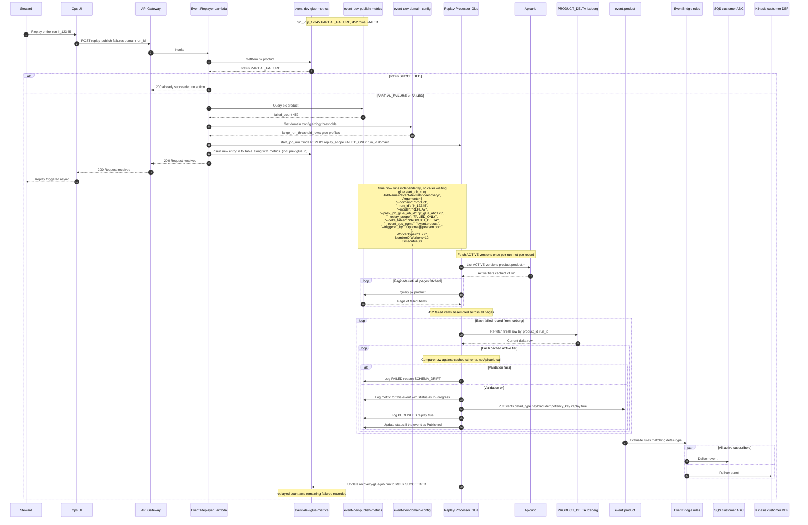

# Replay from `event-{env}-publish-metrics`

How to **re-process a failed events** when one row exists in **`event-{env}-publish-metrics`** for a merge `run_id` — without re-running the full Gold run_id using Recovery fabric Processor (Glue job) for the entire delta.

**Scope:** Processor/bus failures only (event never reached `event-dev-product`). For subscriber delivery failures, see **`event-{env}-failed-deliveries`** (separate flow — not covered here).

**Related:** [ADR-0007](../adr/0007-eventing-dynamodb-tables.md) (table schemas and sample items)

---

## When to use this flow

Use **`POST /replay/publish-failures`** when:

- A row exists in **`event-{env}-publish-metrics`** with **`event_status = FAILED`**
- The event **did not** reach **`event-{env}-product`** (schema drift, validation error, PutEvents entry failure)
- The steward has **fixed the root cause** (Apicurio schema, mapping, or bad field in payload)

**Do not use this flow when:**

- The whole processor run must be reprocessed → re-run Glue or trigger a new merge (different procedure)
- The event **was on the bus** but a **customer SQS/Kinesis/API** failed → use **`event-{env}-failed-deliveries`** replay instead

---

## Starting state — one failure for `jr_12345`

Gold merge **`jr_12345`** had **10** product UPDATE rows. Processor published **9** to the bus; **P009** failed validation.

### Run metrics — `event-{env}-glue-metrics`

```json
{
  "job_name": "event-dev-fabric-processor",
  "glue_job_run_id": "jr_glue_abc123",
  "replay_job_run_id":null, --NULL FOR INITAL RUN
  "operation": "OVERALL",
  "domain": "product",
  "gold_job_run_id":"jr_a1b2c3d4e5f6",
  "delta_table":"product_delta",
  "mode":"INCREMENTAL", --INCREMENTAL/RE-PROCESS
  "status": "PARTIAL", --IN_PROGRESS/SUCCEEDED/FAILED/PARTIAL_FAILURE/REPLAY_IN_PROGRESS
  "worker_type": "G.2X",
  "num_workers": 10,
  "timeout_minutes": 480,
  "reason":"[oom]", --"SCHEMA_DRIFT" / "OOM" / "TIMEOUT" / nullable
  "error_msg":"out of memory error", -- capture the entire glue job error
  "gold_delta_count": 10,
  "event_published_count": 9,
  "event_failed_count": 1,
  "active_tiers_processed":["v1","v2"],
  "started_at":"",
  "completed_at":"",
  "duration_seconds":"",
  "ops_triggered":["INSERT","UPDATE","DELETE"],
  "ops_succeeded":["INSERT","DELETE"],
  "ops_failed":["UPDATE"],
  "replay_count":0,
  "ttl":"" --Align TTLs across the tables to match 90 days
}
```

### Failure row — `event-{env}-publish-metrics`

```json
{
  "pk": "product#jr_12345",
  "sk": "product:dev:P009:100:jr_12345:updated:v2",
  "domain": "product",
  "delta_run_id": "jr_12345",
  "glue_run_id": "jr_glue_abc123",
  "event_id":"P009",
  "operation":"UPDATED",
  "schema_version": "v2",
  "detail_type": "product.updated.v2",
  "publish_source": "event-dev-fabric-processor",
  "event_bus_name": "event-dev-product",
  "idempotency_key": "product:dev:P009:100:jr_12345:updated:v2",
  "apicurio_artifact":product.product.updated-value
  "failure_stage": "PROCESSOR_VALIDATE",
  "last_error": "SCHEMA_DRIFT: field 'org_id' failed validation (null not allowed)",
  "event_detail": {
    "product_id": "P009",
    "org_id": null,
    "operation": "UPDATED",
    "schema_version": "v2",
    "ISBN13":123213213,
  },
  "event_status": "FAILED",
  "replay_count": 0,
  "timestamp":2026-08-25T18:31:43Z,
  "ttl":"" --Align TTLs across the tables to match 90 days
}
```

**`sk` derivation:**

```text
{domain}:{env}:{product_id}:{org_id}:{run_id}:{op_suffix}:{tier}
→ product:dev:P009:100:jr_12345:updated:v2
```

---

## Re-processing flow (Event Management Lambda)

```text
1. Steward fixes schema or corrects payload (e.g. org_id = "100" in event_detail)
2. UI calls POST /replay/publish-failures with run_id + idempotency_key
3. Event Management Lambda:
     a. Load row from event-dev-publish-metrics (pk=product#jr_12345, sk=…)
     b. Confirm event_status == FAILED
     c. Triggers Recovery Glue job, validate schemas, update metrics
     d. PutEvents → event.dev.product (one entry for P009)
4. EventBridge rules on event.dev.product match DetailType product.updated.v2
5. All subscribed customers (ABC SQS, DEF Kinesis, …) receive P009
6. Lambda updates row: event_status=REPLAYED, replay_count+=1, replayed_at
```

No full Glue re-run for **`jr_12345`**. No direct send to a single customer queue — **bus publish** lets existing rules fan out to **all** subscribers.

---

## Sequence diagram



---

## API — replay one failed publish

### List failures for a run (optional)

```http
GET /publish-failures?domain=product&run_id=jr12345&event_status=FAILED
```

### Replay single event

```http
POST /replay/publish-failures
Content-Type: application/json

{
  "domain": "product",
  "run_id": "jr_12345",
  "pk": "product#jr_12345",
  "idempotency_keys": [
    "product:dev:P009:100:jr_12345:updated:v2"
  ]
}
```

### Response (example)

```json
{
  "domain": "product",
  "run_id": "jr_12345",
  "recovery_job_run_id":"rc_12345",
  "message":"Triggered recovery-glue-job"
}
```
### Replay failures in the whole runid

```json
{
  "domain": "product",
  "pk": "product#jr_12345",
  "run_id": "jr_12345",
}
```

### Response (example)
```json
{
  "domain": "product",
  "run_id": "jr_12345",
  "recovery_job_run_id":"rc_12345",
  "message":"Triggered recovery-glue-job"
}
```
---

## PutEvents payload (what Lambda sends)

Lambda reads **`publish_source`**, **`event_bus_name`**, **`detail_type`**, and **`event_detail`** from the failure row (after steward fix):

```json
{
  "JobName": "event-dev-fabric-recovery",
  "Arguments": {
    "--domain": "product",
    "--run_id": "jr_12345",
    "--mode": "REPLAY", -- REPLAY/ARCHIVE-REPLAY (original_glue_job_id is optional)
    "--original_glue_job_id": "jr_glue_abc123", ---- Lambda will get it from event-{env}-glue-metrics
    "--replay_scope": "FAILED_ONLY",
    "--idempotency_keys": "[\"product:dev:P009:100:jr_12345:updated:v2\",\"product:dev:P045:100:jr_12345:updated:v1\"]",
    "--delta_table": "PRODUCT_DELTA",
    "--event_bus_name": "event-dev-product",
    "--triggered_by": "optional@pearson.com"
  },
  "WorkerType": "G.1X",
  "NumberOfWorkers": 2,
  "Timeout": 60
}
```

## PutEvents payload - Specific events (what Lambda sends)
```json
{
  "JobName": "event-dev-fabric-recovery",
  "Arguments": {
    "--domain": "product",
    "--run_id": "jr_12345",
    "--mode": "REPLAY",
    "--original_glue_job_id": "jr_glue_abc123",
    "--replay_scope": "SPECIFIC_ITEMS",
    "--idempotency_keys": "[\"product:dev:P009:100:jr_12345:updated:v2\",\"product:dev:P045:100:jr_12345:updated:v1\",\"product:dev:P078:100:jr_12345:created:v1\"]",
    "--delta_table": "PRODUCT_DELTA",
    "--event_bus_name": "event-{env}-product",
    "--triggered_by": "optional@pearson.com"
  },
  "WorkerType": "G.1X",
  "NumberOfWorkers": 2,
  "Timeout": 60
}
```
This is the same shape the processor would have emitted had validation succeeded on the original run.

---

## After replay

### Failure row will be updated in the event-{env}-publish-metrics

```json
{
  "pk": "product#jr_12345",
  "sk": "product:dev:P009:100:jr_12345:updated:v2",
  "event_status": "REPLAYED",
  "replay_job_run_id":"jr_glue_abc9989",
  "replay_count": 1,
  "replayed_at": "2026-08-26T13:30:00Z"
}
```

### Subscribers

Customers with rules matching **`product.updated.v2`** receive P009 **once** (same as any other bus event). Consumers should dedupe on **`idempotency_key`** if a duplicate replay is attempted.

---

## What this flow does not do

| Action | Used here? |
|--------|------------|
| Re-run processor Glue for full `jr_12345` | No |
| Read all 10 rows from `PRODUCT_DELTA` again | No |
| Write to `event-{env}-failed-deliveries` | No |
| Send directly to one customer SQS (bypass bus) | No — use bus so **all** rules apply |
| Store success rows in `event-publish-metrics` | No — table is **FAILED only** |

---

## Checklist

1. Confirm row in **`event-dev-publish-metrics`**, `event_status = FAILED`, for the correct **`run_id`**.  
2. Fix Apicurio schema and/or update **`event_detail`** in the row (or fix source data and refresh payload before replay).  
3. Call **`POST /replay/publish-failures`** with **`idempotency_key`(Specific list of items) or `pk`(Entire failures in that jr_1234)**.  
4. Verify subscribers received the event (queue depth, consumer logs).  
5. Confirm row shows **`REPLAYED`**.

---

## Related docs

| Document | Description |
|----------|-------------|
| [ADR-0007](../adr/0007-eventing-dynamodb-tables.md) | Four eventing DynamoDB tables + samples |
| [`event-centric-publish-reference.md`](event-centric-publish-reference.md) | Full Gold → bus publish path |
