# Raising a UAT deployment for a domain module

> **The stack analogue is [`stack-promotion-model.md`](stack-promotion-model.md)**, which
> is the mandated model for anything under `stacks/`. This document is the `domains/`
> counterpart, built after it and sharing its central property: a UAT deploy is pinned to
> a version. Read that one for the stack side; the differences are set out below.
>
> Note that `guidelines.md` §3 still mandates a third model for domains — `domain-cd.yml`
> with Argo CD — which has never executed. This is what the gold domains actually use.

**Audience:** domain teams promoting a module's gold layer to UAT.
**Status:** all four gold domains now have a UAT workflow. Product's has a Terraform
step and the others do not — see "Price, program and stock" at the end for why that
makes them the safer ones to run first.

## How promotion works — read this before the steps

**There are two promotion models, and "deploy to UAT" means something different in
each.** Most confusion about UAT comes from applying one model's thinking to the other.

```mermaid
flowchart TD
    subgraph S["STACK promotion — echo, apicurio"]
        A1["merge to develop"] --> A2["dev deploy builds artefacts<br/>into uif-echo-dev-release-artifacts"]
        A2 --> A3["bump stacks/echo/VERSION"]
        A3 --> A4["release-echo.yml cuts echo/vX.Y.Z<br/>+ a manifest pinning every artefact"]
        A4 --> A5["dispatch promote-echo.yml ON THAT TAG<br/>environment=uat  promote=run"]
        A5 --> A6["uat approval: Raj / Vaibhav"]
        A6 --> A7["artefacts COPIED dev bucket to uat bucket<br/>then release/uat/DATE.N cut on green smoke"]
    end
    subgraph D["DOMAIN deployment — product, price, program, stock"]
        B1["merge to develop"] --> B1b["dev deploy runs: tests + dev apply"]
        B1b --> B2["bump domains/DOMAIN/VERSION"]
        B2 --> B2b["DOMAIN-release.yml cuts DOMAIN/vX.Y.Z<br/>only if the dev deploy JOB was green"]
        B2b --> B3["dispatch deploy-DOMAIN-uat.yml<br/>ON THAT TAG + own uat latch"]
        B3 --> B4["uat approval: Raj / Vaibhav"]
        B4 --> B5["artefacts SYNCED from the TAGGED commit<br/>to uif-echo-uat-gold-artifacts"]
        B5 --> B6["sync_pipelines registers the config<br/>(the Glue database comes on the first run)"]
    end
```



### The stack model: promote bytes, never rebuild

`echo` and `apicurio` ship as **one release unit each**. The dev deploy builds the
artefacts; a tag records exactly which ones; promotion **copies those same bytes** into
uat.

Why it works this way, in the workflow's own words: *"the artifacts in the tag's manifest
are the bytes that passed the gate. Rebuilding would produce"* different hashes for the
same release tag. So what runs in uat is provably the thing that was tested in dev — when
apicurio was promoted, the digest in the tag manifest was byte-identical to what had been
verified running in dev.

Consequences worth internalising:

- **A tag is required.** You cannot promote "develop". `echo/v0.10.0` is 110 commits
  behind develop the moment someone merges — promoting it ships the code as of the tag.
- **Getting new code into uat needs a VERSION bump.** `release-echo.yml` fires only on a
  change to `stacks/echo/VERSION`, and `check-version.sh` refuses a number that already
  has a tag. The number is a human claim about whether consumers break, not a counter.
- **Promotion is always a manual dispatch.** A tag pushed by a workflow using the default
  `GITHUB_TOKEN` does not fire tag-triggered workflows, so the `push: tags:` trigger on
  `promote-echo.yml` never fires for a tag CI cut. Dispatch it on the tag ref.
- **`promote` defaults to `skip`.** Set it explicitly or you get a green run that did
  nothing.

### The domain model: pin a commit, re-read the repo from it

A domain also releases by tag, but the tag pins a **commit** rather than artefacts.
`deploy-<domain>-uat.yml` checks out `<domain>/vX.Y.Z` and syncs that domain's schema and
mapping files and its pipeline config **from the tagged tree**. It is idempotent and safe
to re-run.

- **A tag is required here too.** It is what makes the deploy reproducible and stops work
  merged to develop after the tag from riding along. Until 2026-09-28 domains had no tag
  at all, which is what UIFPE-656 fixed.
- **The version is declared, not derived.** `domains/<domain>/VERSION` is a claim about
  whether consumers break; `check-version.sh` (reused from the stacks, unmodified) refuses
  a malformed number, one already tagged, or one going backwards.
- **The release gate is the dev deploy.** `<domain>-release.yml` refuses to tag a commit
  whose `deploy-<domain>-dev.yml` **deploy job** did not succeed — so a version that never
  reached dev cannot be promoted. It inspects the job, not the run, because the run also
  concludes success when the latch is off and the deploy was skipped.
- **The config step is the deployment**, for these domains. It writes the gold config
  table, which is what makes the pipeline exist for the dispatcher. It does **not**
  create the Glue database — the first transform run does that, and a later sync
  applies the Lake Formation tag.
- **Only product has a Terraform step, and since UIFPE-669 it is opt-in** (`terraform:
  skip | plan | apply`, default `skip`) **and in its own jobs**, so it cannot block the
  gold half. The other three have no Terraform root at all.
- **UAT has its own latch**, `<DOMAIN>_UAT_DEPLOY_ENABLED`. Not the dev one: that is
  already `true` for all four domains, so sharing it left uat effectively unlatched.

### The two compose, and that is where the gap was

The stack owns the gold pipeline — the Glue jobs, the Lambdas, the dispatcher, the
schedule rules. A domain owns its schema, mapping, and the config row that says "run this
entity" (ADR-0018).

So a working uat gold layer needs **both** halves. The 2026-09-28 review found exactly
one half done: the stack was fully promoted — 14 Lambdas, 14 Glue jobs, all rules ENABLED
— while the config table held 0 rows, so the dispatcher ticked on schedule with nothing to
dispatch, `gold-transform` had never run, and so the gold databases — which the first
transform run creates — never came into being either.

**Neither half is wrong on its own. The stack cannot register your entity, and your
domain deploy cannot create the pipeline that runs it.**

### What "from dev" actually means

Nothing is promoted *out of* a dev environment. In both models the source of truth is
**`develop`, the branch**:

- the stack builds artefacts from it, tags them, and copies those artefacts to uat
- a domain tags a commit on it, and the deploy reads its files from that tagged commit

Dev the *environment* is where the artefacts were built and proven, not where they are
copied from — except in the literal S3 sense that the stack's promotion reads
`uif-echo-dev-release-artifacts`. So a change reaches uat only once it is on `develop`;
there is no path from a feature branch, and both workflows enforce that with a
`github.ref` guard.

## What a UAT deployment actually does

`deploy-product-uat.yml` is `workflow_dispatch` only — there is no automatic UAT deploy
on merge. Since UIFPE-669 it is **three independent jobs**, not one sequence:

| Job | Runs | What it does |
|---|---|---|
| **gold** | always | latch → test gate → AWS creds → artefact sync → **config sync**. Needs no Terraform. |
| **plan** | only if the `terraform` input is not `skip` | latch → test gate → creds → `make plan`, then uploads the plan as an artefact |
| **apply** | only if `terraform` is `apply`, and `needs: plan` | downloads that plan and applies **it** — never re-plans |

Two things follow from the split, and both were defects before it:

- **Gold no longer waits on Terraform.** The artefact sync is a plain `aws s3 sync` to a
  bucket that exists and the config sync writes DynamoDB; neither reads a Terraform
  output. They used to sit *after* `make apply` in the same job, so a Terraform failure
  took them down with it — which is why product could not register in UAT at all while
  the other three could.
- **The plan is reviewable before it is applied.** Both jobs go through the `uat`
  environment, so the apply's approval is requested once the plan artefact already
  exists. Previously `make plan` and `make apply` ran back to back and the plan was only
  a log entry after the fact — on a root with no state, whose plan is a 28-resource
  CREATE, the approver could not have been approving the plan.

`terraform` defaults to **`skip`**, so a plain dispatch runs the gold half only. That is
the right default while UIFPE-669 is open.

**The config sync is the promotion**, and it is part of the deployment — not a separate
manual task, and it should not be run by hand.

**It does NOT create the Glue database.** The first transform run creates it, and a
later sync applies the `uif-echo-gold-layer` Lake Formation tag — so on a first deploy
the sync prints `SKIP <database> (not created yet)`, which is correct and not a failure.
`ensure_gold_database` does exist, but on the API's `create_gold_pipeline` path, not
this one.

## The steps to raise it

A UAT deploy is raised **on a release tag**, never on a branch. Two stages: cut
the tag, then deploy it.

### Stage 1 — cut the version tag

1. **Confirm the change is on `develop` and its dev deploy went green.** The release
   refuses to tag a commit whose `deploy-<domain>-dev.yml` **deploy job** did not
   succeed — so a version that never reached dev cannot be tagged. It checks the job,
   not the run, because a run also concludes success when the latch is off and the
   deploy was skipped.

2. **Bump the domain's declared version.** Edit `domains/<domain>/VERSION` to the next
   `MAJOR.MINOR.PATCH` and merge it to develop. The number is a **claim about whether
   consumers break** — only a human who understands the change can make it. Check it
   before merging:

   ```bash
   COMPONENT=<domain> stacks/echo/scripts/check-version.sh domains/<domain>/VERSION
   ```

   It prints the tag it will cut, or refuses a malformed number, one that already has a
   tag, or one that goes backwards.

3. **The tag is cut for you.** Merging that bump fires `<domain>-release.yml`, which
   validates the version, waits for the dev deploy on the same commit, and pushes an
   annotated `<domain>/vX.Y.Z` carrying its evidence. Read it back with
   `git show <domain>/vX.Y.Z`.

   Nothing deploys off the back of it — a tag pushed by a workflow using the default
   `GITHUB_TOKEN` does not fire tag-triggered workflows, by design.

### Stage 2 — deploy that tag to UAT

4. **Confirm a `uat` overlay exists** for every gold entity in the domain:
   `domains/<domain>/src/apps/pipelines/overlays/uat/<gold_id>.yaml`. Without it the
   merged config fails validation and the config step does nothing useful. Plan it
   first — no `--apply` is a plan, and you should read it:

   ```bash
   python3 stacks/echo/src/apps/cli/sync_pipelines.py --env uat
   ```

5. **Open the UAT latch.** Set the repo variable `<DOMAIN>_UAT_DEPLOY_ENABLED` to
   `true` (Settings → Secrets and variables → Actions → Variables).

   **Note this is not the same variable as the dev latch.** `<DOMAIN>_DEPLOY_ENABLED`
   is dev's and is already `true` for all four domains; UAT has its own so it genuinely
   fails closed.

6. **Dispatch on the tag:**

   ```bash
   gh workflow run deploy-<domain>-uat.yml --ref <domain>/vX.Y.Z
   ```

   The tag is what pins the version: `actions/checkout` takes the tagged commit, so
   work merged to develop afterwards cannot ride along. Dispatching on `develop` is
   refused by the environment, and the job guard requires the tag — so there is no way
   to deploy an unpinned state by accident.

7. **Approve the environment gate.** The job runs in the `uat` GitHub environment,
   which requires a reviewer — **Raj-Karunakaran_pearson**, **vaibhav-yenorkar_pearson**
   or **ReyasAhamed-HabibRahman_pearson**. The run sits in `waiting` until one of them
   approves, and the person who dispatched it may approve their own run. Read the list
   back rather than trusting this one:

   ```bash
   gh api repos/<owner>/<repo>/environments/uat      --jq '.protection_rules[] | select(.type=="required_reviewers") | .reviewers[].reviewer.login'
   ```

8. **Close the latch again.** Set `<DOMAIN>_UAT_DEPLOY_ENABLED` back to unset or
   `false`. Left on, every future dispatch deploys without anyone deciding to.

## How to verify afterwards

Do not take a green run as proof. Check the things the deployment was for:

```bash
# 1. the config landed
aws dynamodb scan --table-name uif-echo-uat-gold-pipeline-config \
  --region eu-west-1 --select COUNT

# 2. the gold database — EXPECT EntityNotFoundException on a first deploy.
#    The first transform run creates it; the sync only tags it afterwards.
aws glue get-database --name uif_echo_uat_gold_<entity> --region eu-west-1

# 3. the artifacts the config points at actually exist
aws s3 ls s3://uif-echo-uat-gold-artifacts/schemas/gold/<entity>/v1/ --region eu-west-1
aws s3 ls s3://uif-echo-uat-gold-artifacts/mappings/<entity>/v1/ --region eu-west-1
```

**Command 3 is the one that matters, because nothing on this path checks it.**
`sync_pipelines.py` writes the row with a bare `put_item` and never constructs an S3
client, so a `master_s3_path` pointing at a missing object is registered without
complaint and fails later, at the first run. The `head_object` check people remember is
on the API's `create_gold_pipeline` (`pipeline_controller.py`), which a UAT deploy does
not go through. What keeps the two consistent here is the **step order** — artefacts at
step 6, config at step 7 — so a failed artefact sync stops the run before the config is
written. Verify it anyway.

## Enabling the pipeline is a separate, deliberate act

The UAT overlays commit `enabled: false`. That is not an oversight:

- `enabled` is console-owned (`sync_pipelines.RUNTIME_PATHS`, UIFPE-564). YAML seeds it
  for a **new** entity and the console owns it afterwards, so changing the YAML later has
  no effect — change it on the Syncs page.
- UAT's `schedule-gold-dispatch-tick` rule is **already ENABLED**. Seeding `enabled: true`
  would put the pipeline into the dispatch rotation the moment the config lands, and it
  would start running at its due slots with nobody watching.

So: deploy, verify, then enable from the console when the team is ready to watch a run.

One caveat for a first run: an entity whose schema changed non-additively must be run
manually with `--rebuild` first — scheduled runs refuse a non-additive change by design.

## Price, program and stock — shorter, not harder

These three now have `deploy-<domain>-uat.yml` too, and their deployment is **six steps,
not seven: there is no Terraform**.

**They need no Terraform backend.** An earlier draft of this runbook said they did; that
was wrong. Their `infrastructure/terraform` holds only a README, because since ADR-0018
the gold pipeline, its Glue jobs and its Lambdas belong to the **echo stack**, and a
domain owns its schema, mapping and event delivery. So the whole of their uat deployment
is: put the artefacts where the stack's jobs read them, and register the pipeline.

The steps above apply unchanged, minus the Terraform step, with the domain's own latch and tag:

```bash
gh workflow run deploy-price-uat.yml   --ref price/vX.Y.Z      # PRICE_UAT_DEPLOY_ENABLED=true
gh workflow run deploy-program-uat.yml --ref program/vX.Y.Z    # PROGRAM_UAT_DEPLOY_ENABLED=true
gh workflow run deploy-stock-uat.yml   --ref stock/vX.Y.Z      # STOCK_UAT_DEPLOY_ENABLED=true
```

Each tag comes from its own `<domain>-release.yml`, fired by a `domains/<domain>/VERSION`
bump — see stage 1.

Because there is no Terraform, these three are the **lower-risk** ones to run first:
nothing is created or replaced, the artefact sync is per-entity with `--delete` scoped to
that entity's prefix, and the config sync only adds a row.

**Product's gold half now runs like the other three**; its Terraform half is the part
to be careful with, and is opt-in for that reason. That root has never been applied to
uat: the plan is a CREATE of **28** resources (marketing-copy service, event delivery) —
the figure from the plan run on 2026-09-28, not an estimate — its uat deploy role may
need the grant widening dev needed under UIFPE-184, and **the plan currently fails** on a
dependency that legitimately does not exist yet:

```
Error: reading Lambda Function (uif-event-uat-dlq-recorder)
  ResourceNotFoundException: Function not found
```

The event stack has never been deployed to uat, and a `data` source for a missing
resource is a hard plan failure. So leave `terraform` at `skip` until **UIFPE-669**
closes. Dispatch `terraform: plan` to see that failure for yourself without spending an
apply approval on it.

For reference, the uat state convention — which product follows and these three do not
need — keeps each root's state inside the stack's own data bucket rather than dev's shared
bucket, so a bucket policy or lifecycle rule cannot reach across stacks:

```
stacks/echo .../terraform/backends/uat-uif.hcl        uif-echo-uat-data  tfstate/infra-terraform.tfstate
stacks/echo .../terraform-gold/backends/uat-uif...    uif-echo-uat-data  tfstate/gold-terraform.tfstate
domains/product .../backends/uat.s3.tfbackend         uif-echo-uat-data  tfstate/product-domain-terraform.tfstate
```

## Status, as of 2026-09-29

Both of the blockers this runbook was first written against are cleared:

| Was blocking | Now |
|---|---|
| `overlays/uat` did not exist for any domain — `sync_pipelines --env uat` failed validation | all five entities have one (PR #644) |
| product's `backends/uat.s3.tfbackend` was a placeholder, so its Terraform apply failed before the config sync | filled in: `uif-echo-uat-data`, `tfstate/product-domain-terraform.tfstate` (PR #644) |
| price, program and stock had no UAT workflow | added, and they need no backend |

**Three domains have been promoted, following the steps above:** stock, price and
program, each on its own `<domain>/v0.1.1` tag. Between them that put 3 rows in
`uif-echo-uat-gold-pipeline-config` and 16 objects under
`s3://uif-echo-uat-gold-artifacts/`. All three are `enabled: false`, so nothing is in
the dispatch rotation and no Glue database exists yet — see "Enabling the pipeline is a
separate, deliberate act".

**Product has not been promoted.** Its Terraform root carries the event-delivery
resources, whose UAT path is not built (UIFPE-669), so its step 4 is the one part of this
runbook that has never been exercised. Treat the product section as designed-but-untested
until that ticket closes.

Re-read the live state rather than trusting this section — it is a snapshot, and the two
claims in it that were wrong before were both of this kind.
