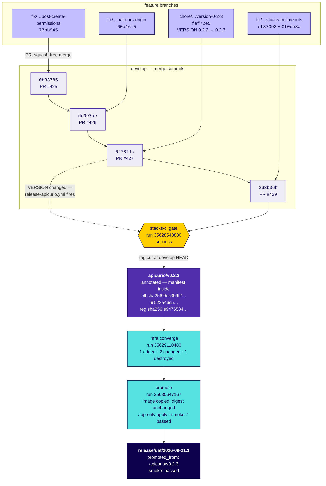
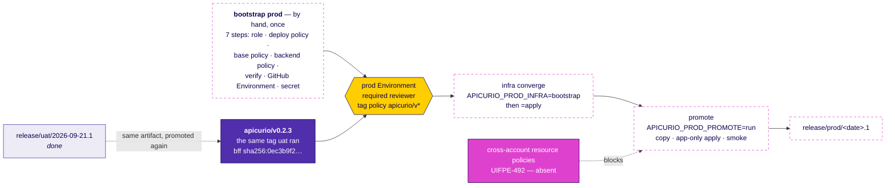

# Promotion model for `stacks/` — bootstrap, infra, promote

This is the mandated CI/CD model for anything under `stacks/`: how an
environment is created, how its infrastructure is kept in step with the code,
and how an application artifact moves from dev to uat to prod without being
rebuilt. It is written to be followed — by an engineer, or by a coding agent
told to make another stack work this way — so it states exact file names,
variable names and verifiable assertions rather than describing an approach.

The worked instance is `stacks/apicurio/`, which is the only stack running this
model today. It is proven through dev and uat; **prod is defined here but has
never been exercised**, and the section that says so says exactly what is
missing.

**Scope, and how this relates to the Argo CD model.** `guidelines.md` §3
mandates a different pipeline — `domain-cd.yml`, Argo CD reconciling
`values-<env>.yaml` onto Kubernetes. That model is scoped to `domains/` on
Kubernetes. It is also, as of 2026-09-21, **not running**: the GitHub API
answers `gh run list --workflow=domain-cd.yml` with *"workflow not found on the
default branch"*, so it has never executed once. For stacks on ECS and
Terraform, this document is the standard. Do not mix the two: a stack following
this model has no `values-<env>.yaml` and no Argo CD application.

**What domains actually use today** (2026-09-28, UIFPE-656). Rather than the
Argo CD model above, the four gold domains promote through a tag-per-domain
model deliberately shaped after this one:
[`domain-promotion-runbook.md`](domain-promotion-runbook.md). It shares this
document's central property — a UAT deploy is pinned to a version and cannot
take whatever is on `develop` — and differs in one way worth knowing: **a
domain tag pins a COMMIT, not artefacts.** A stack tag carries an artefact
manifest because promotion copies pre-built bytes between buckets; a domain
UAT deploy re-reads files from the tagged tree, so there is nothing pre-built
to pin. Stock, price and program were promoted this way on 2026-09-28.

---

## 1. The asymmetry the model rests on

Everything below follows from one distinction. Get this wrong and the rest
reads as arbitrary ceremony.

| | Application artifacts | Infrastructure |
|---|---|---|
| Verb | **promote** | **converge** |
| Meaning | copy the bytes to the next environment and prove the digest did not change | apply the same Terraform root with that environment's tfvars |
| Rebuilt per env? | **Never.** A rebuild produces a different artifact, so the thing tested in dev is not the thing running in prod | Not applicable — there is no infrastructure artifact to carry |
| Travels as | a container image digest and a bundle hash | a git-tracked tfvars file |

Because infrastructure converges rather than promotes, **there is nothing to
copy between environments** — which is why this model has two workflows rather
than one pipeline with three stages. Trying to express convergence as promotion
is what produces per-environment Terraform forks.

What binds the two halves into one release is a single identity: **the build
tag's release manifest.** Both workflows resolve every digest from it, so an
infra-only apply still lands a known application version rather than whatever
is currently `latest`.

---

## 2. The two tags, and what each one is evidence of

Two tags answer two different questions. Conflating them is the most common
misreading of this model.

| | Build tag | Release tag |
|---|---|---|
| Form | `<stack>/vX.Y.Z` — e.g. `apicurio/v0.2.3` | `release/<env>/<date>.<n>` — e.g. `release/uat/2026-09-21.1` |
| Answers | *what code went into this artifact* | *what was deployed, where, when* |
| Evidence | the CI gate | smoke tests |
| Cut by | `release-<stack>.yml`, when `stacks/<stack>/VERSION` changes on `develop` | the promote workflow, after smoke passes |
| Carries | a release manifest in the **annotation** | what it promoted, and that smoke passed |

The build tag's manifest is the contract. `apicurio/v0.2.3`'s reads:

```yaml
apicurio/v0.2.3:
  git_commit: "263b06b11669d6761e498863b35c31191a93cd6a"
  built_at: "2026-09-21T16:58:17Z"
  gate:
    check: stacks-ci gate
    run_id: 35628548880
    conclusion: success
  artifacts:
    bff_image:
      repository: 283556840805.dkr.ecr.eu-west-1.amazonaws.com/uif-apicurio-dev-bff-ecr-repo
      digest: sha256:0ec3b9f29f73926114a1997abab889ce242aa0ac759a8875ede822b66d9a2892
    ui_bundle:
      sha256: "523a46c5cd80b03eb774d1a206773ffec46bcc90f86b67b3745342f6e31be026"
      archive: s3://uif-apicurio-dev-release-artifacts/523a46c5….tar.gz
      version_id: "HGXYGj_L3mhibVtFPXOGcJV3g77B2Pwr"
    registry_image:
      reference: quay.io/apicurio/apicurio-registry:3.3.2
      digest: sha256:e9476584866f9cbfd6b11c1fbdd0df64976277e069f54d537572032751a4b6fc
```

**The manifest generator's job is refusal.** `scripts/release-manifest.sh` will
not write a manifest recording a mutable tag where a digest belongs, a
truncated digest, or a gate that did not pass. A manifest that lies is worse
than none, because it looks exactly like evidence.

**Reproducibility is observable, not asserted.** `v0.2.0`, `v0.2.1`, `v0.2.2`
and `v0.2.3` all carry BFF digest `sha256:0ec3b9f2…` and UI bundle
`523a46c5…`. If your stack's four consecutive tags do not produce identical
hashes for unchanged source, the build is not reproducible and promotion
proves nothing.

---

## 3. The three phases

### Phase 1 — bootstrap (once per environment, by a human)

`stacks/<stack>/infrastructure/deploy/bootstrap-environment.sh <env>` creates
everything an environment needs *before* any workflow may name it. Seven steps:

| Step | Creates | Why it blocks the environment |
|---|---|---|
| 1/7 | the deploy role | nothing can assume anything without it |
| 2/7 | the env-scoped IAM deploy policy | dev's policy pins resource ARNs to `uif-<stack>-dev-*`, so an `env=uat` apply 403s on ECR, ECS, IAM, RDS, S3 and WAF — **in the same AWS account.** Same account does not mean same permissions |
| 3/7 | the base deploy policy | the actions that cannot be resource-scoped |
| 4/7 | the Terraform backend policy | the state bucket is not a resource the stack *manages*, so the IAM derivation cannot see it |
| 5/7 | verification that the role can act | see the warning below |
| 6/7 | the GitHub Environment | referencing `environment: uat` before it exists does not fail loudly — it deploys with no protection |
| 7/7 | the CI secret container and Terraform config | |

**Nothing in CI calls this script, deliberately.** Every step is a one-time
privileged change to IAM or repository settings, and should be made by a human
who can read the result.

> **Step 5's verification is known to be insufficient — track this.**
> `--verify-only` reports every action allowed on a role that cannot deploy,
> because the IAM derivation only sees resources the stack manages. It is blind
> to four distinct mechanisms: resources the stack does not manage, wrongly
> scoped resources, conditions it never evaluates, and actions the provider
> issues only *after* a resource is created. Budget apply-and-fix rounds;
> a green `--verify-only` is not evidence. See UIFPE-496.

### Phase 2 — infra converge (per environment, per tag)

`deploy-<stack>-infra.yml` applies the Terraform root with that environment's
tfvars. One root module, `backends/<env>.hcl` + `envs/<env>.tfvars` — never a
per-environment fork.

- Triggered by a push of `<stack>/v*`, or by `workflow_dispatch`.
- Gated by the environment's required reviewer, which blocks the job **before
  it starts**. Approving therefore approves the *intent* — this tag, this
  environment — not the plan text. To read the plan first, run with the latch
  on `plan`, read it, then set `apply` and re-run. The tag is immutable, so the
  second run deploys the same identity.
- `plan` and `apply` must stay in the **same job**. A saved plan file carries
  generated values in clear and is never uploaded as an artifact.

### Phase 3 — promote (per environment, per tag)

`promote-<stack>.yml` copies the artifacts the manifest names into the target
environment, runs an app-only Terraform apply, runs smoke, and cuts the release
tag.

The app-only apply is guarded: `scripts/assert-app-only-plan.sh` reads the plan
JSON on **stdin** and exits 0 to apply, 3 on an empty plan, 1 to refuse. A
promote that would touch infrastructure fails rather than quietly applying it.

---

## 4. Environment by environment

| | dev | uat | prod |
|---|---|---|---|
| Workflow | `deploy-<stack>-dev.yml` | `deploy-<stack>-infra.yml` + `promote-<stack>.yml` | same two |
| Trigger | push to `develop` on `stacks/<stack>/**` | push of `<stack>/v*`, or dispatch | same |
| Artifacts | **built from source** | **promoted** from dev | **promoted** from uat |
| Deployment policy | branches `develop`, `main` | **tag `<stack>/v*` only** | not configured |
| Required reviewer | **none** | 1 | not configured |
| Latches | workflow inputs | `<STACK>_UAT_INFRA`, `<STACK>_UAT_PROMOTE` | `<STACK>_PROD_INFRA`, `<STACK>_PROD_PROMOTE` |
| Status | live | **live** — `release/uat/2026-09-21.1` | **model only — see below** |

**dev is the only environment that builds.** It is where the artifact comes
from; every other environment receives it. That is why dev's workflow has
`bff_image: build` and the others have no build step at all.

**uat's tag-only deployment policy is load-bearing.** Because the environment
accepts only refs matching `<stack>/v*`, a dispatch run on `develop` targeting
`environment: uat` is **rejected**. This is what makes "uat can only be
deployed from a build tag" a mechanism rather than a convention.

### What prod still needs

Stated concretely because the table above could otherwise read as "prod works":

- [ ] **The `prod` GitHub Environment does not exist.** Only `dev` and `uat`
      do. Until it is created with a reviewer and a `<stack>/v*` tag policy,
      no prod deployment is possible.
- [ ] **Bootstrap has never run for prod** — no prod deploy role, no
      prod-scoped policies.
- [ ] **Cross-account resource policies are absent.** uat promotes within one
      account, so this was never exercised. prod is a different account, and
      the promotion source read grant alone is not sufficient. See UIFPE-492.
- [ ] **RTO/RPO are undefined.** The Terraform module is already env-aware —
      `prod` gets deletion protection, a final snapshot and 7-day backups
      automatically — but no targets exist to verify against.

---

## 5. The latch discipline

Deployment is gated by **repository variables that are a deploy-window latch,
not configuration**:

```
<STACK>_<ENV>_INFRA     unset|skip = do nothing (DEFAULT)
                        plan       = plan only, changes nothing
                        apply      = apply the plan this run produced
                        bootstrap  = FIRST APPLY ONLY: create the ECR
                                     repository, then apply everything
<STACK>_<ENV>_PROMOTE   unset|skip = do nothing (DEFAULT)
                        run        = promote this tag's artifacts
```

Three rules, each with a failure behind it:

1. **Close the window when done.** Left open, every subsequent build-tag push
   deploys that environment unattended.
2. **Never leave both latches open for the same tag push.** Both workflows
   trigger on the same `<stack>/v*` push and both enter the same
   `<stack>-deploy-<env>` concurrency group. GitHub Actions keeps at most one
   *pending* run per group, so the second arrival is cancelled outright with
   no message explaining why. `needs:` does not help — it orders jobs *within*
   one run.
3. **A dispatch input overrides the variable.** On `workflow_dispatch` the
   input wins; the variable decides only on a tag push. So `-f infra=apply`
   works regardless of what the variable says — which also means a stale
   variable is not the safety net it appears to be.

Unrecognised values collapse to the default rather than failing the run: these
are read on every tag push, and a typo should deploy nothing and say so rather
than break every push. Matching is exact against the whole token — substring
matching would read `no-apply` as `apply`.

---

## 6. Adopting this for another stack

The contract, in the order a new stack needs it. Every item is checkable.

**Files to create under `stacks/<stack>/`:**

- [ ] `VERSION` — a bare SemVer line. Changing it on `develop` is what cuts a
      build tag.
- [ ] `infrastructure/terraform/` — **one** root module, with
      `backends/<env>.hcl` and `envs/<env>.tfvars` per environment. If you
      have per-environment modules, fold them first; this model cannot work
      over a fork.
- [ ] `infrastructure/deploy/bootstrap-environment.sh` and its
      `terraform-iam-map.json`.
- [ ] `scripts/` — `release-manifest.sh`, `read-manifest.sh`, `check-version.sh`,
      `next-release-tag.sh`, `resolve-deploy-mode.sh`, `assert-app-only-plan.sh`,
      `copy-image.sh`, `restore-bundle.sh`, `bundle-hash.sh`.
- [ ] `DEPLOY-<ENV>.md` per environment — the phase table and its recovery
      section.

**Workflows to create under `.github/workflows/`:**

- [ ] `release-<stack>.yml` — cuts the build tag on a `VERSION` change.
- [ ] `deploy-<stack>-dev.yml` — builds and deploys dev.
- [ ] `deploy-<stack>-infra.yml` — converges one environment.
- [ ] `promote-<stack>.yml` — promotes into one environment.

**Repository and environment configuration:**

- [ ] Repository variables `<STACK>_<ENV>_INFRA` and `<STACK>_<ENV>_PROMOTE`,
      left **unset** outside a deploy window.
- [ ] A GitHub Environment per environment, each with a deployment **tag**
      policy of `<stack>/v*` for uat and prod, and a required reviewer.
- [ ] `AWS_ROLE_ARN` as an environment-scoped secret per environment.
- [ ] The CI smoke credential in **both** halves, carrying one generated
      value: Secrets Manager `uif/<stack>/<env>/auth/ci`, and an
      **environment-scoped** GitHub secret. Environment-scoped matters: a
      repo-level secret is shared, so setting it there sends dev's value to
      uat, and the resulting failure is a 403 mismatch rather than a
      missing-secret error.

**Constraints that are not negotiable:**

- [ ] Every `uses:` must be on the enterprise Actions allow-list —
      `actions`, `github`, `hashicorp`, `aws-actions`, `aquasecurity`,
      `sonarsource`, `opentofu`, `pearson*`. **One disallowed `uses:` fails
      the whole workflow at startup with no logs and no job list.** The
      repository cannot allow-list its way out; it is org-governed.
- [ ] Pin the Terraform version identically in every workflow that plans or
      applies. A saved plan is only valid for the version that wrote it.
- [ ] Give every job a `timeout-minutes`. Without one, a hung vendor step runs
      to GitHub's 6-hour ceiling, and **job logs are unreachable until a job
      ends** — so an unbounded hang shows nothing to diagnose.

---

## 7. Traps, each with its detection signal

These all cost real time on apicurio. Each entry gives what you will actually
see, because the presentation rarely points at the cause.

| Trap | What you see | Why |
|---|---|---|
| **A `GITHUB_TOKEN`-pushed tag triggers nothing** | the tag exists; no workflow runs | deliberate GitHub behaviour, to prevent recursion. Use a PAT or a separate dispatch |
| **An annotated tag arrives without its annotation** | `git cat-file -t refs/tags/<t>` says `commit`, not `tag`; the manifest is unreadable | `actions/checkout` given a tag ref fetches the resolved SHA into `refs/tags/<name>`, producing a lightweight tag. Re-fetch with `git fetch --force origin "+refs/tags/<t>:refs/tags/<t>"` and assert the type |
| **tfvars changes do not arrive** | a plan with *no* change at all — not "only X", nothing | tfvars are git-tracked, so frozen into the commit the tag points at. **Changing a variable costs a re-run; changing a file costs a new tag** |
| **First deployment: service never starts** | apply reports success; service 0/1; events show `CannotPullContainerError`; rollout `FAILED` | the infra apply pins a digest the promote has not delivered yet, `wait_for_steady_state` is unset so the apply returns green, and the ECS **circuit breaker stops retrying** before the image arrives. Recover with `aws ecs update-service --force-new-deployment`. See UIFPE-500 |
| **Smoke 503 blamed on the CI credential** | `test_allows_request_with_ci_key` fails saying to check the secret | a mismatch is **403** from the authorizer. A **503** means the authorizer allowed it and the backend is down. Look at ECS, not the secret |
| **`set -e` does not catch a failing substitution** | empty digests promoted with no error | a failing command substitution *as an argument to `echo`* does not abort. Assign to a bare variable first, then write it out |
| **S3 hides a missing key as 403** | `terraform init` 403s on the state bucket | `HeadObject` on a missing key returns 403, not 404, without `s3:ListBucket`. Grant it on the bucket |
| **An IAM action that cannot be scoped looks denied** | `implicitDeny` with an **empty** `MatchedStatements` | some actions support no resource-level permissions and must sit on `"*"`. Simulating them against a specific ARN always denies. Prove it comparatively: a scopable action on the same ARN returns `allowed` |
| **A vendor step hangs instead of failing** | job `in_progress` for hours, no output, no log | logs are unreachable until the job ends. `timeout-minutes` is what converts this into a readable failure |
| **Approval count surprises you** | one approval covers two jobs, or each needs its own | approval is per *pending-deployment event*: simultaneously-pending jobs share one, sequential (`needs:`) jobs get separate ones |

---

## 7a. A worked example — `apicurio/v0.2.3` into uat, 2026-09-21

Every identifier below is real. This is the chain that actually put
`release/uat/2026-09-21.1` into uat.

The same three diagrams are published on Confluence as
[6.2 CI/CD — Bootstrap, Infra & Promotion](https://pearson.atlassian.net/wiki/spaces/UIF/pages/1530560709),
rendered from the D2 sources in [`diagrams/`](diagrams/). Mermaid is kept here
because GitHub renders it inline; Confluence does not, so the published page
carries rendered SVGs of the same flows.



### The one thing this example teaches that the model does not

**The tag landed on `263b06b`, not on `6f78f1c` — the commit that changed
`VERSION`.** A `VERSION` change *triggers* `release-apicurio.yml`, but the tag
is cut at whatever `develop` HEAD is when that workflow actually runs. Here the
push-triggered run timed out waiting for the gate (Snyk Code was returning
HTTP 503), and the later dispatch cut the tag from a newer HEAD that had two
more merges on it.

Two consequences worth designing around:

- **The tag's `git_commit` is the authority, not the VERSION bump commit.**
  Anything reconstructing what shipped must read the manifest, not `git log`
  for the `VERSION` change.
- **Everything merged between the bump and the cut is in the release.** That is
  usually fine and occasionally not; it is the reason the manifest records a
  commit at all.

### Step by step, with the evidence at each hop

| # | What happened | Evidence |
|---|---|---|
| 1 | Four branches merged to `develop` via PRs #425, #426, #427, #429 | merge commits `0b33785`, `dd9e7ae`, `6f78f1c`, `263b06b` |
| 2 | `VERSION` 0.2.2 → 0.2.3 on `develop` fired `release-apicurio.yml` | `check-version.sh` resolved `apicurio/v0.2.3` |
| 3 | It polled the `stacks-ci gate` for the evidence commit | gate run **35628548880**, `success` |
| 4 | Build tag cut, manifest written into the annotation | `git cat-file -p apicurio/v0.2.3` |
| 5 | uat infra converged from that tag | run **35629110480** — `1 added, 2 changed, 1 destroyed` |
| 6 | uat promoted from that tag | run **35630647167** — image copied, app-only apply, smoke 7 passed |
| 7 | Release tag cut | `release/uat/2026-09-21.1` |

**Step 5's plan was small and CORS-dominated on purpose.** The only difference
between `v0.2.2` and `v0.2.3` was one Terraform variable, so the two runs prove
the asymmetry directly: the *application* bytes were identical — same BFF
digest, same UI hash — while the *infrastructure* converged onto a new value.

---

## 7b. The same tag into prod — illustrated, not yet possible

**Nothing below has been run.** prod has no GitHub Environment, so none of it
can execute today (§4, "What prod still needs"). It is drawn because the shape
is the point: **prod takes the same build tag, unchanged.** There is no
prod-specific build, no rebuild, and no second artifact.



The dashed nodes are the ones that have never run. The one solid blocker is
UIFPE-492: uat promoted **within a single AWS account**, so cross-account reads
were never exercised, and prod is a different account. The promote step will
fail on reading dev's ECR repository and artifact bucket until the source-side
resource policies exist.

Note also which latch value prod's **first** infra run needs: `bootstrap`, not
`apply`, because the prod ECR repository will not exist yet. Every run after
that is `apply`.

---

## 8. Definition of done (adopting this model)

- [ ] `bootstrap-environment.sh <env>` has run for every environment named by a
      workflow, and its GitHub Environment exists with a reviewer and a tag policy.
- [ ] Four consecutive build tags of unchanged source produce **identical**
      artifact digests and bundle hashes.
- [ ] A build tag's manifest records a gate run that actually passed, and the
      manifest generator refuses when it did not.
- [ ] An infra apply and a promote have each run for that environment, and the
      promote cut a `release/<env>/<date>.<n>` tag with smoke passing.
- [ ] Both latches are closed (`unset`) outside a deploy window.
- [ ] Every job has a `timeout-minutes`; every `uses:` is on the allow-list.
- [ ] The stack's `DEPLOY-<ENV>.md` carries a recovery section covering at least
      a locked state file, a partial apply, and a failed ECS rollout.

---

## Worked instance and further reading

- **The stack:** `stacks/apicurio/` — `DEPLOY-DEV.md`, `DEPLOY-UAT.md`.
- **What the first run of this model actually cost:**
  `stacks/apicurio/UAT-DEPLOYMENT-RECORD.md` — the open-items checklist and
  every failure grouped by mechanism. Read it before planning a prod run;
  most of those failures are first-run failures, not uat-specific ones.
- **The Kubernetes/`domains/` pipeline:** [`guidelines.md`](guidelines.md) §3.
- **Naming:** `architecture-design/standards/rules/naming/00-core.md`. The
  environment tokens are `dev`, `uat`, `prod` — the same three everywhere.
- **Jira/GitHub sync:** [`jira-github-integration.md`](jira-github-integration.md).
