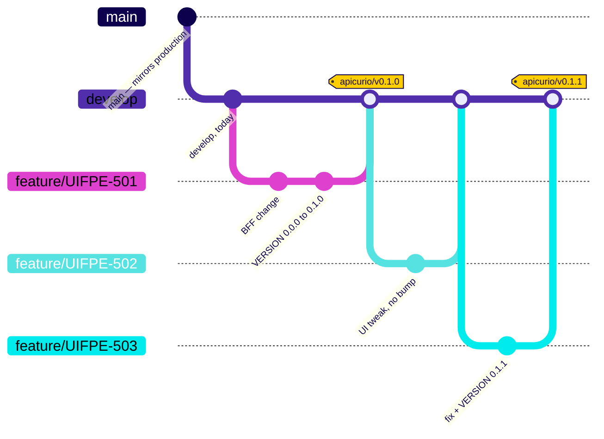
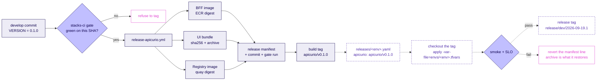

# Apicurio release identity — build tag, release manifest, promotion

- Status: Design agreed 2026-09-19. Half 1 approved for implementation; Half 2 specified, not built.
- Scope: `stacks/apicurio/` — how a build gets an immutable, promotable identity.
- Implements: the rule ADR-0019 marks **settled** ("Version at the deployable capability
  boundary"), for Apicurio. Tracked on UIFPE-456; this work rides UIFPE-36.
- Rubric: UIF Engineering Delivery Guide, **CI/CD** and **Build & Release** tabs
  (read in full 2026-09-19).

## What this is, in plain language

Today nobody can answer "what exactly is running in Apicurio's dev environment?" without
reading a deploy log. There are **zero** tags on `origin`, no release manifest, and no
version number that means anything — `src/pyproject.toml` and `ui/package.json` each say
`0.1.0` independently, which is worse than saying nothing.

This design gives Apicurio one release identifier, `apicurio/vX.Y.Z`, that names an exact,
reproducible set of artifacts. It splits into two halves. **Half 1** — build identity — is
buildable today and is what we are implementing: a declared version, a git tag, and a
manifest that binds the three things Apicurio actually ships to the commit that produced
them and the CI gate that passed on it. **Half 2** — promotion identity — is specified here
but blocked on things outside this stack: a second environment to promote into, and
ADR-0019 being accepted.

## What the guide settles, and we therefore do not re-debate

Read from the CI/CD and Build & Release tabs, 2026-09-19:

- **Two tags answer two different questions.** A build tag `<component>/v<semver>` answers
  *what code went into this artifact?*. A release tag `release/<env>/<date>.<n>` answers
  *what was deployed, where, and when?*. The release tag's message embeds the manifest, and
  its date stamps `fixVersion` on every Jira issue in the release.
- **Feature branches are never tagged.** Your work is identified by its Jira key and its
  commit, nothing else.
- **Version at the capability boundary is settled, not proposed** — and it "governs every
  stack this repository builds". All of Apicurio is one release unit. This is orthogonal to
  Apicurio's three independently *gated* deploy surfaces: gating separately and versioning
  together are compatible, and both remain true.
- **Apicurio is the guide's one legitimate example** of independent versioning:
  `apicurio/vX.Y.Z`, "the exception working as intended, not a loophole". This work is the
  worked example, not a carve-out.
- **Rollback is reverting the manifest entry**, not a redeploy.
- **The six-part build contract.** Every build produces, every time: every required
  artifact; an immutable reference plus SHA256 for each; a release manifest tying them
  together; one capability release identifier; traceability to the source commit; and
  evidence it passed the required gates.

## Current state — verified, not assumed

The guide places Apicurio in the easy column because *"Apicurio builds one container image,
and a container image is one immutable, taggable thing."* Apicurio ships **three**
deployable artifacts, and before this work only one had an immutable reference:

| Artifact | Immutable reference, before this work | Evidence |
|---|---|---|
| BFF image | Yes — ECR digest, repository is `IMMUTABLE` | landed in PR #360 |
| UI bundle | **No** — `aws s3 sync dist/ --delete` to the bucket root. Bucket versioning *is* `Enabled`, so version IDs exist and are never captured | `deploy-apicurio-dev.yml:727`, `frontend.tf:34` |
| Registry image | **No** — `quay.io/apicurio/apicurio-registry:3.3.2`, a **mutable** upstream tag | `variables.tf:105`, `ecs.tf:126` |

The UI bundle is Echo's Glue-script problem exactly — synced in place, overwritten every
deploy, no version recorded — sitting in the stack the guide calls the easy case. The
registry pin means "what is this environment running?" is unanswerable even for the
off-the-shelf half, because upstream can repoint `3.3.2` at any time.

Scored against the six-part contract, before this work: artifacts *partial*; immutable
references *1 of 3*; manifest *none*; release identifier *none* (`origin` has zero tags; the
only tag anywhere is a local `pre-rebase-UIFPE-36`); commit traceability *partial* (the
image is tagged by commit sha); gate evidence *the gate runs, and binds to nothing*.

**One blocker ADR-0019 records does not apply to us.** Its "what this does not decide"
section leaves open whether a versioned S3 prefix (`jobs/v1.4.3/`) is compatible with
`.claude/rules/naming/00-core.md`, which bans version tokens. Apicurio needs no versioned
prefix — its archive key is a **content hash** — and that rule governs *resource names*
(its examples at `00-core.md:123` are roles and functions). A git tag and an S3 version ID
are neither. Nothing here waits on that question.

## Decisions

1. **The version is declared in a file.** `stacks/apicurio/VERSION` holds one line, starting
   `0.1.0`. CI tags what it reads. Rejected: deriving it from conventional commits (infers a
   compatibility claim from a commit prefix, and commits here already carry a required
   Jira-key format) and dropping semver for a date sequence (breaks the guide's
   `v<semver>` format and the `git log apicurio/v1.4.1..apicurio/v1.4.2` idiom).
   Semver on a capability is a claim about whether consumers break; the BFF serves a
   versioned `/api/v1/` surface, so only a human who understands the change can assert it.
2. **The component is `apicurio`.** The guide uses both `apic/v2.1.0` (promotion diagram) and
   `apicurio/vX.Y.Z` (the normative exception paragraph). The second is the one making the
   rule, and CLAUDE.md says use the stack names exactly.
3. **Build tags are cut on a `VERSION` bump, not on every merge.** The bump PR *is* the
   release decision. Builds still happen on every merge touching `src/`; most never become
   releases. This is the guide's "building never implies deploying" holding.
4. **Bump `VERSION` in the same PR as the change it releases.** A standalone bump commit
   makes `stacks-ci`'s `detect` job skip most sub-jobs, so the gate passes on a commit where
   nothing was tested — technically correct (the gate counts `skipped` as a pass) and weak as
   evidence. Riding the bump with the change means the cited gate run actually exercised the
   released code. Standalone bumps stay legal for re-releasing; they are not the habit.
5. **The manifest lives in the annotated tag's message**, mirrored to a GitHub Release.
   Rejected: a committed manifest file, which needs CI to push to `develop` — a bot token and
   a branch-protection carve-out nine days before protection is due to be enabled.
6. **Terraform gets no artifact row.** It is source, fully identified by `git_commit`. A row
   would imply a separate immutable reference to pin, which it neither has nor needs.
7. **Contract travels with the tag; values are environment state.** `variables.tf` and the
   modules are versioned by the tag's commit. `envs/<env>.tfvars` is read from the branch
   representing the environment's desired state, the same category as `releases/<env>.yaml`.
   If tfvars rode in the tag, promoting a build from dev to prod would drag dev-era
   assumptions with it, and every CORS-origin or desired-count tweak would burn a version
   number for something that is not a release. The cost is drift between tagged module code
   and HEAD values; Terraform fails at plan time on both an unset required variable and an
   undeclared one, so drift surfaces as a red plan, never a wrong apply.
8. **A build tag's evidence is the CI gate; a release tag's is smoke and SLO.** This falls
   out of the two-tags-two-questions model rather than being imposed on it, and it is why
   Apicurio's existing `smoke` job is already the right hook for Half 2.
9. **The two soft references are fixed as part of this work**, not recorded as gaps. A
   manifest with one honest row and two soft ones is not rollback evidence; at 2am it is a
   guess with a version number on it.
10. **The UI bundle is made environment-agnostic via runtime config.** See below — without
    this, "build once, promote" is false for one of three artifacts.

## Diagram 1 — build identity on `develop` (Half 1)

This is deliberately **not** git-flow. Git-flow's release branches merging into `main` are
what the guide's standing rule forbids: *"if you find yourself merging one branch into
another to get code into an environment, stop: that is the mistake this whole model exists
to prevent."*

- One long-lived trunk, `develop`. Feature branches come from it and merge back **once**.
- Tags mark **builds**, not merges to `main`. A tag appears only where the PR bumped `VERSION`.
- Feature branches are never tagged.
- `main` takes no part. Half 1 does not touch it.



The middle merge is the one worth reading twice: it built and deployed to dev like any other
merge and produced **no release**.

## Diagram 2 — from a commit to a running environment

Solid is Half 1. Dashed is Half 2.



The build tag is where the solid path ends — *what code went in*. The release tag is where
the dashed path ends — *what was deployed, where, when*.

---

# Half 1 — build identity (implementing)

## The version file

`stacks/apicurio/VERSION` — one line, `0.1.0`. Validated on every release run: matches
`^[0-9]+\.[0-9]+\.[0-9]+$`, is strictly greater than the highest existing `apicurio/v*`
tag, and its own tag does not already exist.

`0.1.0` is the honest starting number: Apicurio runs in dev only and makes no stability
promise. The first UAT promotion is the natural `1.0.0`.

`src/pyproject.toml` and `ui/package.json` both drop to `0.0.0` with a one-line comment
pointing at `VERSION`. Neither is published to a registry, so neither carries information
today, and two independent `0.1.0`s sitting beside a real release identity is exactly the
ambiguity the guide's "Avoid" column describes. A non-version kills it without adding a sync
step that would go stale.

## The manifest

Carried in the annotated tag's message, mirrored to a GitHub Release. Values illustrative;
the schema is the specification:

```yaml
apicurio/v0.1.0:
  git_commit: 8f31a2c9e4b7d1a3f5c8e2b6d9a4f7c1e3b5d8a2
  built_at: 2026-09-19T08:32:11Z
  gate:
    check: stacks-ci gate
    run_id: 18472910334
    conclusion: success
  artifacts:
    bff_image:
      repository: <account>.dkr.ecr.eu-west-1.amazonaws.com/uif-apicurio-dev-bff-ecr-repo
      digest: sha256:4f1c...
    ui_bundle:
      sha256: 9a2e...
      archive: s3://<release-artifacts-bucket>/9a2e....tar.gz
      version_id: 3HL4kqtJ8pXo...
    registry_image:
      reference: quay.io/apicurio/apicurio-registry:3.3.2
      digest: sha256:7b3d...
```

A flat `artifacts:` map, rather than ADR-0019's type-grouped illustration
(`glue_scripts:` / `lambdas:` / `layers:`). Named entries with per-entry fields carry the
same information and mean Echo's manifest needs no schema change to fit — just more entries.
One less thing for the ADR to settle.

The manifest is **fully derivable from the tag alone**: every field comes either from the
commit or from a content hash of something built from it. Nothing depends on what CI
happened to have lying around.

## The three artifact references

**BFF image — already immutable; recorded.** The release workflow asks ECR for the image
tagged `<git_commit>` and builds only if absent — the ask-first pattern already at
`deploy-apicurio-dev.yml:422`. The repository is `IMMUTABLE`, so a re-push cannot quietly
change what a tag means.

**Registry image — add a digest pin, keep the tag as declared intent.** `variable
"registry_image"` stays exactly as it is, comment and all, because it records *what we mean*
(`3.3.2`) and why quay.io rather than Docker Hub. A new `registry_image_digest` — no
default, the same regex validation `bff_image_digest` already carries — is what `ecs.tf:126`
pulls, as `repository@digest`. The release workflow re-resolves the tag against quay
(public, no auth) and **warns loudly, recording both values**, if `3.3.2` now points
elsewhere. That is a supply-chain drift detector this stack does not have today. A warning
and not a hard failure, because upstream repointing a tag should not wedge our releases — it
should make a human decide to bump.

**UI bundle — content hash plus a retrievable archive.** The hash is
`find dist -type f ! -path 'dist/config.json' | LC_ALL=C sort | xargs -r sha256sum | sha256sum`, computed **excluding
`config.json`**: path-and-content addressed, immune to tar metadata quirks. The archive goes
to a **new, private, versioned release-artifacts bucket** (~15 lines of Terraform) under the
key `<sha256>.tar.gz` — a content address, not a version token.

That bucket is deliberate rather than reusing the UI bucket, which has two bugs:

1. `aws s3 sync dist/ --delete` (`:727`) syncs to the bucket **root**, so anything stored
   alongside the bundle is deleted on the next deploy. An archive kept there would survive
   exactly until someone shipped a UI change.
2. That bucket is a public CloudFront origin, so release evidence would be downloadable by
   anyone who guessed the path.

Separating the two avoids both, rather than papering over them with an `--exclude`.

## Runtime configuration — what makes the bundle promotable

`deploy-apicurio-dev.yml:711` builds with `VITE_API_URL: ${{ env.UI_API_URL }}`, whose value
comes from `terraform output -raw bff_api_url` at `:673`. The workflow's own comment states
the consequence: *"Compiled INTO the bundle, which is why the API Gateway has to exist
before this step, not after."*

So today's bundle **cannot be promoted** — it has dev's API Gateway URL baked in. That
collides head-on with the rule the guide calls settled. It does not hurt Half 1, where there
is one environment and the hash is still valid rollback evidence; it blocks Half 2
completely.

The fix: stop inlining the URL. Ship a `config.json` fetched at boot and written per
environment at deploy time, and have `api-client.ts` read it. The bundle becomes
byte-identical across environments — one content hash, genuinely promotable. As a bonus the
UI build then has **no AWS dependency at all**, so it can be built in the release workflow
without credentials and without the stack already existing.

`main.tsx` awaits `loadConfig()` before `createRoot().render()` and fails visibly if the
fetch fails — strictly better than today's failure mode, which the existing comment
describes: an empty URL inlined, same-origin requests, and CloudFront answering them with
`index.html`. `ui/public/config.json` carries a localhost default so the dev server and the
vitest and Playwright suites need no special handling.

**Rejected: routing `/api/*` through CloudFront as a second origin.** It would also make the
bundle portable and would kill CORS outright, but the API Gateway authorizer's IP-allowlist
path is what credentials the UI. Behind CloudFront the authorizer would see edge IPs rather
than the user's, so the allowlist would have to widen to CloudFront's published ranges. That
is a security regression, not a simplification.

## `release-apicurio.yml`

```yaml
on:
  push:
    branches: [develop]
    paths: ['stacks/apicurio/VERSION']
concurrency: { group: release-apicurio, cancel-in-progress: false }
permissions: { contents: write, id-token: write, checks: read }
```

1. **`validate`** — read `VERSION`; check the regex; assert it is strictly greater than the
   highest existing `apicurio/v*` tag; assert its tag does not exist. No credentials, fails
   fast on the common mistakes.
2. **`gate`** — poll the checks API for `stacks-ci gate` on this exact SHA until it
   concludes; proceed only on success. It **polls rather than using `workflow_run`**, because
   that trigger only fires for workflows living on the default branch, and `main` is 956
   commits behind with 2 of 28 workflows on it — the same constraint that put Beacon's
   deploys behind repo variables. When branch protection lands this stays correct; it just
   becomes belt-and-braces.
3. **`artifacts`** — OIDC into the deploy role, then resolve all three references: ECR
   ask-first for the BFF digest; `npm ci && npm run build`, hash `dist/` excluding
   `config.json`, upload `<sha256>.tar.gz`; resolve the registry tag against quay and warn on
   drift.
4. **`tag`** — assemble the manifest, `git tag -a apicurio/vX.Y.Z -F manifest.yaml`, push it,
   and mirror it to a GitHub Release whose body is the manifest.

## Changes to `deploy-apicurio-dev.yml`

The UI job's `terraform output` read at `:669` stays, but `bff_api_url` moves from a
build-time environment variable to a file written after the build:

1. `npm run build`
2. hash `dist/` excluding `config.json` — this is the bundle identity
3. write the real `dist/config.json` from the Terraform output
4. `aws s3 sync dist/ --delete`, as now

Writing it *into* `dist/` before the sync, rather than copying it afterwards, leaves no
window in which the bucket serves a localhost config and no second command to forget. The
existing "fail if `bff_api_url` is empty" guard moves to step 3 and keeps doing its job.
`config.json` takes the same `no-cache` treatment `index.html` already gets at `:730` and
joins the CloudFront invalidation path list.

After `smoke` passes, the deploy job reports which build tag it deployed, via
`git describe --tags --match 'apicurio/v*'`, so a run says `deployed apicurio/v0.1.0
(+3 commits)`. When `releases/dev.yaml` arrives it can be generated from data already
emitted, and in the meantime "+3 commits" is an honest signal that dev is ahead of its last
release.

## Repository settings this needs (owner approval)

**A tag-protection ruleset on `apicurio/*`**, so only this workflow and admins can create or
delete those tags. Without it the manifest's immutability is convention — anyone with write
access can move a tag. Verified 2026-09-19: the repository has two rulesets,
`allowable_authors` and `allowable_committers`, both targeting **branches**; nothing targets
tags. Best grouped with the 2026-09-28 branch-protection work rather than done piecemeal.

---

# Half 2 — promotion identity (specified, not built)

**Release tag.** `release/<env>/<date>.<n>` — e.g. `release/uat/2026-10-02.1` — created when
a promotion completes. Its message embeds the manifest of the build tag it promoted, and its
date stamps `fixVersion` on every Jira issue in the release. Its evidence is **smoke and
SLO**.

**Promotion manifest.** `releases/<env>.yaml`, one line per stack:

```yaml
apicurio:
  build: apicurio/v0.1.0
```

Promoting changes that one line. Nothing rebuilds. Rollback reverts that line — which is why
the archive in the release-artifacts bucket has to exist: reverting a line has to have
something to point at.

**Deploying a tag.** Check out the tag's commit for the Terraform module code; read the
manifest from the tag message; pass `bff_image_digest` and `registry_image_digest` in as
variables; sync the UI from `<sha256>.tar.gz`; `terraform apply -var-file=envs/<env>.tfvars`.
Per decision 7: contract travels with the tag, values are environment state.

## What blocks Half 2

1. **A second environment.** Promotion needs somewhere to promote *to*. Apicurio has only
   `backends/dev.hcl` and `envs/dev.tfvars`. Blocked on UAT/prod account IDs, surveyed
   network values, and the five mandatory tag values.
2. **Enforceable release authority.** The guide restricts manifest edits to a designated
   release owner per stack. Verified 2026-09-19: the only GitHub Environments are `copilot`
   (no protection rules) and `dev` (`branch_policy`, **no reviewers**); there is no `uat` or
   `prod` environment. Until someone is named, "restricted" is a sentence in a document.
3. **ADR-0019 acceptance.** Still `Status: Proposed (2026-09-18) — not yet decided`,
   `Deciders: TBD`. Half 1 does not need it — it implements the rule the ADR marks settled.
   Half 2 creates `releases/`, whose schema binds Echo, Beacon and Harbor; that is not
   Apicurio's call to make unilaterally.
4. **Tag protection**, as above.

One thing that *was* a blocker no longer is: the UI bundle's baked-in API URL, fixed in
Half 1.

## Open questions for others — raise, do not resolve here

1. **`main` advancing.** The guide says both *"nothing is ever merged again"* and *"main
   mirrors production"*, and offers `git diff main develop` as "built but not yet in
   production" — which requires `main` to advance somehow. Whether that is a fast-forward at
   promotion or something else is not stated. Per CLAUDE.md, an apparent contradiction
   between two pieces of existing guidance is asked about, not silently resolved. Half 1 does
   not touch `main`, so nothing here is blocked on the answer.
2. **`apic` vs `apicurio`.** The guide's promotion diagram says `apic/v2.1.0`; its exception
   paragraph says `apicurio/vX.Y.Z`. We follow the second (decision 2); the diagram wants a
   fix.
3. **"Apicurio builds one artifact."** The premise placing Apicurio in the easy column. It
   builds three, and two had no immutable reference before this work. Worth correcting on the
   Build & Release tab, because it is the reason the UI bundle's version gap went unnoticed.

## References

- UIF Engineering Delivery Guide — CI/CD and Build & Release tabs, read 2026-09-19
- `architecture-design/decisions/0019-build-tag-release-manifest-for-non-container-artifacts.md`
- `.github/workflows/deploy-apicurio-dev.yml`, `.github/workflows/stacks-ci.yml`
- `stacks/apicurio/infrastructure/terraform/{variables.tf,ecs.tf,bff.tf,frontend.tf}`
- `.claude/rules/naming/00-core.md:123`
