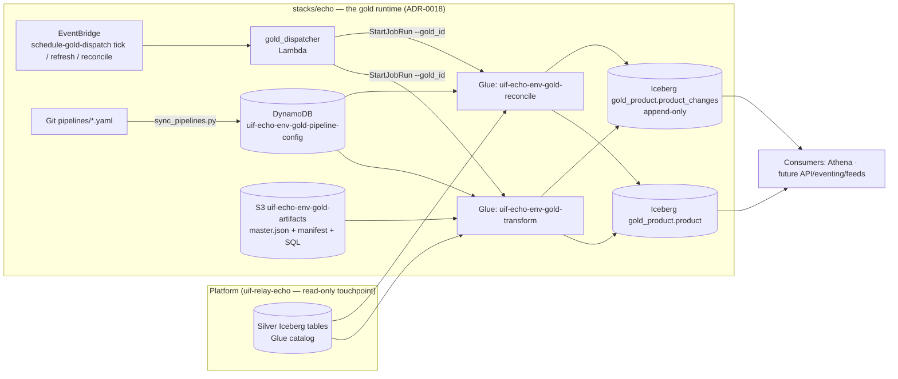

# Low-Level Design — UIF Silver→Gold Module (`stacks/echo`)

| | |
|---|---|
| **Status** | Approved design, implementation complete (pre-cutover) |
| **Version** | 1.0 |
| **Date** | 2026-07-22 |
| **Owners** | reyasahamed.habibrahman@pearson.com · raj.karunakaran@pearson.com |
| **Repository** | https://github.com/pearson-dnt-coe/universal-Integration-framework — the runtime is `stacks/echo` (ADR-0018); `uif-dal-gold` is retired |
| **Related** | ADR-0001 (Gold foundations) · ADR-0003 (Incremental CDC) · ADR-0004 (Independent control plane) — all under `docs/adr/` |
| **Platform reference** | https://github.com/pearson-dnt-coe/uif-relay-echo (Bronze/Silver + UI, other team, read-only) |

---

## 1. Purpose & Scope

The Silver→Gold module materializes **business entities** (Product first) from
Silver-layer Iceberg tables into a consumer-facing Gold layer, incrementally,
with per-channel change detection so downstream consumers (API, eventing,
data feeds) each know precisely when *their* view of an entity changed.

**In scope:** Gold entity materialization + hard-delete reconciliation, the
change-detection/CDC engine, the Gold control plane (pipeline configuration),
Gold scheduling, Gold infrastructure (Terraform), CI/CD.

**Out of scope:** Oracle→Bronze→Silver ingestion and the admin UI (platform
repo, other team); the outbound publishers themselves (Autobahn eventing,
pull API — future phases; this design defines the contract they consume).

## 2. Architecture Overview



**Independence model (ADR-0004):** the module runs end-to-end with no calls to
the platform's code or API. Shared infra primitives are reused by reference:
the standard estate's `uif-echo-{env}-glue-role` execution role, its
`uif-echo-{env}-data` bucket (our objects under `code/gold/` only), and its
`uif-echo-{env}-pipeline-metrics` table -- shared with its silver jobs rather
than copied per layer. The only data touchpoint is reading Silver Iceberg via the Glue catalog.

## 3. Data Model

### 3.1 Naming convention

Gold business columns are **camelCase** (`inventoryItemId`, `lineOfBusiness`) —
JSON-first consumer model. Framework metadata columns keep an underscore
prefix (`_channel_hashes`). Note: Athena lowercases unquoted identifiers
(cosmetic only; queries are case-insensitive).

### 3.2 Entity table — `gold_product.product`

Grain: **1 row per (inventoryItemId, organizationId)** — point-in-time state (no SCD2;
history via Iceberg time-travel, bounded by snapshot retention).

| Column | Type | Notes |
|---|---|---|
| `inventoryItemId` | BIGINT | `MTL_SYSTEM_ITEMS_B.INVENTORY_ITEM_ID`, natural key pt 1 |
| `organizationId` | BIGINT | `ORGANIZATION_ID`, natural key pt 2 |
| `productId` | STRING | `SEGMENT1` (item number) |
| `isbn10`, `isbn13` | STRING | conditional source by catalog group (Digital = 10002) |
| *…business attributes grow by config PR (see §6)* | | ~27 additional attributes approved via the mapping workbook |
| `_channel_hashes` | MAP<STRING,STRING> | per-channel SHA-256 (D4); key `canonical` gates the MERGE |
| `_gold_updated_at` | TIMESTAMP | moves ONLY on real business change |
| `_gold_run_id` | STRING | Glue run that last changed the row |

Iceberg v2, `merge-on-read`, location `s3://uif-echo-{env}-gold/product/`.

### 3.3 Change log — `gold_product.product_changes`

Append-only, payload-free, partitioned by `change_date`:
`(inventoryItemId, organizationId, op [INSERT|UPDATE|DELETE|BOOTSTRAP|BACKFILL],
changed_channels ARRAY<STRING>, run_id, _gold_updated_at, change_date)`.
Retention `retention.changes_days` (365) — decoupled from entity snapshot
expiry (`snapshot_days`, 14).

## 4. CDC Engine (ADR-0003) — `generic_gold_transform.py` + `gold_cdc.py`

Runtime flow per run (library `gold_cdc.py` holds all pure logic, shipped via
`--extra-py-files`, unit-tested without Spark):

1. **Load** config (DynamoDB) + master.json + manifest + SQL (S3); validate
   `key_mapping` (every source) and `array_sort_keys` (every ARRAY property).
2. **Maintenance diff** — registries in config vs schema:
   - new channel in `x-channels` → silent hash backfill (`map_concat`), no
     `_gold_updated_at` movement, no log rows; cursor seeded to now.
   - new attribute in `master.json` → auto-DDL `ADD COLUMN … AFTER <last business column>` so the metadata columns stay last (JSON-Schema→Spark
     type map; `number+format:float/double` → FLOAT/DOUBLE), full-key rebuild,
     one UPDATE setting new columns + recomputing ALL hashes (mandatory — stale
     hashes would flood the next run). Modes: `silent` (default) | `emit`.
3. **Phase 1 — detect** per source: scan `watermark_col > watermark[alias]`
   (per-source watermarks, D2), project changed rows to affected Gold keys via
   the manifest `key_mapping` (PK-subset sources fan out, e.g. item-level →
   all orgs). Union → `affected_keys`; none → no-op success.
4. **Phase 2 — rebuild**: register FULL (unfiltered) temp views for all
   sources; semi-join only the driving source to `affected_keys`; run the
   mapping SQL unchanged → complete, internally consistent entities. (This
   fixes the filtered-join bug: lost changes / NULL-clobbering.)
5. **Hash diff**: compute `_channel_hashes` (SHA-256 over sorted-property JSON,
   `hash_spec_version=1`), LEFT JOIN to current Gold, derive `changed_channels`
   per row; rows with an unchanged `canonical` hash are dropped (no-op skip).
6. **Ordering guarantee (D6)**: append verdicts to `product_changes` **first**,
   then MERGE (`WHEN MATCHED AND canonical hash IS DISTINCT FROM … THEN UPDATE`),
   then advance per-source watermarks atomically in one DynamoDB update.
   Crash ⇒ duplicates, never gaps (consumers dedupe on `(pk, run_id)`).
7. **Guardrail**: warn when affected entities exceed `glue.max_affected_fraction`
   (default 0.5) of the table. Metrics row per run to the shared metrics table.

`--rebuild=true` drops + CTAS-rebuilds the table; change-log **silent** by design.

**Reconcile** (`generic_gold_reconcile.py`, nightly): anti-join Silver
source-of-truth PKs vs Gold → orphan rows deleted (dry-run + `max_deletes_per_run`
caps), appending `DELETE` verdicts to the change log before the delete MERGE.

## 5. Outbound Contract (for future publishers)

Per-channel cursors (`publish_cursors` in config). Incremental consumption:
`SELECT … FROM product_changes WHERE array_contains(changed_channels, :ch) AND
_gold_updated_at > :cursor`, join back to `product` for payload, project the
channel's attributes (published tier subsets), emit, advance cursor.
Full load = snapshot read of `product`; replay = cursor reset; point-in-time =
Iceberg time-travel. Channels are isolated — no replay affects another.

## 6. Control Plane (ADR-0004 — config-as-code first)

- **Definitions in Git**: `pipelines/base/{gold_id}.yaml` deep-merged with
  `pipelines/overlays/{env}/{gold_id}.yaml`.
- **`scripts/sync_pipelines.py`**: validates (`scripts/gold_config.py` —
  required fields, exactly one source-of-truth, watermark shape, mode enums,
  frequency enum), auto-initializes defaults, **plans by default / writes with
  `--apply`**, **never overwrites runtime-owned fields** (watermarks, channel
  registry, materialized properties, cursors, run metadata), never deletes
  unmanaged items. Paginated scan.
- **`scripts/register_gold_pipeline.py`**: ad-hoc/dev registration — uploads
  schema/mapping artifacts to `uif-echo-{env}-gold-artifacts`, validates, writes
  DynamoDB directly. No platform API involved.
- Schema/mapping authoring stays Git-atomic (ADR-0001): `master.json` +
  `canonical_lineage` + `output_columns` + SQL change in one PR; CI validates
  conformance, lineage coverage, tier subsets, `key_mapping` and sort-key lints.
- **Adding an attribute or channel is a config PR** — the maintenance diff
  (§4.2) handles DDL and backfill automatically at the next run.

## 7. Scheduling — `lambda/gold_dispatcher.py`

EventBridge → Lambda → `glue.StartJobRun`:

Since UIFPE-149 (2026-08-11) scheduling is **per pipeline**, not per rule. There
are only two rules:

| Rule (uif-echo-{env}-schedule-gold-dispatch-*) | Cron (UTC) | Payload | Does |
|---|---|---|---|
| tick | `0/5 * * * ? *` | `gold-tick` | transform sweep — dispatches every pipeline whose slot has arrived |
| reconcile | `30 3 * * ? *` | `gold-reconcile` | orphan hard-delete detection, for configs with `reconcile.enabled = true` |

Each pipeline declares its own schedule in `pipelines/base/<domain>.yaml`:

```yaml
schedule:
  frequency: gold-4h        # how often — one of eleven rungs, 5m … 24h
  start_time: "14:45"       # from when, UTC. QUOTE IT (see below)
  failure_cooldown_minutes: 30
```

Two daily tables can now run at different times; before this, each cadence was a
single shared rule and they could not. The authoritative list of rungs — their
intervals, default start times, labels and the slot arithmetic — is
`src/apps/scripts/gold_frequencies.py`. `qe/test_gold_frequency_parity.py` fails
CI if Terraform or the UI drifts from it, and `qe/fixtures/schedule-slots.json`
is a shared vector that the Python and TypeScript slot implementations both
assert.

**Quote `start_time`.** YAML 1.1 (which PyYAML implements, and `sync_pipelines.py`
uses PyYAML) parses an unquoted `6:30` as the sexagesimal integer 390. The
compiler always writes quotes and `gold_config.validate` rejects a non-string,
so this is defended twice — but hand-editing is where it would bite.

**Due-ness is slot-based.** A pipeline's slots are `start_time + k × interval`;
it is due when its last scheduled run started before the most recent slot. Every
interval divides 1440 minutes, so the slots tile the day exactly — no short gap
at midnight, and `start_time` phases the grid rather than delaying the first run
(14:45 on `gold-4h` gives 02:45/06:45/…/22:45). Three properties follow:

- a skipped sweep loses nothing — the next one computes the same slot;
- the phase never drifts, being derived from `start_time`, not from the last run;
- a job that overruns its interval builds no backlog.

A config's cadence is resolved through alias normalization (`gold` → `gold-24h`,
`gold-hourly` / `gold-60m` → `gold-1h`) with per-cadence default start times that
preserve the historical clocks, which is what keeps a live pipeline dispatching
through the deploy-order window when Terraform has been applied but configs have
not been re-synced.

**In-flight guard.** A `gold_id` with an unfinished run
(`STARTING`/`RUNNING`/`STOPPING`/`WAITING`) is skipped, checked across BOTH job
names so a transform and a reconcile can never overlap on one entity. The run
history walk is bounded by the largest configured Glue timeout plus a margin —
nothing older can still be running — because an unbounded walk on every sweep is
what throttles, and a throttled guard is no guard.

The guard **fails closed** for every cadence: if it cannot be verified, nothing
dispatches (alarm on `GOLD_DISPATCH_GUARD_FAIL_CLOSED`). That inverted the
earlier fail-open posture and is only safe because slot-based due-ness makes a
refused sweep cost minutes of lateness rather than a whole run. Maintenance runs
(`--refresh_columns`, `--rebuild`) block the guard but never satisfy a slot.
Separately, `schedule.failure_cooldown_minutes` (default 30) holds off the next
sweep after a failed run — the guard blocks unfinished runs, never failed ones.

Duplicate EventBridge delivery can still stack a run: the guard is
check-then-act with no lock. Bounded damage (idempotent hash-gated MERGE,
consumers dedupe on `(pk, run_id)`); the fix would be a DynamoDB lease, which
is deliberately not taken — see `CLAUDE.md`.

Worker sizing from `cfg.glue` (defaults G.2X×16 transform, G.1X×4 reconcile).

## 8. Configuration Reference (DynamoDB item, key fields)

```jsonc
{
  "gold_id": "product", "version": "latest", "enabled": true, "domain": "product",
  "schema":  { "master_s3_path": "s3://uif-echo-dev-gold-artifacts/schemas/gold/product/v1/master.json", "version": "v1" },
  "mapping": { "manifest_s3_path": "…/manifest.yaml", "sql_s3_path": "…/sql/product.sql" },
  "sources": [ { "alias": "items", "silver_table": "silver_product.mtl_system_items_b",
                 "watermark_col": "_silver_updated_at", "is_source_of_truth": true } ],
  "target":  { "database": "uif_echo_{env}_gold_product", "table": "product",
               "s3_path": "s3://uif-echo-dev-gold/product/",
               "primary_key_cols": ["inventoryItemId", "organizationId"] },
  "schedule": { "frequency": "gold-24h", "failure_cooldown_minutes": 30 },
  "watermark": { "bookmark": "…", "silver_snapshots": { "items": "…", "items_ext": "…" } },
  "channels": { "registered": [], "bootstrap_mode": "silent" },
  "materialized_properties": [], "backfill_mode": "silent",
  "publish_cursors": {}, "hash_spec_version": 1,
  "retention": { "changes_days": 365, "snapshot_days": 14 },
  "reconcile": { "enabled": false, "dry_run": true, "max_deletes_per_run": 5000 },
  "glue": { "worker_type": "G.1X", "num_workers": 8, "timeout_minutes": 180,
            "max_affected_fraction": 0.5,
            "full_load": { "worker_type": "G.2X", "num_workers": 8,
                           "timeout_minutes": 180 } },
  "snapshot_gate": true
}
```

`key_mapping` (change→key projection) and `array_sort_keys` live in the Git
mapping manifest, atomic with the SQL (ADR-3). Registries/watermarks/cursors
are runtime-owned — populated by the jobs, preserved by sync.

## 9. Infrastructure (Terraform, `infra/`)

| Resource | Name (dev) | Ownership |
|---|---|---|
| Glue job (transform) | `uif-echo-dev-gold-transform` | **this repo** (import at cutover) |
| Glue job (reconcile) | `uif-echo-dev-gold-reconcile` | **this repo** (import at cutover) |
| Config table | `uif-echo-dev-gold-pipeline-config` | **this repo** (import at cutover) |
| Dispatcher Lambda + role | `uif-echo-dev-gold-dispatch` | **this repo** (new) |
| EventBridge rules | `uif-echo-dev-schedule-gold-dispatch-{tick,refresh,reconcile}` | **this repo** (new) |
| Glue execution role | `uif-echo-dev-glue-role` | the standard estate's, shared with its silver jobs (data-source lookup) |
| Scripts bucket | `uif-echo-dev-data` — our keys under `code/gold/` | the standard estate's, beside silver's `code/` |
| Metrics table | `uif-echo-dev-pipeline-metrics` | the standard estate's, shared with silver |
| Gold buckets (`aws_s3_bucket.gold`, `aws_s3_bucket.gold_artifacts`) | `uif-echo-dev-gold`, `uif-echo-dev-gold-artifacts` | **this repo** (import at cutover) |

State: S3 backend key `echo-gold/{env}/terraform.tfstate` (isolated from the
platform's `echo/{env}/` keys). Environments are a **picklist**
(`environments.json`) consumed by scripts, Makefile, and the Terraform
`environment` validation — adding an env is a JSON + tfvars/backend change.

**Why the `gold/` prefix is mandatory:** the platform deploy runs
`aws s3 sync … glue_jobs/ --delete`; anything of ours under `glue_jobs/`
would be purged. `gold/` is outside that sync's scope.

## 10. CI/CD & Branching

| Branch | Role | Deploys to |
|---|---|---|
| `develop` | working branch | **dev** (automatic on push) · **uat** (manual) |
| `main` | prod version | **uat** (manual — incl. revert-to-prod) · **prod** (manual, plan-first, explicit `apply=yes`) |

Branch→env rules are enforced by `if: github.ref` guards in the workflows.
Deploy sequence — this is what the DEV WORKFLOW runs unattended on every push to
`develop`, not a manual runbook: test gate → `terraform apply` → scripts to the
`gold/` prefix → artifacts to `uif-echo-{env}-gold-artifacts` (per entity) →
`sync_pipelines.py --apply` → UI. Order matters for the same reason it always
did (version skew), and it is the workflow that guarantees it. Because
`terraform apply` runs with no human reviewing the plan, read `make plan` before
merging and time the merge away from the schedule's ticks — see
`../CLAUDE.md`.

**Cutover latch:** repo variable `PRODUCT_DEPLOY_ENABLED` (renamed from the
source repo's `DEPLOY_ENABLED` — scoped per domain in the monorepo). It is SET
for dev, so dev deploys are live; uat/prod are `workflow_dispatch`-only and still
latched, where the job hard-fails with an error. Dev instead SKIPS with a notice
when the variable is unset. CI (tests, terraform validate) runs on pushes and
PRs; schema **validation** runs on both branches, registry **publish** on `main`
only.
Setup required: GitHub environments `dev/uat/prod` with `AWS_ROLE_ARN_*`
OIDC secrets; branch protection on `main` recommended.

## 11. Cutover Runbook (one-time, per env — ADR-0004 §CP-5)

1. Platform team: disable their 3 gold EventBridge rules; `terraform state rm`
   the gold resources; delete gold code/TF from their repo.
2. This repo: `make init ENV=dev` → `terraform import` (jobs, config table,
   buckets — names unchanged, e.g. `terraform import aws_s3_bucket.gold
   uif-echo-{env}-gold` and `terraform import aws_s3_bucket.gold_artifacts
   uif-echo-{env}-gold-artifacts`) → `make plan` (expect: new script objects at
   `gold/`, dispatcher stack, in-place job updates) → `apply`.
3. `python scripts/sync_pipelines.py --env dev --apply`.
4. Verify: invoke dispatcher `{"frequency":"gold-tick"}` → transform run green
   end-to-end; delete legacy `glue_jobs/generic_gold_*.py` objects.
5. Set `DEPLOY_ENABLED=true`.

**Until step 1 completes, `terraform apply` must not run.** First transform
run after cutover auto-migrates the existing dev table: adds metadata columns,
backfills hashes, expands the legacy scalar watermark — no manual steps.

## 12. Error Handling & Operational Notes

- **Delivery semantics:** at-least-once into the change log (log→MERGE→watermark
  ordering); duplicates possible on crash-rerun, gaps impossible. Consumers
  dedupe on `(pk, run_id)`.
- **Failed runs** never advance watermarks → automatic reprocessing; hash gate
  makes reprocessing idempotent.
- **Metrics** per run (status, affected_keys, rows_written, duration) in the
  shared metrics table, TTL 90 days.
- **Safety caps:** reconcile `max_deletes_per_run` + `dry_run`; transform
  `max_affected_fraction` warning; sync never deletes; destructive ops need
  explicit flags throughout.
- **Known lifecycle events:** re-tiering an attribute or bumping
  `hash_spec_version` triggers a silent table-wide hash recompute; source-clone
  refreshes in lower envs require the watermark-reset runbook (platform scope).

## 13. Open Items

| Item | Owner | Status |
|---|---|---|
| Gold cleanup + EventBridge disable in platform repo | Platform team | agreed, pending |
| Cutover execution (§11) + `DEPLOY_ENABLED=true` | Both | **dev DONE** 2026-08-04 / 2026-08-11; uat+prod pending |
| GitHub env secrets (`AWS_ROLE_ARN_*`), branch protection on `main` | Us | **dev DONE** — `AWS_ROLE_ARN_DEV` set and the role trusts this repo's ID-QUALIFIED OIDC subjects (`repo:…@183024320/…@1308482856:environment:dev`; the unqualified form never matches on GHEC). uat+prod pending |
| UAT/prod AWS environments (backends are placeholders) | Us | future |
| Product attribute batch (~27 attrs incl. conditional Digital-Catalog split, UK-org proliferation, contributors array) | Us | mapping approved, implementation next |
| Outbound publishers (Autobahn eventing, pull API) | Us | future phase — contract ready (§5) |
