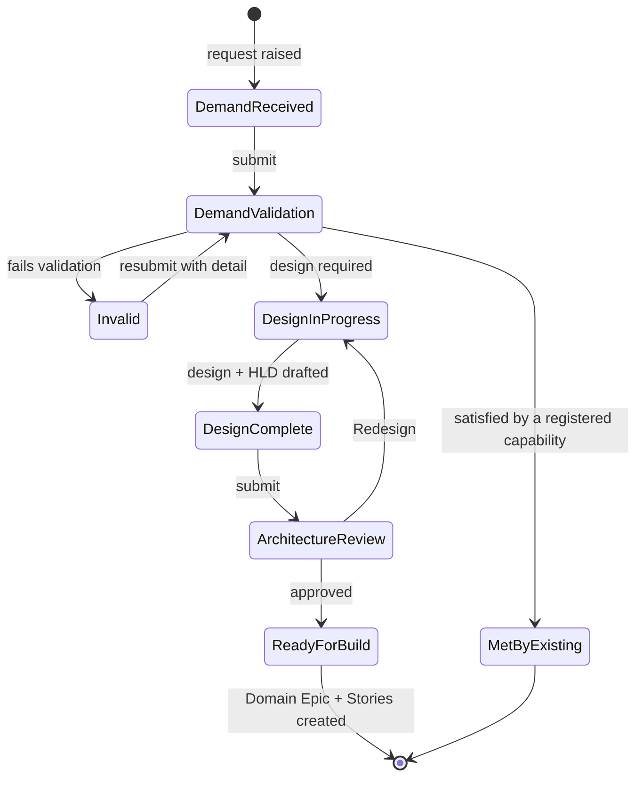

# Demand workflow — intake to Ready for Build

This document defines how a request for new integration work enters UIF, gets validated, gets designed, passes architecture review, and becomes buildable delivery work. It is the stage *before* the delivery backlog: a Demand ends where a Domain Epic begins.

Plain-language version for a PM or UX Lead: today a request for "we need an integration to system X" can arrive by any route and go straight into someone's sprint. This workflow forces two questions to be answered first — *is this demand real and complete?* and *can something we already built satisfy it?* — and only then allows design and build. The second question is the whole point. Pearson's Enterprise Blueprint targets a **66% cumulative reduction** in legacy integrations by reuse; a workflow with no state for "this demand is met by something that already exists" cannot deliver that, because every demand structurally ends in a new build.

**Where this sits in the model.** JPD answers WHY at portfolio scale (Idea → Opportunity → Initiative). This workflow answers *should we build this, and what is it* for a single concrete request. Delivery work (Story, Task, Sub-task) parents to a **Domain Epic** per the single-owning-parent rule (`../capabilities/docs/capability-domain-jira-map.md`). Demand is upstream of all of it — which is why nothing here needs a Story parent, and why `Ready for Build` is precisely the point at which the Domain Epic and its Stories get created.

---

## 1. The state machine



Eight statuses. Two of them are terminal (`Invalid`, `Met by Existing Capability`), and one of those is a metric rather than a failure.

### Two things that are deliberately *not* statuses

**"Is design required?" is a gate, not a state.** Modelling it as a status creates something that means "we have not decided yet", which is indistinguishable from `Demand Validation` — two statuses with one meaning, and cycle-time reporting that splits arbitrarily between them. It is the branch *out of* `Demand Validation`.

**`Redesign` is a transition, not a status.** It is semantically identical to `Design In Progress`: same work, same owner, same exit criteria. As a separate status, design effort splits across two buckets and the question "how long does design actually take" becomes unanswerable. Model it as a transition named `Redesign` that returns the issue to `Design In Progress` and increments `Rework Count`, so rework is measured instead of hidden.

## 2. Exit gates per status

A gate is what must be true to *leave* a status — not what happens in it.

| Status | Exit gate | Owner |
|---|---|---|
| Demand Received | Requester, business outcome, consuming system, and target date all present | Requester |
| Demand Validation | Reuse search performed and recorded; capability span named; classified valid / invalid / met-by-existing | PM + Solution Architect |
| Invalid | *Terminal, reopenable* — reason recorded as text, not merely a status change | PM |
| Met by Existing Capability | *Terminal* — names the specific registered contract that satisfies the demand | Solution Architect |
| Design In Progress | HLD drafted; capability span confirmed; security and observability posture stated | FDE + Solution Architect |
| Design Complete | HLD is reviewable in version control, not an image pasted into a comment | FDE |
| Architecture Review | Checked against the engineering principles; approved or returned via `Redesign` | Solution Architect |
| Ready for Build | Domain Epic exists; Stories carry `capability:*` labels | PM + FDE |

Security and observability appear as a **design-time gate**, not a later review, because `../CLAUDE.md` makes them design inputs: "A design that doesn't state its security posture and its observability signals isn't finished."

## 3. Gates must be fields, or they cannot be enforced

This is the part that makes the workflow configurable rather than aspirational. **Jira can only test fields.** "Reuse search done" is not configurable; "Reuse Outcome is not empty" is. Every gate above therefore has to be reified as an artifact — replace the verb with the thing it produces.

| Gate | Field | Type | Notes |
|---|---|---|---|
| Requester | Reporter | *built-in* | — |
| Business outcome | `Business Outcome` | Paragraph | — |
| Consuming system | `Consuming System` | Short text | — |
| Target date | Due date | *built-in* | — |
| Reuse search done | `Reuse Outcome` | Select | `Reuse` · `Partial` · `None` |
| Reuse candidate named | `Satisfying Contract` | Short text | Apicurio `group:artifact` coordinate, or repo path |
| Capability span named | `Capability Span` | Multi-select | The thirteen capability names, exactly |
| Invalid reason recorded | Resolution + `Invalid Reason` | *built-in* + Paragraph | — |
| HLD drafted / reviewable | `HLD Link` | **URL** | See below |
| Security posture stated | `Security Posture` | Paragraph | — |
| Observability posture stated | `Observability Posture` | Paragraph | — |
| Principles checked | `Principles Reviewed` | Checkbox | — |
| Approved or redesign | `Review Outcome` | Select | `Approved` · `Redesign` |
| Rework measured | `Rework Count` | Number | Incremented by automation |
| Domain Epic exists | Parent / issue link | *built-in* | — |

Twelve new custom fields; Reporter, Due date, Resolution and Parent are built-ins. Resist adding more — every field is something a human must fill before the card will move, and an unfillable gate gets bypassed rather than satisfied. If a field is not named as a gate in §2, it does not belong here.

**Why `HLD Link` is a URL field, specifically.** "Reviewable in version control, not an image in a comment" reads as unenforceable prose, but as a URL it becomes a regex test: does the value start with `https://github.com/pearson-dnt-coe/universal-Integration-framework/`? A Confluence attachment or a pasted screenshot fails it. This is the general technique for every soft-sounding gate in this document — find the artifact, type the field, test the value.

The HLD itself is **Mermaid committed to `../architecture-design/`**, per `../CLAUDE.md`'s preference for text-renderable diagrams. An image cannot be diffed or reviewed, and Architecture Review is a review. Use the Pearson palette and Plus Jakarta Sans if the diagram is rendered for a deck.

## 4. Validators enforce; Automation reacts

Both tools are needed, and using the wrong one is the most common way this workflow ends up decorative.

| Tool | Blocks a transition? | Use it for |
|---|---|---|
| Workflow **Validator** | **Yes** — refuses the move | The exit gates in §2 |
| **Automation** rule | No — fires *after* the event | Revert-and-explain fallback, derived work, notifications, metrics |

UIFPE is a **company-managed** project (the project REST resource reports `simplified: false`), so the full workflow editor — Conditions, Validators, Post-functions — is available. A team-managed project would not have validators at all, and the entire §2 table would have to fall back to the reactive pattern below.

### 4a. Hard gate — the preferred form

Project settings → Workflows → edit the Demand workflow → select the transition → **Validators** → add a field-required validator per gate field. Then **publish the draft**.

| Transition | Validator requires |
|---|---|
| Submit (Demand Received → Demand Validation) | `Business Outcome`, `Consuming System`, Due date |
| Design required (Demand Validation → Design In Progress) | `Reuse Outcome`, `Capability Span` |
| Met by existing (Demand Validation → Met by Existing Capability) | `Reuse Outcome`, `Satisfying Contract` |
| Fails validation (→ Invalid) | `Invalid Reason` |
| Design drafted (Design In Progress → Design Complete) | `HLD Link`, `Security Posture`, `Observability Posture` |
| Submit for review (Design Complete → Architecture Review) | `HLD Link`, `Capability Span` |
| Approved (Architecture Review → Ready for Build) | `Principles Reviewed`, `Review Outcome` |

Jira Cloud exposes a limited validator set, and the exact available validators vary by instance. Verify what your instance offers before assuming a gate is covered; where the validator you need does not exist, use 4b for that gate only.

### 4b. Soft gate — the universal fallback

Where no validator fits, let the transition happen and immediately reverse it. Worked example for Design Complete → Architecture Review:

| Step | Configure |
|---|---|
| **Trigger** | *Issue transitioned* → to **Architecture Review** |
| **Condition** | Issue type = `Demand` |
| **Condition** | **JQL**: `"HLD Link" is EMPTY OR "Capability Span" is EMPTY OR "Security Posture" is EMPTY` |
| **Action** | *Comment*: `Returned to Design Complete — Architecture Review requires HLD Link, Capability Span, and Security Posture. See jira/demand-workflow.md §2.` |
| **Action** | *Transition issue* → **Design Complete** |

Use **one JQL condition** rather than stacking separate field conditions: fewer steps to misconfigure, and it reads identically to the validator's intent.

The same shape enforces the version-control rule on the HLD — condition: `HLD Link` does not match `^https://github\.com/pearson-dnt-coe/universal-Integration-framework/` → comment and revert.

### 4c. What Automation is genuinely the right tool for

Not gating. The derived work either side of a transition:

- **Ready for Build** → create the Domain Epic if one does not exist, using the shape in `../.claude/skills/domain/SKILL.md`, link it to the Demand, and set the domain Component.
- **Met by Existing Capability** → the reuse metric needs no separate stamping once `Reuse Outcome` exists as a field. The integration-reduction number becomes a query rather than a claim:
  ```jql
  project = UIFPE AND issuetype = Demand AND "Reuse Outcome" = Reuse
  ```
- **Redesign** → increment `Rework Count`.
- **Architecture Review entered** → notify the Solution Architect.

## 5. What an agent should do here, and what it must not

The reuse search is the highest-value assisted step in the entire workflow, and it is the one a human is worst at: it requires knowing every registered contract across every domain. An agent searching Apicurio coordinates and `domains/*/src/schemas/` can propose candidates in seconds.

| Step | Mechanism |
|---|---|
| Demand Received completeness | **Automation** — fields present, else comment and hold |
| Reuse search | **Agent proposes candidates; a human decides** and records `Reuse Outcome` |
| HLD diagram | **Agent drafts Mermaid; the Solution Architect owns it** |
| Architecture Review | **Human.** An agent may pre-check that each principle is *addressed*; it does not judge whether it is *satisfied* |
| Ready for Build → Domain Epic + Stories | **Automation** |

Agent actions stay advisory — comment, suggest, summarise — never transition, assign, or close. This is the same `humanInTheLoop` posture `../capabilities/agent/guidelines.md` requires of UIF's own agents; the governance UIF writes for its agents applies to the agents UIF runs on itself. A non-deterministic check cannot be a gate: an LLM may answer differently on two identical demands, and delivery cannot be gated on that. Enforcement stays in validators and JQL.

## 6. Provisioning — what is scriptable and what is not

Most of this configuration has a supported REST endpoint. **Automation rules are the exception**, and that fact should shape the design: put as much enforcement as possible into validators, which both block correctly *and* can be provisioned, and keep the Automation rule count small enough to build by hand once.

| Object | Endpoint | Scriptable |
|---|---|---|
| The twelve custom fields | `POST /rest/api/3/field` | Yes — scripted |
| Select/multi-select/checkbox options | `POST /rest/api/3/field/{fieldId}/context/{contextId}/option` | Yes — scripted |
| `Demand` issue type | `POST /rest/api/3/issuetype` | Yes — scripted |
| The eight statuses | `POST /rest/api/3/statuses` | Yes — scripted |
| Screens and field placement | `POST /rest/api/3/screens/{screenId}/tabs/{tabId}/fields` | Yes — scripted, opt-in via `--screen-id` |
| Workflow: transitions and validators | `POST /rest/api/3/workflows/create` | API exists, **not scripted** — see below |
| Workflow scheme, project association | `/rest/api/3/workflowscheme` | API exists, not scripted |
| **Automation rules** | none published | **No — UI only** |

`provision-demand-workflow.sh` in this folder performs the scripted rows. It is **dry-run by default** and requires `--apply` to write, because unlike creating an issue this writes *project-level configuration* — a much wider blast radius, and custom fields and statuses are global objects on a company-managed site. Point it at a sandbox site before UIFPE. It is idempotent: it matches on name and skips anything that already exists, so it is safe to re-run.

**Why the workflow itself is not scripted, even though an API exists.** The validators are the entire point of the workflow, and they are referenced by rule keys whose availability varies by instance. A wrong or unsupported key does not error — it produces a workflow that looks correct and enforces nothing, which is the worst outcome available. Build the workflow in the UI against §4a, where the validator picker shows what this instance genuinely supports. The script provisions everything the workflow *depends on*, so that step is pure wiring.

## 7. Build order

Do it in this order; each step depends on the one before.

1. **Run the provisioning script in dry-run**, read the planned calls, then `--apply` against a sandbox project.
2. **Verify field screen association.** A custom field that exists but is not on the `Demand` issue type's create and edit screens is invisible — people will report the field as missing. The script places fields; confirm it in the UI anyway.
3. **Publish the workflow draft.** Editing a live workflow creates a draft; unpublished changes have no effect while the board looks entirely correct.
4. **Build the §4c Automation rules by hand** — four rules, UI only.
5. **Add §4b fallbacks** only for gates where no validator was available.
6. **Verify one demand end to end** with a throwaway issue: walk it through every transition, including `Invalid` and `Redesign`, and confirm each gate actually refuses an incomplete move.

Two failure modes to watch during step 4:

- **Loops.** The revert pattern transitions an issue, which is itself a transition event. In rule details, leave **"Allow rule to be triggered by other rules" unchecked**, or the rule re-triggers itself.
- **Field names in JQL must be quoted exactly as created** — `"HLD Link"`, not `HLD Link`. A typo matches nothing and the rule silently does nothing, while appearing healthy in the rule list. Check the audit log after the first real trigger.

## Related

- Single-owning-parent rule that `Ready for Build` hands off to: `../capabilities/docs/capability-domain-jira-map.md`
- Domain Epic shape created at `Ready for Build`: `../.claude/skills/domain/SKILL.md`
- Delivery-backlog automation flows (separate from this workflow): `jira-automation-rules.md`
- The thirteen capability names used by `Capability Span`: `capability-model.md`
- Agent human-in-the-loop policy §5 applies: `../capabilities/agent/guidelines.md`
