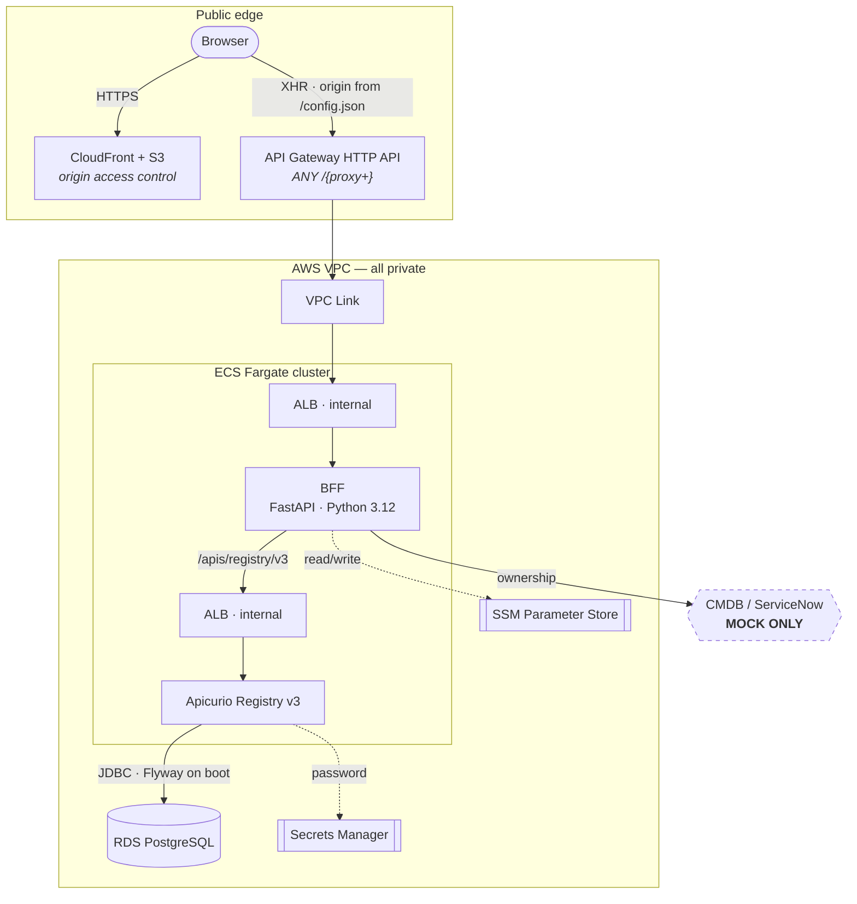
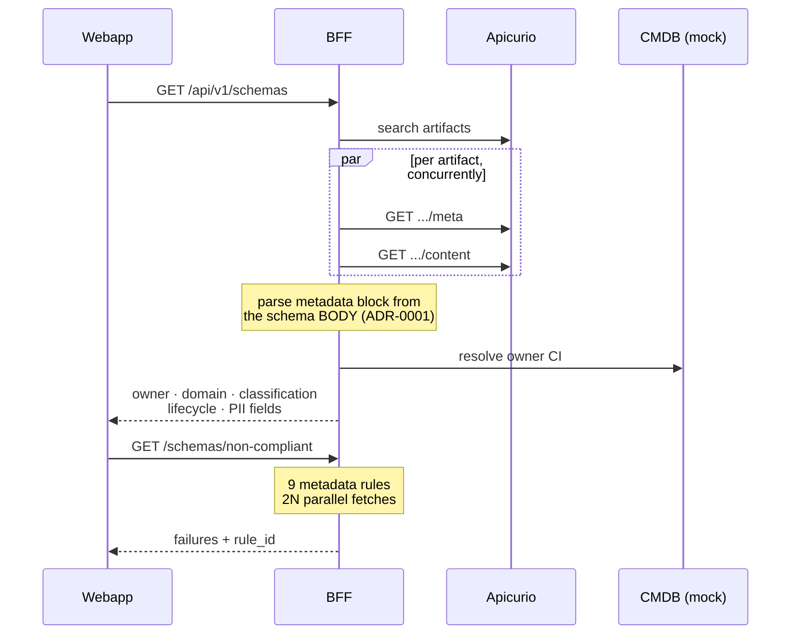
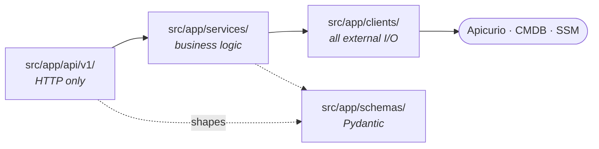
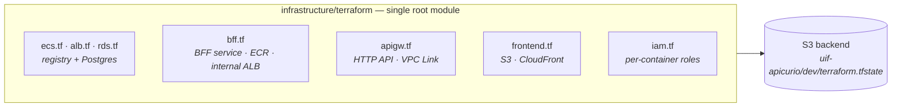
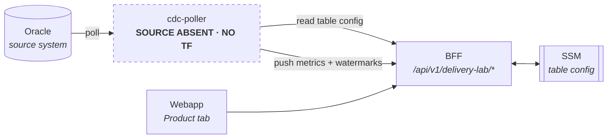
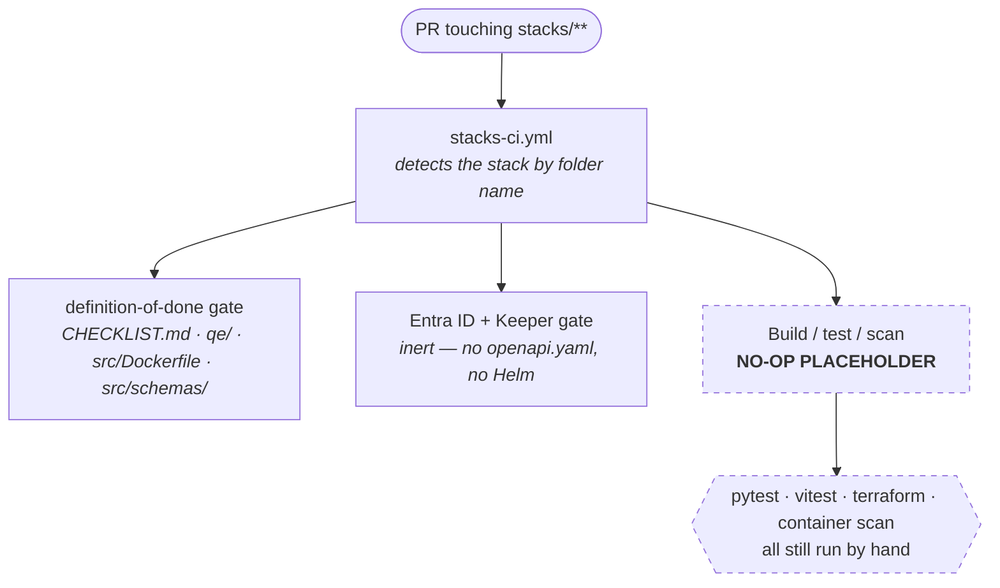

# Pearson Schema Registry — Architecture

Pearson has thousands of data contracts — the agreed shape of a product record, an enrolment event, an order API — and no single place that answers *who owns this one, is it compliant, and who breaks if I change it*. This service is that place. Apicurio Registry stores the contracts; this service wraps it in a governance API and a UI so those questions have an answer a person can act on.

> **Location and version.** This document described the service under `capabilities/schema/{api,webapp,infra}` against Apicurio **v2**. It now lives at `stacks/apicurio/{src,ui,infrastructure}` and runs Apicurio **v3** (`apicurio/apicurio-registry:3.3.2`) — see [ADR-0012](../../architecture-design/decisions/0012-schema-registry-moves-to-stacks-apicurio.md). Paths, the API version and the Terraform section below are updated; the conceptual and layering content is unchanged.

It exists to make **Schema Registry First** enforceable rather than aspirational: a contract is registered before it is implemented, and registration is checked against Pearson's metadata rules instead of trusted.

## Start here, by role

| You are | Read | Why |
|---|---|---|
| **PM / UX Lead** | [§1 Conceptual](#1-conceptual-view--what-it-does-and-for-whom) | What the service is for, who uses it, what it deliberately does not do |
| **FDE** | [§2 Component](#2-component-view--structure-and-flow) then [§3 Operational](#3-operational-view--how-it-runs) | Structure, request flow, layering rules, then deploy topology |
| **QE Lead** | [§4 Known gaps](#4-known-gaps) and [§2 API surface](#api-surface) | What is unverified or mocked, and the contract under test |
| **Architect / reviewer** | [§5 Decisions](#5-decisions) | The two decisions that need sign-off, not just code review |
| **Anyone deploying it** | [§3 Apply order](#terraform-modules-and-apply-order) | Wrong order fails; one module name is misleading |

Every diagram below is followed by a **Reads as** paragraph carrying the same information in prose — for screen readers, for reviewing diffs, and for surfaces that cannot render Mermaid.

---

## 1. Conceptual view — what it does, and for whom

### The job

| Question a person has | What the service does |
|---|---|
| *Who owns this schema?* | Resolves the schema's owner CI against the CMDB and shows team, email and application |
| *Is it compliant?* | Validates the metadata block against 9 Pearson rules and reports the failing rule by id |
| *What does this service produce and consume?* | Builds a per-service portfolio from its registered contracts |
| *What breaks if I change it?* | Surfaces Apicurio's compatibility rule and version history |
| *Will my deploy pass?* | Simulates a deploy from a base-image manifest before it runs |

### Who uses it

- **Engineers** — the governance dashboard: schema list, detail, compliance, service portfolio.
- **Platform / CDC operators** — the Delivery Lab tab, for CDC table config and pipeline watermarks.
- **CI, eventually** — the same metadata rules are intended to run as a build gate, not only in the UI.

### What it deliberately is not

Scope was narrowed on purpose; these are decisions, not backlog:

- **No RDF knowledge graph.** Oxigraph, the `g:*` named graphs, both extractors, SPARQL passthrough, the Twin explorer and D3 drift detection were all removed.
- **No Business Assurance Agent.** The BAA consumed this service by SPARQL; no replacement contract is owed.
- **No datastore of its own.** State lives in Apicurio, the CMDB, or SSM.

`capabilities/knowledge-graph/` and `capabilities/agent/` remain untouched — two of UIF's thirteen capabilities, with a live consumer in `domains/assessment/`. They are simply not realized here. Reasoning: [ADR-0007](../../architecture-design/decisions/0007-remove-oxigraph-knowledge-graph.md).

---

## 2. Component view — structure and flow

### Runtime topology

**Reads as:** the browser has two public entry points and no others — CloudFront (serving the static bundle from S3 via origin access control) and an API Gateway HTTP API with a catch-all `ANY /{proxy+}` route. API Gateway reaches into the VPC through a VPC Link to an **internal** ALB, which fronts the BFF on ECS Fargate. The BFF calls Apicurio over a second internal ALB using Apicurio's REST API at `/apis/registry/v3`. Apicurio owns a PostgreSQL RDS instance, migrating its own schema with Flyway on boot and reading its password from Secrets Manager. The BFF reads and writes CDC table config in SSM Parameter Store, and resolves schema ownership against the CMDB — **which is a mock**. Both ALBs are `internal = true`, so nothing inside the VPC is directly reachable.

The browser calls API Gateway directly; CloudFront does not proxy the API. The origin it calls is read at boot from `/config.json`, written per environment at deploy time, rather than compiled into the bundle — which is what makes one bundle promotable across environments.

### Request path — what the BFF actually adds

A schema list is one Apicurio call. *"Which non-compliant schemas does team X own"* is a fan-out plus a join — that is why this layer exists rather than the UI talking to Apicurio.

**Reads as:** for a schema list the BFF searches Apicurio once, then fans out per artifact — fetching metadata and content concurrently — parses the Pearson metadata block out of the schema **body**, resolves the owner against the CMDB, and returns one enriched row per schema. The compliance endpoint does a similar 2N parallel fan-out and returns each failure with its rule id. The schema body is authoritative for the metadata block; Apicurio `properties` are a derived index kept for list-view speed, and a mismatch between them is a hard validation failure rather than a silent reconciliation.

### API surface

| Router | Endpoints | Purpose |
|---|---|---|
| `health` | `GET /health` | Liveness + Apicurio reachability, probed at Quarkus's `/q/health/ready`. Apicurio is the **only** downstream checked |
| `schemas` | `GET /schemas`, `/{group}/{artifact}`, `/{group}/{artifact}/services`, `/overview`, `/non-compliant`, `POST /non-compliant/refresh`, `POST /{group}/{artifact}` | List, detail, compliance, registration |
| `services` | `GET /services`, `/{urn}/schema-portfolio`, `POST /onboard` | Portfolio, produces/consumes, deploy simulation |
| `delivery-lab` | `GET/PUT /tables`, `/tables/state`, `/tables/{id}/watermark`, `GET /pipeline`, `POST /metrics`, `POST /services/register` | CDC control plane — see §3 |

### Layering

**Reads as:** one direction of travel. Routers do HTTP only and call services; services hold business logic and orchestrate clients; clients perform all external I/O. Services must never import `httpx` or FastAPI, and routers must never hold business logic. Pydantic models in `schemas/` shape requests and responses for both. The frontend mirrors this: `service → TanStack Query hook → component` — never `fetch` inside a component, and server state never enters Zustand.

---

## 3. Operational view — how it runs

### Terraform — one module, one state

**Reads as:** one root module, applied once, with one state key in the shared
state bucket Beacon and Product already use. `terraform init
-backend-config=backends/dev.hcl` then `terraform plan
-var-file=envs/dev.tfvars`. There is no apply order to get wrong because there
are no longer several modules to order.

This replaced six root modules — `bootstrap`, `apicurio-rds`, `apicurio-bff`,
`apigw-bff`, `s3-frontend`, `ecs-cdc-poller` — that were coupled by
`terraform_remote_state` against **local** state paths such as
`../apicurio-rds/terraform.tfstate`, with no S3 backend wired anywhere.
`bootstrap` created a state bucket and lock table that nothing consumed. In
practice that meant deploys only worked when one operator ran all six in
sequence in a single working copy, and `plan` never worked from a fresh clone.
Both problems are gone rather than relocated; two caveats this document used
to carry — the misleading `apicurio-rds` module name and "a green `validate`
is not evidence of deployability" — no longer apply.

What did **not** get fixed by the fold: `envs/dev.tfvars` still carries
`vpc-UPDATE-ME` / `subnet-UPDATE-ME-*` placeholders, inherited from the
pre-existing stack. Nothing here has ever been applied.

### The CDC / Delivery Lab arm — half migrated

The one part of the architecture that is not whole, and more than a stray Terraform module.

**Reads as:** the `cdc-poller` polls Oracle, reads its table configuration *from this BFF*, and pushes metrics and watermarks back to it; the BFF persists that config in SSM, and the webapp's Product tab is the operator view. The **control plane is here** — the `delivery-lab` router, `delivery_lab_service`, `ssm_client` and the Product tab all migrated. The **agent is not**: `cdc-poller/` fell outside the api/webapp/infra migration mapping.

Consequences: the old `ecs-cdc-poller` module **failed `terraform validate`** — its `ecr.tf` called `filemd5("${path.module}/../../cdc-poller/Dockerfile")` on a path that did not exist, and `filemd5` is evaluated at validate time. It was dropped rather than folded in. Restoring the arm now means adding the source at `stacks/apicurio/cdc-poller/` **and** re-authoring its Terraform inside the folded module; the alternative is deleting the `delivery-lab` router, service, schemas and Product tab. Half-present is the worst of the three options, and it is still where this sits.

### Build and delivery

**Reads as:** `stacks-ci.yml` picks this stack up automatically from its folder
name — no workflow edit was needed. Its definition-of-done gate requires
`CHECKLIST.md` and `qe/`, and because real code now lives under `src/`, also
`src/Dockerfile` (the one-image contract) and `src/schemas/`. All four pass.
The identity/secrets gate is inert here: it only fires on
`src/api/openapi.yaml` or Helm templates, and this stack has neither.

**The build/test/scan step is still a documented no-op.** `stacks-ci.yml` says
a stack "wires its concrete steps here once it ships code" — this one now has,
and that wiring has not been done. So `pytest`, `vitest`, `tsc`, `terraform
validate` and the container scan are all run by hand today. The
pre-migration `schema-registry-ci.yml`, which did run them in six parallel
jobs, was never on `develop` and did not survive the move; its jobs are the
obvious template for filling the placeholder in.

`deploy-apicurio-dev.yml` covers infrastructure only, gated on the
`APICURIO_INFRA` repo variable, and is not yet safe to run against the
placeholder VPC IDs. The BFF image and the UI bundle have no CD at all.

## 4. Known gaps

Ordered by how much each undermines what the service claims to do.

| # | Gap | Consequence | Severity |
|---|---|---|---|
| 1 | **No user authentication** — `authorizer.tf`'s Phase 1 stop-gap (UIFPE-36) gates the public HTTP API by source-IP allowlist (`var.api_allowed_cidrs`) plus a shared header secret for CI, and a CLOUDFRONT-scope WAFv2 web ACL (`waf.tf`, closed 2026-09-15) restricts the UI's CloudFront distribution to the same range. Neither yields a principal: no per-user authorization, no audit trail of who changed what. `APICURIO_AUTH_ENABLED` still unset, and the UI's `api-client.ts` still has no auth interceptor | Anything on the allowed network can read and write the governance surface anonymously. Real user identity waits on Entra federation | **Critical** |
| 2 | **CMDB is a mock** — hard-coded fixtures, no ServiceNow client exists | Every ownership answer the UI gives is fixture data, presented without caveat. The owner-resolution check validates against those same fixtures, so compliance results inherit the fiction | **Critical** |
| 3 | **`cdc-poller` absent** — source never migrated, and its Terraform was dropped in the fold | The `delivery-lab` router and Product tab have no data producer, and no deploy path exists for one | **Critical** |
| 4 | ECS + Terraform, not EKS + Helm + Argo CD | Non-conformant with the mandated UIF platform | High |
| 5 | Three build artifacts, not one image | `src/Dockerfile` satisfies the one-image gate, but the UI bundle and the off-the-shelf registry image are separate artifacts | High |
| 6 | Metadata validator is Avro-only | Protobuf / JSON Schema / OpenAPI / AsyncAPI emit `schema_type_unsupported` instead of being validated. The registry accepts them; governance cannot see them | High |
| 7 | **No CI build/test/scan, and no CD** | `stacks-ci.yml`'s build step is still the no-op placeholder; every test run and every deploy is manual | High |
| 8 | Compliance cache and Delivery Lab watermarks are in process memory | Lost on restart; pins `bff_desired_count` to 1, since two tasks would serve divergent state | Medium |
| 9 | Metadata checks not wired into CI | "Enforced in CI" is still aspirational — the rules exist only behind the API | Medium |
| 10 | **Deployed by hand, not through the deploy path.** Dev and uat are both live — `uif-apicurio-dev-cluster`, and `uif-apicurio-{dev,uat}-{bff,registry}-alb` all active — and `envs/dev.tfvars` carries real VPC and subnet IDs. This entry previously read "nothing deployed; placeholder VPC IDs"; that was stale. What is true is that `deploy-apicurio-dev.yml` **has never run** (zero runs across the repo's last 300), so nothing ties what is running to a merge | An environment now exists to verify against, which was the previous blocker. What replaces it is traceability: the running BFF is task definition revision 8, whose image digest resolves to tag `a6b4f198` — discoverable only by reading ECR. `APICURIO_INFRA` and `APICURIO_UI` are unset, so a push applies nothing, and the first deploy through this path is still untested | Medium |
| 11 | **v3 port verified against the spec, not a server** | The v2→v3 client rewrite is asserted with `respx` mocks built from the upstream OpenAPI document for tag `v3.3.2`. `branch=latest` path handling and the `CreateArtifact` body shape are unproven against a real registry. The reason previously given — that no 3.3.2 instance was available — no longer holds: `registry_image` pins `quay.io/apicurio/apicurio-registry:3.3.2` and that image is running in dev, so the verification is now possible and simply outstanding | Medium |
| 12 | `ruff` report-only | 82 findings do not block a merge | Tracked |

**Resolved by the move** (ADR-0012), previously on this list: Terraform's local-state coupling and the missing S3 backend; the misleading `apicurio-rds` module name; the `ecs-cdc-poller` module failing `terraform validate`; and the `apicurio-registry-sql:3.0.6` image pin, which referenced an image that does not exist.

## 5. Decisions

| ADR | Decides | Status |
|---|---|---|
| [ADR-0001](../../architecture-design/decisions/0001-gold-layer.md) | Unrelated numbering lineage (Gold layer) — listed only because this service's own metadata-block decision is *also* called ADR-0001 in the pre-migration docs. The metadata rule is stated in `src/schemas/metadata-block.schema.json` | — |
| [ADR-0006](../../architecture-design/decisions/0006-schema-registry-under-capabilities.md) | Why this service's code sat under `capabilities/schema/` — a scoped exception to repository rule 2 | **Superseded by 0012** |
| [ADR-0007](../../architecture-design/decisions/0007-remove-oxigraph-knowledge-graph.md) | Removing the knowledge graph and the Business Assurance Agent integration, and what that costs | Accepted |
| [ADR-0011](../../architecture-design/decisions/0011-apicurio-schema-governance.md) | The Apicurio guardrail governance layer this registry serves | Accepted |
| [ADR-0012](../../architecture-design/decisions/0012-schema-registry-moves-to-stacks-apicurio.md) | The move to `stacks/apicurio/`; the Schema standards moving too; Apicurio v3 at 3.3.2; one flat Terraform module | Accepted |

**The metadata-block rule** (the schema body is authoritative; Apicurio
`labels` are a derived index; a disagreement is `properties_mismatch` rather
than a silent reconciliation) is referred to as ADR-0001 throughout this
service's code and docs, from before the migration. It is *not* the repo's
`0001-gold-layer.md`. The rule itself is now stated machine-readably in
`src/schemas/metadata-block.schema.json`.

## Naming

One canonical name per thing, so diagrams, prose and code agree.

| In diagrams and prose | In the code / AWS | Note |
|---|---|---|
| BFF | `stacks/apicurio/src`, `infrastructure/terraform/bff.tf` | Never "backend" or "api/" — both were pre-migration folder names |
| Webapp / UI | `stacks/apicurio/ui`, `infrastructure/terraform/frontend.tf` | Never "frontend" or "webapp/" — same reason |
| Apicurio | `apicurio/apicurio-registry:3.3.2` on ECS, `infrastructure/terraform/ecs.tf` | **v3.** Not `apicurio-registry-sql` — that variant has no 3.x tags |
| Delivery Lab | router `delivery-lab`, webapp **Product** tab | UI label and route differ; both are current |
| CDC poller | `cdc-poller` — source absent, no Terraform | See §3 |

---

*Source of truth: this file. Test counts (`pytest` 119 passed / 6 skipped, `vitest` 134 passed), `terraform fmt`/`validate` results, and the Docker Hub tag checks were executed, not estimated. Verified against the code and against Apicurio's published v3.3.2 OpenAPI document — **not** against a running AWS account or a running registry. Nothing in this stack has ever been deployed.*
