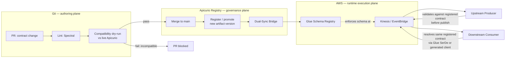

# Schema — Apicurio Registry as a Guardrail & Governance Engine

This is the tool-specific companion to [`guidelines.md`](guidelines.md), the same relationship [`../event/streaming.md`](../event/streaming.md) has to `../event/guidelines.md`. `guidelines.md` states the general registry mechanics (naming a coordinate, register-before-implement, compatibility enforcement in CI); this document is how those mechanics map onto the concrete, deployed tool — **Apicurio Registry** — and onto the concrete AWS boundary it hands off to: **Kinesis Data Streams**, **EventBridge**, and **AWS Glue Schema Registry**.

Read `../api/guidelines.md` §2 ("Schema registry tooling: Apicurio") first if you haven't — this document does not re-explain what Apicurio is, only how it acts as an enforced guardrail across every contract type, including the two that document doesn't cover: MCP tool manifests and structured agent outputs.

---

## 1. The three planes

| Plane | What lives here | What crosses it |
|---|---|---|
| **Git (authoring)** | `openapi.yaml`, `asyncapi.yaml` + JSON Schema/Avro payloads, `mcp-manifest.yaml`, `agent-manifest.yaml` — one PR per contract change, human-reviewed | A candidate contract version, proposed by a PR |
| **Apicurio Registry (governance)** | The enforced single source of truth: one versioned, content-hashed artifact per contract, per `group:artifact` coordinate; the compatibility rule for each artifact; the canonical shared entities (§3) | A version is admitted only if it passes the compatibility gate (§4); nothing is admitted from a branch, only from a merge to the domain's main line |
| **AWS (runtime execution)** | Kinesis Data Streams and EventBridge carry the messages; **AWS Glue Schema Registry** enforces the same schema at serialize/deserialize time for producers and consumers (`../event/streaming.md` §4) | The registered artifact, pushed by the Dual-Sync Bridge (§5) the moment it's promoted in Apicurio — never authored a second time by hand against Glue |

**The rule this enforces:** a contract is never "live" in two different shapes. Git holds the proposal, Apicurio holds the one admitted truth, AWS runs against exactly that truth via the bridge. If a producer or consumer ever needs to ask "what schema am I actually bound by," the answer is always "whatever Apicurio has registered," never "whatever the last person committed to `src/events/`."

---

## 2. Artifact groups and types — including MCP and Agent

`../api/guidelines.md` §2 already establishes the `group:artifact` coordinate (`group` = owning domain, `artifact` = the contract's own name). This capability's five artifact types today are OpenAPI, AsyncAPI, JSON Schema/Avro, MCP manifests, and agent output schemas — `guidelines.md` line 5 already lists API/Event/Semantics/Data/Knowledge-Graph/MCP/A2A as artifact types Schema governs; this section is where MCP and Agent get the same worked mechanics API and Event already have:

- **MCP tool manifest** (`../mcp/guidelines.md` §2) — registered under the owning domain's group, artifact name `<domain>-mcp-server` (matching the server name, §1 of that document). The manifest's own `inputSchema`/`outputSchema` `$ref`s the domain's already-registered API or event schema — Apicurio governs the manifest as one more artifact, it does not re-govern the schemas the manifest points at a second time.
- **Agent structured output** (`../agent/guidelines.md`) — the `outputSchema` an `agent-manifest.yaml` declares is itself a registrable JSON Schema artifact, artifact name `<domain>-<task>-output` — this is what lets an agent's structured output be validated the same way an API response is (§4).

Nothing here changes what those two capabilities' own `guidelines.md` already require of the manifest's *shape*; it only makes explicit that the manifest and its referenced schemas are governed artifacts like any other, subject to the same compatibility gate.

---

## 3. Canonical shared schemas (Address, Money, Metadata)

There is no shared physical folder for these (no `domains/common/` domain — creating one would be a new domain, gated the same way any new domain is, per `../../CLAUDE.md` "Before creating structure"). Shared entities are registered in Apicurio under their own group, `common`, and every domain references them **by registry coordinate**, the same pattern `domains/product/src/events/asyncapi.yaml` already uses for the shared CloudEvents envelope:

```yaml
# domains/product/src/events/asyncapi.yaml (existing, real file)
payload:
  allOf:
    - $ref: 'https://schemas.pearson.com/uif/pearson-event-envelope/v1'
    - type: object
      properties:
        data:
          $ref: '../schemas/events/product-created-data.json'
```

The same shape applies to `common` entities:

```yaml
properties:
  billingAddress:
    $ref: 'https://schemas.pearson.com/common/address/v1'
  price:
    $ref: 'https://schemas.pearson.com/common/money/v1'
```

**Two valid resolution modes — state which one a contract uses, don't leave it implicit:**
1. **Registry-URL `$ref` (build-time resolution).** The `$ref` above is a real, resolvable URL against the Apicurio-fronting domain; codegen and contract-test tooling resolve it at build time. This is correct for tooling that runs in CI, where a network call to the registry is expected and fast.
2. **Vendored, pinned copy (`src/schemas/vendor/`).** For a runtime path that must not take a network dependency on the registry (a Lambda cold start, an edge service), pull a pinned copy of the `common` artifact into the domain's own `src/schemas/vendor/address.v1.json` at build time (a CI step, never a manual copy-paste) and `$ref` that local, vendored file instead. Treat a vendored copy exactly like a generated file (§6) — it is regenerated by a script and drift-checked, never hand-edited.

A raw registry-URL `$ref` resolved **at request-serving runtime** (not build time) is the anti-pattern to avoid — it makes every request latency-coupled to the registry's availability. Pick mode 1 for build/CI-time resolution, mode 2 for anything on the runtime request path.

---

## 4. The guardrail lifecycle



- **Lint (Spectral)** — naming, required metadata (registry coordinate block, compatibility mode), SemVer discipline. Mechanical, cheap, runs on every PR regardless of whether the live registry is reachable.
- **Compatibility dry-run** — the candidate version is evaluated against Apicurio's compatibility API in check/dry-run mode (no publish); an incompatible change fails the PR here, never discovered after merge.
- **Register/promote** — merging to the domain's main line is the only path that publishes a real new version (`guidelines.md` §2 — schema registry first still means this is the domain's own registration, not a platform-run step).
- **Dual-Sync Bridge** — the mechanism this document adds. Triggered by a successful registration in Apicurio; pushes the same artifact into **AWS Glue Schema Registry** under a matching name and the equivalent compatibility mode, so a Kinesis/EventBridge consumer using Glue's SerDe is validating against the identical schema Apicurio just admitted — never a second, independently-authored copy. See the reference implementation's `sync_to_glue_schema_registry.py` for the concrete mapping and API calls; this document states the *why* and *when*, not the *how*.

**Upstream/downstream flow.** An upstream producer validates its payload against the registered contract (either resolving Apicurio directly, or — on the AWS-native path — the Glue SerDe library, which enforces the schema Dual-Sync just pushed) before publishing to Kinesis/EventBridge. A downstream consumer deserializes the same way: Glue SerDe on the AWS-native path, or a generated client (§7) that was built from the same registered artifact. Neither side ever hand-maintains its own copy of the shape.

---

## 5. SDK / type generation

Generated TypeScript/Java/Python clients are built **from the registered Apicurio artifact**, not the local file in the PR that's still under review — generation only runs on merge to main, against what's actually live, so a generated client can never be ahead of what the registry has admitted. Generated code is a **CI build artifact**, never committed into a domain. This is a deliberate lesson from `product_events_clients.generated.tf` (`domains/product/infrastructure/terraform/`): a committed generated file needs its own drift-check to stay honest (that Terraform file's generator is re-run and `git diff --exit-code`'d on every dev deploy) — simpler to not commit generated SDKs at all when nothing forces it. See the workflow in §7.

---

## 6. Definition of done (Apicurio governance, on top of `guidelines.md` §5)

- [ ] Every registered artifact — API, event, MCP manifest, agent output schema — declares its `group:artifact` coordinate and compatibility mode (§2, `guidelines.md` §1–2).
- [ ] Any reference to a canonical shared entity (Address, Money, Metadata, …) is a registry-coordinate `$ref` to the `common` group, in the resolution mode (§3) appropriate to where it's used — never a locally re-defined copy.
- [ ] The PR's CI ran lint (Spectral) and a compatibility dry-run against live Apicurio before merge; an incompatible change was rejected, not merged with a note to "fix later" (§4).
- [ ] On merge, the artifact was registered/promoted and the Dual-Sync Bridge pushed the matching schema to AWS Glue Schema Registry (§4) — verify via the registry's own version history, not by assuming the CI step ran.
- [ ] Any generated SDK consumed by a domain application was pulled from a CI build artifact, never hand-committed (§5).

---

Reference implementation (Spectral rulesets, the compatibility-check/registration/dual-sync scripts, tests): [`../../delivery-lab/reference-implementations/schema-governance/`](../../delivery-lab/reference-implementations/schema-governance/). Starter templates for a new contract: [`../../delivery-lab/templates/contract-governance/`](../../delivery-lab/templates/contract-governance/). CI wiring: `../../.github/workflows/contract-governance.yml` and `../../.github/workflows/generate-sdks.yml`. AWS-side detail (Kinesis/MSK provisioning, the Glue Schema Registry mechanics this document's Dual-Sync Bridge writes into): [`../event/streaming.md`](../event/streaming.md) §4.
