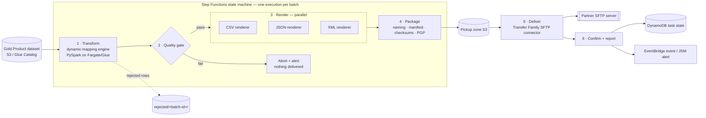

# RELAY · Beacon — Product Data Export over SFTP
## Solution Design Document

| | |
|---|---|
| **Capability** | Universal Integration Fabric · RELAY · **Beacon** (export module) |
| **Use case** | Gold-layer Product dataset delivered to partner(s) over SFTP in CSV, JSON, and XML |
| **Status** | Draft v0.7 (v0.2 added §10 Control Panel; v0.3 replaced Markdown with XML; v0.4 folded in UX-review decisions D16–D19; v0.5 adopted strict RELAY-runtime compliance D20–D21; v0.6 added D22 — immutable versioned config pairs drive runs; v0.7 adds D23 — one output format per export, format-first authoring) |
| **Date** | 2026-08-05 |
| **Author** | Karthik Pandiyan (with Claude) |
| **Related** | UIF RELAY Design Pack (component / logical / solution views); `dynamic-mapping` engine (this repo) |

---

## 1. Purpose and scope

This document defines the end-to-end design for the first Beacon export pattern: publishing the **well-defined Product Schema**, sourced from the **Gold-layer Product dataset**, to external consumers over **SFTP**, in **multiple output formats (CSV, JSON, XML)**.

It is deliberately designed as a *configuration of the RELAY platform* rather than a bespoke pipeline. The four net-new components introduced here — the renderer/template seam, the batch-level quality gate, the packaging step, and outbound SFTP delivery — form Beacon's reusable spine: every subsequent Beacon export reuses them with only config and template changes.

**In scope:** transform, validation, rendering, packaging, delivery, orchestration, security, observability, extensibility model.
**Out of scope (this phase):** the **Harbor (import)** and **Echo (replicate)** modules — this design covers **Beacon (export) only** and has no dependency on either being built; incremental/delta exports (full refresh only in v1 — see §13); non-SFTP delivery channels (GCS/SharePoint reuse the same design later). The control panel (§10) is in scope for design, with build phased per §12.

---

## 2. Background and context

- **RELAY** is the UIF self-serve exchange, retiring MFT point-to-point, SSDP and bespoke file integrations. Its three modules are **Echo** (replicate), **Beacon** (export), **Harbor** (import), over a Bronze/Silver/Gold mediation lake, governed by a control plane (orchestration, job catalog, template engine, auth & lineage).
- The **Gold-layer Product dataset** is produced by the data abstraction layer (fed by the Oracle GoldenGate CDC backbone) and is the single source for this export.
- The **dynamic-mapping engine** (config-driven PySpark; this repository) provides the transform layer: mappings, joins, derivations and row-level validations declared in JSON, statically validated (structure + sqlglot expression allowlist + zero-row dry-run) before any data is read. Proven end-to-end on AWS Glue in the sandbox account.

### Guiding principle

> Onboarding a new format, or a new partner variant of an existing format, must be a **config/template change reviewed in a PR — never an engine release**.

This extends the principle that justified the mapping engine (mappings as config) one layer outward (renderings and deliveries as config).

---

## 3. Requirements

### 3.1 Functional

| # | Requirement |
|---|---|
| F1 | Read the Product dataset from the Gold layer (S3 / Glue Catalog). |
| F2 | Transform Gold Product fields to the agreed export Product Schema (renames, derivations, filters). |
| F3 | Emit the same logical dataset in three formats per run: CSV, JSON, XML. |
| F4 | Validate rows against declarative data-quality rules; quarantine failing rows; never deliver known-bad rows. |
| F5 | Enforce batch-level quality gates before any delivery (row-count floor, rejection-rate ceiling, delta-vs-previous check). |
| F6 | Package files to partner conventions: naming pattern, single-file outputs, ZIP container (default-on, per-feed opt-out — UIFPE-172), manifest + checksums, optional PGP encryption. |
| F7 | Deliver to the partner SFTP endpoint with retry-safe, partial-file-safe semantics. |
| F8 | Record run state, emit completion/failure events, and alert on failure or gate breach. |
| F9 | Support adding future formats (e.g. XML, HTML) with config/template changes only. |
| F10 | Every variation point — sources, file formats, delivery channels/endpoints, schedules, quality gates — is administrable from the **control panel** (registry-driven); introducing a new source, format, or delivery method never requires changes to the panel itself. |
| F11 | End users author exports through a **guided, user-friendly UI**: source selection by browsing catalogued source tables, field-level mapping grid with live preview. |
| F12 | Users may alternatively supply a **source query** (common SQL dialects) which the platform converts into a draft dynamic-mapping configuration for review — never executed as-is. |
| F13 | All authored configs — UI-guided, query-converted, or Git-authored — pass through **one identical validation, approval and publishing lifecycle**. |

### 3.2 Non-functional

| # | Requirement |
|---|---|
| N1 | **Idempotency** — any stage can be retried without duplicate or corrupt partner-visible output. All artifacts keyed by batch ID. |
| N2 | **Fail closed** — no file reaches the partner if any gate fails. |
| N3 | **Consistency** — all three formats in a batch are rendered from one canonical dataset (row-identical content). |
| N4 | **Auditability** — per-batch lineage: config version, template version, engine version, run report, rejected rows retained (30-day lifecycle). |
| N5 | **Security** — encryption in transit and at rest; secrets in AWS Secrets Manager; least-privilege IAM per stage. |
| N6 | **Observability** — run metrics queryable; alerts to JSM per platform standard; New Relic APM where applicable. |
| N7 | Runs in the RELAY shared-services AWS account (target region per platform: eu-west-1). |

---

## 4. Solution overview

### 4.1 High-level architecture



### 4.2 Stage separation (key structural decision)

The pipeline is three decoupled stages — **Transform → Render → Deliver** — with a **materialized handoff** (the canonical dataset written to S3 between Transform and Render):

1. The transform is format-agnostic and runs **once** regardless of how many formats are emitted.
2. Renderers can be re-run without re-reading Gold (cheap, isolated retry).
3. Delivery failures never trigger recomputation.

### 4.3 Placement in the RELAY reference architecture

| RELAY concept | This design |
|---|---|
| Job catalog | Mapping config + render config + templates, versioned in Git, published to S3 |
| Template engine | Generic template renderer for future *document* formats (HTML, plain-text); designed in §5.4, not needed for the three v1 formats |
| Orchestration | Step Functions state machine; EventBridge schedule or data-ready trigger |
| Auth & lineage | Run report per batch → DynamoDB; config/template/engine versions stamped into the manifest |
| Mediation lake | Gold = source; pickup zone = delivery staging |
| Observability | Run metrics → CloudWatch; failures → JSM; New Relic APM on long-running containers |

---

## 5. Component design

### 5.1 Job definition (config contract)

One export = one job definition in the catalog, composed of:

```
job/
 ├─ mapping.json      # dynamic-mapping engine config: sources, joins, mappings,
 │                    # row-level validations, canonical output target
 └─ render.json       # per-format render targets + options + gates
                      # (a templates/ dir joins when a document format arrives)
```

Illustrative `render.json` shape (contract, not code):

```json
{
  "version": "1.0",
  "quality_gates": {
    "min_rows": 1,
    "max_rejection_pct": 2.0,
    "row_count_delta_pct_warn": 40
  },
  "renderings": [
    { "format": "csv",  "options": { "delimiter": ",", "header": true, "quote_all": true,
                                     "encoding": "utf-8", "formula_escape": true } },
    { "format": "json", "options": { "style": "jsonlines" } },
    { "format": "xml",  "options": { "root_tag": "products", "row_tag": "product",
                                     "declaration": true, "encoding": "utf-8" } }
  ],
  "packaging": {
    "filename_pattern": "product_export_{yyyyMMdd}_{batch_id}.{ext}",
    "single_file": true,
    "manifest": { "enabled": true, "checksum": "sha256" },
    "post_process": [
      { "type": "compress",    "params": { "format": "gzip" } },
      { "type": "pgp_encrypt", "params": { "key_ref": "partner-x-pgp" } }
    ]
  },
  "delivery": {
    "channel": "sftp",
    "connector_ref": "partner-x-sftp",
    "remote_dir": "/inbound/product",
    "upload_pattern": "tmp-then-rename"
  }
}
```

Configs live in **Git**; CI runs the engine's static validation (structure + sqlglot + dry-run) plus render-config schema validation and template lint on every PR, then publishes approved versions to a versioned S3 prefix. Hand-editing configs in S3 is prohibited.

### 5.2 Stage 1 — Transform (dynamic-mapping engine)

- **Input:** Gold Product dataset (Glue Catalog table preferred; S3 path acceptable in v1).
- **Processing:** existing engine pipeline — config load + static validation, source read, reference validation, zero-row dry-run, single-`select` mapping compilation, row-level validation.
- **Output:**
  - Canonical export dataset (Parquet) → `staging/<job>/<batch_id>/canonical/`
  - Rejected rows with `_failed_rules` → `rejected/<batch_id>/` (30-day lifecycle)
  - Run report JSON (rows in/out, rejected per rule, durations) → DynamoDB + log stream
- **Runtime:** PySpark container on **ECS Fargate** (strategic, per RELAY logical design). The engine's SparkSession-passed-in seam makes this a packaging concern; **Glue is an accepted interim runtime** for the first demo since it is already proven in the sandbox. No engine change either way.

### 5.3 Stage 2 — Quality gate (new component)

Evaluates the run report + canonical dataset **before any rendering/delivery**:

| Gate | Check | On breach |
|---|---|---|
| Row floor | `output_rows >= min_rows` | Abort, alert (suspect empty/missing Gold partition) |
| Rejection ceiling | `rejected_pct <= max_rejection_pct` | Abort, alert (suspect upstream data regression) |
| Delta check | `abs(Δ rows vs previous successful batch) <= warn threshold` | Configurable: warn-and-continue or hold-for-approval |

Fail-closed: a breach ends the execution with nothing in the pickup zone. Gate results are part of the run report.

### 5.4 Stage 3 — Render (new component: renderer registry)

A dispatch over `format:` in `render.json`. Every renderer honors one contract:

> **canonical dataset in → files out** (to `staging/<job>/<batch_id>/rendered/<format>/`)

| Renderer | Mechanism | Notes |
|---|---|---|
| `csv` | Spark writer | Options: delimiter, quoting, header, encoding/BOM, embedded-newline handling, **formula-injection escaping on by default** (`=`, `+`, `-`, `@` prefixes). |
| `json` | Spark writer | JSON Lines default; single JSON array as an option (implies single-file packaging path). |
| `xml` | Spark writer via the **spark-xml** data source (external package on Spark 3.5/Glue; built into Spark 4.0) | Options: `root_tag`, `row_tag`, XML declaration, encoding. Entity escaping of field content (`<`, `>`, `&`, quotes) is handled by the writer — not hand-rolled. Nested canonical columns map to nested elements naturally. Optional post-render **XSD validation** step when the consumer supplies a schema. |

Renderers run as **parallel Step Functions branches** reading the same canonical dataset — cross-format row consistency is guaranteed by construction (N3).

For future *document* formats (HTML pages, plain-text summaries — human-read, layout-bearing), the registry design anticipates a **generic template renderer** (Jinja-style, templates as catalog artifacts, field content escaped by default). It is a design capability, not a committed deliverable — no v1 format needs it now that XML replaced Markdown.

### 5.5 Stage 4 — Package (new component)

Converts renderer output into partner-deliverable artifacts:

- **Single-file assembly:** concatenate/coalesce part-files. v1 uses Spark `coalesce(1)` at product-catalog volumes; the package step owns S3 multipart concatenation as the scale-out path (see risk R2).
- **Naming:** apply `filename_pattern` (date, batch ID, extension).
- **ZIP container (default-on, per-feed opt-out — UIFPE-172, D24):** each rendered file is wrapped as `<name>.<ext>.zip` containing the file under its uncompressed name; `packaging.zip.enabled` in the export config, injected explicitly at publish time (missing key = uncompressed, so pre-feature immutable versions never change shape). The manifest stays a sibling of the zip and checksums the zip itself — the delivered artifact is what partners verify.
- **Manifest:** one manifest per batch listing every file with size + SHA-256, plus config/template/engine versions (audit, N4).
- **Post-processing (plug-and-play utility steps):** an ordered `post_process` list in config (compress, PGP encrypt, …) executed by a generic loop — see §5.8.1 for the mechanism. Partner PGP keys referenced from Secrets Manager.
- **Output:** pickup zone `pickup/<job>/<batch_id>/` — the only prefix the delivery stage can read.

### 5.6 Stage 5 — Deliver (SFTP)

- **Mechanism:** **AWS Transfer Family SFTP connector** (managed outbound push). Partner host keys pinned; credentials/keys in **Secrets Manager** with rotation. No hand-rolled SFTP clients unless a partner requirement forces one.
- **Partial-file safety:** upload to a temporary remote name, then **rename on the remote** after verification — the partner's ingestion never sees a half-written file.
- **Idempotent retry:** re-delivery of the same batch overwrites the same temp name before rename; final names are batch-ID-unique.
- **Verification:** post-upload remote listing/size check against the manifest.

### 5.7 Stage 6 — Confirm and report

- Final batch state → **DynamoDB** task/run table (the platform's task-state store): status, gate results, per-file delivery results, timings.
- **EventBridge** completion/failure event (downstream consumers, future partner notifications).
- Failure or gate breach → **JSM** incident per platform standard.

### 5.8 Orchestration

One **Step Functions state machine** per export pattern (not per partner — partner is a parameter):

```
ResolveJob → Transform → QualityGate ──breach──→ Abort/Alert
                              │pass
                              ▼
                    ┌── Render: CSV ──┐
                    ├── Render: JSON ─┤ (parallel)
                    └── Render: XML ──┘
                              ▼
                          Package → Deliver → Confirm
```

- **Trigger:** EventBridge schedule, or event-driven on "Gold Product refreshed".
- **Batch ID:** derived from the execution ID; threads through every artifact path, filename, and state record.
- **Retries:** per-state with backoff; Transform retry is safe (staging overwrite per batch), Render/Package retries are safe (stage-scoped prefixes), Deliver retry is safe (tmp-then-rename).
- **Topology:** **one parent state machine** per export pattern (~8–9 states incl. the abort path). One execution = one batch, so the execution ID is the batch audit trail. The many Step Function boxes in the RELAY solution diagram map onto *states or reusable child workflows within* this orchestration — not independently deployed machines per flow.

### 5.8.1 Reusable utility workflows (plug-and-play processing features)

Optional, shareable features — PGP encrypt/decrypt, stream-compression codecs (gzip), virus scan, future additions — are **reusable child workflows**, not inline states:

- Each utility is a small Step Function (or single Lambda/Fargate task where one step suffices) built **once**, honoring a standard contract:
  `input {source_prefix, params, batch_id} → output {target_prefix, status, metrics}` — prefix-in/prefix-out, pipeline-agnostic.
- Utilities are entries in a **processing-step registry** (name → ARN + parameter JSON Schema), the same pattern as the renderer and delivery registries. Registration makes the step appear in the control panel automatically (schema-driven form, per D10).
- The parent machine's Package stage contains a **generic post-process loop** (Map state) that reads the ordered `post_process` list from job config and invokes each registered child via nested execution (`startExecution.sync`), chaining prefixes output→input. Step order is config order (e.g. compress **before** encrypt — encrypted data doesn't compress).
- **Enabling a feature on an export = one config line in the panel.** Adding a brand-new feature = deploy child workflow + register it. The parent state machine is never edited for either.
- Boundary: always-on plumbing (manifest, checksums, and the default-on ZIP container — D24/UIFPE-172) stays inline; child workflows are reserved for optional shareable features, avoiding nested-execution overhead on trivial steps.

---

## 6. Data design

### 6.1 Source

Gold-layer Product dataset. **Open item:** confirm catalog/table name, refresh cadence, partitioning, and the authoritative Product Schema field list with the data-abstraction-layer owners (see §12).

### 6.2 Canonical export schema (illustrative — to be confirmed against the agreed Product Schema)

| Field | Type | Source / rule (examples) |
|---|---|---|
| `product_id` | string | Gold key; **not null** (row-level rule) |
| `sku` | string | not null |
| `title` | string | derived (e.g. name normalization) |
| `description` | string | escaped by renderers |
| `category` | string | grouping/filter dimension |
| `list_price` | decimal | rule: `>= 0`; currency-consistent |
| `currency` | string | rule: ISO-4217 allowlist |
| `status` | string | filter: exportable statuses only |
| `last_updated` | timestamp | |
| *(source_system, load_ts literals)* | | lineage columns |

### 6.3 Output format specifications (to pin with the consumer)

| Format | Decisions required |
|---|---|
| CSV | delimiter, quoting, encoding/BOM, header row, date/number formats, embedded newlines |
| JSON | JSON Lines vs array; field order; null handling |
| XML | element naming (`root_tag`/`row_tag`), attribute vs element style, XSD supplied by consumer? namespace requirements, encoding, declaration |

---

## 7. Security design

- **IAM:** one role per stage, least privilege — Transform reads Gold + writes staging; Render reads staging; Package writes pickup; Deliver reads pickup only + the one connector secret. No role spans stages.
- **Encryption:** SSE-KMS on staging/pickup buckets (scoped keys); TLS/SSH in transit; optional PGP payload encryption per partner.
- **Secrets:** partner SFTP credentials and PGP keys in Secrets Manager, rotation enabled; nothing partner-specific baked into images or configs.
- **Data sensitivity:** product/pricing data is commercially sensitive — pickup zone and rejected prefixes get the same access controls and lineage treatment as the Gold layer; rejected rows auto-expire (30 days).
- **Config supply chain:** configs and templates only reach S3 via CI from reviewed PRs; the engine's sqlglot allowlist blocks arbitrary SQL in mapping expressions; template rendering runs in a sandboxed environment (no arbitrary code execution from templates).

---

## 8. Risks, challenges and trade-offs

| # | Risk / trade-off | Position |
|---|---|---|
| R1 | **XML shape agreement** — element naming, attribute-vs-element style, namespaces; and XML is verbose (typically 2–4× CSV size for the same rows). | Pin the XML spec with the consumer (ideally an XSD) *before* renderer configuration; compression via the `post_process` step offsets size. |
| R2 | **Single-file vs distributed writes** — `coalesce(1)` funnels through one executor. | Acceptable at catalog volumes; package-step S3 multipart concatenation is the designed scale-out path. Threshold documented, not discovered in an incident. |
| R3 | **CSV pitfalls** — encoding, embedded newlines, Excel formula injection. | All are explicit config options with safe defaults (`formula_escape: true`, UTF-8, quote-all). |
| R4 | **XML writer dependency** — spark-xml is an external package on Spark 3.5/Glue (extra jar to ship and version-pin); entity escaping must come from the library, never hand-rolled string building. | Pin the spark-xml version alongside the Glue version; the jar ships like the engine wheel. Escaping risk disappears with a real writer (unlike template-built XML). Native in Spark 4.0 when the platform gets there. |
| R5 | **SFTP has no transactions.** | Tmp-then-rename + manifest/checksums + post-upload verification. Decide with partner: ack file / event vs verified-upload-only. |
| R6 | **Credential/key management** — historically MFT's weakest link. | Secrets Manager + rotation from day one; host-key pinning. |
| R7 | **Cross-format inconsistency** if formats were rendered from separate queries. | Prohibited by design: single materialized canonical dataset per batch (N3). |
| R8 | **Runtime choice** Fargate vs Glue. | Fargate is strategic (RELAY logical design); Glue accepted for first demo (already proven). Engine seam makes this reversible. |
| R9 | **sqlglot allowlist governance** — function requests becoming engine releases. | Move allowlist to governed config owned by the control plane (pre-existing engine backlog item; sharper under self-service). |
| R10 | **Gold schema evolution.** | Zero-row dry-run fails fast with a named rule on removed/renamed columns; CI re-validates all configs against current Gold schema on a schedule. |

---

## 9. Extensibility model

- **New data format (e.g. XML, Parquet delivery):** new renderer plugin + registry entry. Transform, gates, packaging, delivery untouched.
- **New document format (e.g. HTML, plain-text summary):** *zero code* — new template artifact + `render.json` entry through the generic template renderer.
- **New partner for the same export:** new job definition (config + connector ref). No new state machine, no new code.
- **New delivery channel (GCS, SharePoint):** new delivery adapter behind the same pickup-zone contract; already anticipated in the RELAY solution design's distribution step.
- **Incremental exports (v2):** built as UIFPE-168 — per-feed full vs incremental extraction on the Gold `_gold_updated_at` watermark. Design: [beacon-incremental-extraction.md](beacon-incremental-extraction.md). (The original flag here anticipated Echo-CDC-on-Bronze and an output-mode extension; the shipped design windows the source read instead, which needs neither.)

---

## 10. Control panel — self-service configurability

### 10.1 Principle: an authoring surface, not a second execution path

The control panel is a **config authoring and governance UI over the same job catalog**. It produces the same artifacts (`mapping.json`, `render.json`, templates, connector references) that a Git PR produces, and publishes them through the same validated, versioned pipeline. There is exactly one execution path; the panel changes *who can author* and *how easily*, never *what runs*. This is the RELAY component view made concrete: self-service UI + agents driving the job catalog and template engine.

### 10.2 Registry-driven design — "everything is data"

The panel is built over four registries. The panel itself is **generic**: each registry entry publishes a JSON Schema describing its options, and the UI renders forms from those schemas. That is what makes F10 hold — registering a new source, format, or channel makes it appear in the panel with its own configuration form, with **no panel release**.

| Registry | Contains | "Introduce a new one" means |
|---|---|---|
| **Source registry** | Catalogued sources: Gold/Glue Catalog tables, S3 prefixes (later JDBC, APIs) with schema, owner, refresh cadence, sensitivity classification, and **eligible formats** (multi-select; default all — e.g. an ONIX feed is registered XML-only) | Admin registers the source in the panel → it appears in the author's source picker, filtered by format eligibility. No code. |
| **Format registry** | Renderers + their option schemas (CSV dialect options, JSON style, template refs) | Document formats: upload a template — no code. Data formats: deploy one renderer plugin, register it with its option schema — panel picks it up automatically. |
| **Delivery channels** (admin) | Channel *types* and their adapters (SFTP; later GCS, SharePoint, API) | New channel: one delivery adapter registered with its config schema. Admin-owned because adapters are code. |
| **Destinations** (author-owned) | Partner endpoint instances: host, remote dir, secrets ref, host key | **Authors create their own destinations** — self-service, domain-scoped, no admin ticket. Credentials go directly to Secrets Manager (the panel never stores or shows them); a destination must pass a connection test before an export can select it; prod use is still gated by publish approval. |
| **Job catalog** | Published, versioned job definitions (the output of authoring) | — |

The engine's **sqlglot function allowlist** also becomes panel-administered governed config (resolves risk R9): platform admins extend it without an engine release.

### 10.3 Authoring experiences — two doors, one output

**Door 1 — Guided (table-first), the user-friendly default:**
Browse/search the source registry → select source table(s) → join builder (if multiple) → **mapping grid**: target field name, expression (with function palette limited to the allowlist), sample-value preview per row → validation rules → formats + options (schema-driven forms) → delivery target → schedule/trigger → submit for validation.

*Join builder (UIFPE-237, generic end-to-end since UIFPE-167).* A feed reads one **driving** source and any number of joined sources — any gold table the picker lists, from any configured domain. Each joined source carries a join type (the wizard offers left, inner, full and cross; the engine also accepts right, left_semi and left_anti from the API) and a condition built from column dropdowns on both sides (several equality pairs ANDed) or written as Spark SQL. The config's `joins[]` folds in declaration order onto the frame seeded by `joins[0].left`, so each join's `left` names the source it attaches to — the one prior table its condition references, else the driving source — and static validation refuses a chain that references a source before it is joined, joins one twice, or leaves one out. A cross join carries no condition. At submit, column references (join keys included) are checked against the live catalog schema of every source, resolved through the source registry or the gold catalog. Incremental extraction stays single-source (§ incremental design, UIFPE-238): a multi-source feed publishes as a full load, enforced in the wizard and in the publisher.

**Door 2 — Query-first (bring your own query):**
The user pastes a source query in whatever dialect they have (Oracle SQL, T-SQL, ANSI, Spark SQL…). A **query-to-config converter** turns it into a *draft* mapping configuration which opens in the same mapping grid for review — the query is **never executed as-is**.

- Mechanics: **sqlglot** — already the engine's validation dependency — parses and **transpiles across dialects**. The converter maps: `SELECT` projections → mapping rules (`one_to_one` / `derived`), `JOIN … ON` → join declarations, `WHERE` → source filters, literals → `literal` rules.
- **Filters (shipped — D18):** `WHERE` becomes the config's `filters` block — a list of Spark SQL boolean strings the engine ANDs and applies to the joined frame before mapping (`engine.apply_filters`), counting the excluded rows as `filtered_rows` in the run report. Row filtering defines what is *in scope* for the export, distinct from validations, which quarantine bad in-scope rows. Both doors emit the block: the guided door's **Filter** step (directly after Mapping) compiles structured clauses — attribute comparisons whose operators follow the column's catalogued type, identifier lists (PPID / ISBN-13) inline as `alias.col IN (...)` up to 5,000 values per condition, and custom Spark SQL — to the same strings; static validation parses every entry with the mapping-expression allowlist and checks alias-qualified columns against the live schema at submit. The builder's own model rides in `settings.filter_model` (UI-only); the compiled string is all the engine ever sees. The step also reads Gold data (UIFPE-441): the attribute picker offers only attributes a person could pick a value for (UIFPE-514, owner decision 2026-09-22) — identifiers by name never (product_id, inventory_item_id, source_item_number, ISBNs…), text columns with more than 1,000 distinct values never, text at or under the cap with a "~N values" label, numbers/dates/booleans always, with dates defaulting to a from/to range; the distinct counts come from an asynchronous, persisted cardinality profile started when the source is chosen, and text attributes are held back until it lands (a failed measurement is shown, never silent) — an attribute condition suggests the column's 50 most common values, and **Preview matches** runs the compiled filter on Athena — how many rows the filter keeps (the before-filter total is measured in the same scan but not shown), a 10-row sample, the identifiers of a pasted list that match nothing — asynchronously, on the shared `primary` workgroup, with every clause transpiled Spark → Trino and any clause Athena cannot run refusing the preview by name.
- Constructs the engine doesn't support (statements, subqueries, non-allowlisted functions, window functions) are **flagged inline on the draft** for the author to resolve — never silently dropped. The conversion is deterministic and reviewable.
- This gives migration leverage: existing SSDP/MFT job queries become draft configs in minutes.

**Door 3 (enhancement path) — Agent-assisted:** per the RELAY component view, agents via MCP use the *same* converter and validation APIs to propose draft configs from natural language or legacy artifacts (mapping spreadsheets, old job specs). Deterministic converter first (v1); agent assistance layers on top without new platform surface.

### 10.4 Validation-first authoring lifecycle

```
Draft ──▶ Validate ──▶ Preview ──▶ Approve ──▶ Publish ──▶ Run / Schedule
          (engine static      (dry-run +        (RBAC,        (immutable
           validation +        sample rows:      four-eyes     version in
           sqlglot + schema    output AND        for prod)     job catalog)
           dry-run as API)     would-be-rejected
                               rows shown)
```

- **Validate** exposes the engine's existing static validation stack **as an API** — the same checks CI runs; a config cannot be saved past Draft without passing.
- **Preview** — shipped for the row filter (UIFPE-441): the Filter step runs the draft's compiled conditions on the Gold tables through Athena and shows how many rows the filter keeps (the before-filter total is computed in the same scan but not shown — owner decision 2026-09-21: it is not what the author asked, and for a joined feed it is not a product count), a 10-row sample and a pasted list's identifiers that match nothing, before anything is published. Since UIFPE-490 the author may also take every matched row (in the preview's columns, capped at 100,000) as one CSV from the same card — a button, then a 15-minute signed link to the file Athena wrote, never an automatic download — and carry on to schedule the feed or not. The CSV is the raw Gold rows after join and filter, not the rendered export; the export itself has no cap. Still to come: the transformed output and the rows validation rules would reject.
- **Publish** writes an immutable version to the job catalog (Git-backed under the hood, preserving D7's audit trail); rollback = republish a previous version.

### 10.5 Personas and RBAC — roles are configurable data, not code

**AuthN** is corporate SSO (Active Directory — the UIF shared identity service); the panel never manages credentials. **AuthZ** is enforced by the panel's APIs against a **role registry**:

- **Permissions are fine-grained verbs:** `draft.create`, `config.validate`, `preview.run`, `publish.submit`, `publish.approve`, `run.trigger`, `run.view`, `destination.manage` (author-scoped — own partner endpoints), `registry.manage`, `channel.manage`, `allowlist.manage`, `role.manage`, …
- **A role is an admin-editable named set of permissions.** The personas below are **default seed roles**, not hard-coded: admins can clone, adjust, or create roles without a platform release.
- **Assignment is AD-group → role mapping**, configurable in the panel — onboarding a team is a group mapping, not per-user administration.
- **Assignments are scope-aware:** a grant binds to a domain / job group (e.g. the Product exports team authors and approves Product jobs only; Finance exports are invisible to them).
- **Approval policies are configuration** in the same model: which target environments require four-eyes, and which approver group applies per domain.
- **Enforcement lives at the API layer**, not the UI — the UI shows/hides by permission, but validate/publish/run APIs are the gate. Every role, mapping, and policy change is itself audit-logged.

| Seed role | Default permissions |
|---|---|
| **Author** (business/engineering user) | Create drafts, validate, preview, submit for approval |
| **Approver** (data steward / owner) | Approve/reject publishes; mandatory for production targets (four-eyes) |
| **Platform admin** | Manage registries, connectors/secrets refs, function allowlist, roles & mappings |
| **Viewer** | Browse catalog, run history, run reports |

### 10.6 Hosting (decided 2026-08-05)

Two deployables, decoupled:

- **Control panel API — Python (FastAPI) container on ECS Fargate** behind the API Gateway in the RELAY shared-services account. Python is a reuse decision, not a preference: the Validate endpoint *is* the engine's validators plus `export_config.validate`, and the query-to-config converter runs on sqlglot — the engine's own parser. The API holds the sole IAM role (DynamoDB drafts/catalog/registries, Secrets Manager destinations, Glue Catalog schemas, Step Functions runs, S3 configs); the browser never calls AWS directly (narrow exception: API-minted presigned S3 URLs). This API also serves MCP agents (Door 3) and CI validation — it is the platform surface, not UI plumbing.
- **UI — static React SPA**, hosting-portable (S3 + CloudFront in the same account, matching the existing RELAY self-service app's pattern). Target end-state: merge as a module into the existing RELAY self-service shell (its `/m/<module>/` structure suggests contributed modules) — pending discussion with the platform team; the SPA is built theme- and routing-compatible so the merge is lift-and-shift. Cookie remains a fallback pilot host for the UI only.

---

## 11. Observability and operations

- **Per-run:** run report (rows in/out, rejected per rule, gate results, per-file delivery status, durations) in DynamoDB — queryable across runs.
- **Metrics/alerts:** CloudWatch metrics on rejection %, gate breaches, delivery failures, duration; alarm → JSM. Rejection-% trend alerting catches silent upstream regressions across many pipelines.
- **Lineage:** manifest stamps config version, template version, engine version per batch.
- **Runbook items:** re-deliver a batch (Deliver stage re-run), re-render one format, replay from canonical, quarantine review of rejected rows.

---

## 12. Delivery phases

| Phase | Scope | Exit criterion |
|---|---|---|
| **0 · Foundations** | Render/package/deliver contracts agreed; Product Schema + format specs pinned with consumer; connector + secrets provisioned; **registry data model agreed** | Signed-off config contract; test SFTP reachable |
| **1 · Vertical slice** | Transform (existing engine, Glue interim) → CSV + JSON render → package (naming, manifest) → SFTP push to test endpoint; quality gate v1 (row floor + rejection ceiling) | One batch delivered end-to-end, retry-safe, gates demonstrated (incl. a forced failure) |
| **2 · XML renderer** | `xml` registry entry (spark-xml writer + options schema); jar shipped/pinned alongside the Glue job; optional XSD validation step; partner XML spec agreed | XML output signed off by consumer (validates against their XSD if supplied) |
| **3 · Control panel MVP** | Registries (source/format/delivery) + validation & preview APIs; guided authoring (Door 1); **query-to-config converter** (Door 2); approve/publish lifecycle | A non-engineer authors and publishes a working export config without touching Git; a pasted legacy query converts to a runnable draft |
| **4 · Hardening** | Fargate runtime image; PGP option; delta gate; JSM wiring; RBAC; runbooks | Production-readiness review |
| **5 · Productize** | Second export onboarded entirely through the panel (config/template only); agent-assisted authoring (Door 3) piloted via MCP | Proves the extensibility claim (§9) and F10–F13 |

---

## 13. Open questions / decisions needed

| # | Question | Owner |
|---|---|---|
| Q1 | Authoritative Product Schema field list + Gold table location, refresh cadence, partitioning | Data abstraction layer team |
| Q2 | XML spec: element naming, attribute vs element style, namespaces — does the consumer supply an XSD? | Consumer |
| Q3 | CSV/JSON dialect specifics (§6.3) | Consumer |
| Q4 | Delivery confirmation contract: ack file / event vs verified upload | Consumer / partner |
| Q5 | PGP required in v1? | Security / partner |
| Q6 | Trigger: schedule vs Gold-refresh event (and cadence) | Product owner |
| Q7 | Sandbox first (existing AWS sandbox + Glue) vs straight to shared-services account | Platform team |
| Q8 | Which SQL dialects must the query-to-config converter support in v1 (Oracle is the presumed priority given source estate)? | Migration/consumer teams |
| Q9 | Approval policy: which target environments require four-eyes approval, and who are the approver groups? | Governance / data stewards |
| Q10 | ~~Control panel hosting~~ **Decided (§10.6):** API on ECS Fargate in shared services. Remaining: UI's end-state — does the RELAY self-service shell accept contributed modules, and on what cadence? Entra ID app registration for SSO | Platform team |
| Q11 | **Per-environment source availability in the source registry** (backlog, from sandbox rehearsal 2026-08-07): a registry entry should declare which environments can actually serve it, so the wizard marks unavailable sources ("gold_product.product — not available in sandbox; use demo.products_csv") instead of letting an unrunnable-here draft publish silently. Surfaced when a published config referencing the Gold Iceberg table failed correctly-but-confusingly in the sandbox | Control panel backlog |

---

## 14. Decision log

| # | Decision | Rationale |
|---|---|---|
| D1 | Three-stage pipeline with materialized canonical handoff | Single transform for N formats; cheap isolated retries; guaranteed cross-format consistency |
| D2 | XML is a **data format**: rendered by a real XML writer (spark-xml) through the renderer registry — never template/string-built. The generic **template renderer** remains the designed path for future *document* formats (HTML, plain-text) but is no longer a committed deliverable | Writer-level entity escaping is correctness, not convention; registry keeps XML a config-level choice (v0.3 change: XML replaced Markdown as the third format) |
| D3 | Renderer **registry** dispatched from config | New formats without touching existing stages |
| D4 | **Fail-closed** batch quality gate before any rendering/delivery | Partner never receives suspect data; MFT estate cannot make this guarantee |
| D5 | Transfer Family **SFTP connector** over custom clients | Managed retries/credentials; less bespoke code — the thing RELAY exists to retire |
| D6 | **Tmp-then-rename** remote upload pattern | Only reliable partial-file protection SFTP offers |
| D7 | Configs/templates in **Git via CI**, never hand-edited in S3 | Engine's static validation becomes the CI gate; auditability |
| D8 | Fargate strategic runtime; Glue interim | Matches RELAY logical design; engine session seam makes it reversible |
| D9 | Control panel is an **authoring surface over the job catalog**, never a second execution path | One validated pipeline regardless of authoring door; UI can never produce a config Git couldn't |
| D10 | Panel UI is **schema-driven from registries** | New sources/formats/channels appear in the panel without panel releases — the F10 guarantee |
| D11 | Query-to-config conversion is **deterministic (sqlglot), draft-producing, never executes the pasted query** | Reviewable, safe, reuses the engine's existing dependency; dialect transpilation for free |
| D12 | Unsupported query constructs are **flagged inline, never silently dropped** | Author trust; silent partial conversion is worse than honest failure |
| D13 | Function allowlist moves to **panel-administered governed config** | Closes R9 without weakening the security model (admins only, audited) |
| D14 | **One parent state machine** per export pattern; optional features (PGP, compress, scan) are **registered child workflows** invoked by a generic config-driven post-process loop | Single batch audit trail; features plug in via config + registry — the parent machine is never edited to enable or add a feature |
| D15 | **Roles are configurable data**: role registry + AD-group mapping + scope-aware grants + configurable approval policies, enforced at the API layer | Role changes and team onboarding without releases; UI-level checks alone are not a security boundary |
| D16 | **Destinations are author-owned, channels are admin-owned** (UX review, 2026-08-05): authors self-serve their partner endpoints (secrets straight to Secrets Manager, mandatory connection test, domain-scoped); admins own only the channel adapters | An admin-gated endpoint registry would put a ticket queue inside the self-service flow — the exact bottleneck RELAY exists to remove. Governance stays: credential isolation, verification, publish approval |
| D17 | **Format eligibility is source-registry data** (revised after UX review — ONIX example): every source registry entry declares the formats it may be exported in (multi-select; default = all). The wizard filters the source list by the partner's needed formats, and step 4 offers only the chosen source's eligible formats | *Technically* any source renders to any format (canonical dataset, D1) — but *business* standards constrain what is meaningful: an ONIX feed is XML-only; offering CSV against it confuses authors and invites invalid exports. Eligibility is curated data, so correcting it is a registry edit, not a release |
| D18 | **Row filters define scope** ("what is in scope"), distinct from validations ("in-scope but bad → quarantine"). Shipped as the mapping contract's `filters: [str]` block — Spark SQL booleans, ANDed, applied post-join and pre-mapping; excluded rows are counted (`filtered_rows`), never rejected. Surfaced in the wizard's own **Filter** step directly after Mapping — it shapes the joined dataset the mapped fields read from (first drafted for the source step, then a Mapping-step card under UIFPE-201) — where a structured builder compiles clauses to those strings; the compiled string is the only thing the engine, the validator and the published config ever see | Users think in WHERE clauses (proven by the query door); conflating filtering with validation would pollute the rejected-rows audit trail with rows that were never meant to ship |
| D19 | **Control panel API: Python (FastAPI) on ECS Fargate** behind the API Gateway; UI: static React SPA, hosting-portable, built shell-merge-ready | Python reuses the engine's validators and sqlglot converter verbatim (no drift between "what validates" and "what converts"); Fargate avoids Lambda layer/cold-start friction, matches the RELAY logical design's container tier, and stays portable to Cookie/EKS. UI/API decoupling keeps the shell-module end-state a lift-and-shift (§10.6) |
| D20 | **Strict RELAY-runtime compliance** (2026-08-07, supersedes D8's "Glue interim acceptable"): the pipeline decomposes into the diagram's executors — **PySpark transform on an ECS Fargate container** (plain entrypoint, exit code = branch signal), **light steps (deliver / record-run / emit-event) on Lambda**, orchestrated by the **D14 Step Functions machine**, triggered via **EventBridge → SQS (DLQ) → Pipe**, task state in the **DynamoDB runs table**. Glue remains sandbox-demo tooling only. Diagram steps 1–4 (partner entry surface: inbound SFTP, API GW credential verification) deliberately deferred as shared-platform configuration | Team decision to follow the RELAY solution diagram literally — one architecture, no runtime forks to explain in governance. The engine's session-injection seam and the beacon modules' executor-agnosticism made this a packaging change, not a rewrite |
| D21 | **S3 delivery channel as the simplified first target** (deliver Lambda copies pickup → destination bucket; SFTP remains a registered, proven channel) | Removes the partner-endpoint dependency from the orchestration build; S3 copy is atomic per object (no tmp-then-rename), manifest-last and idempotency still enforced; destinations for S3 need no credential (IAM role), simplifying D16's flow |
| D23 | **One output format per export, chosen first** (2026-08-08): the wizard's mandatory first step is the output format (single-select); no source tables are shown until it is chosen, and the eligibility filter then applies automatically. The contract enforces it at every door: the export config validator requires **exactly one rendering**. Same data in another format = another job, with its own gates, destination and schedule. The **canonical staging step is retained** even though multi-format consistency no longer needs it: the quality gate must run before any partner-shaped file exists (D4 — fail-closed means *never created*, not *created then cleaned up*), render/deliver retries must not re-run the transform (N1), and partner-file concerns (escaping, naming, manifests) stay out of the shared engine. Cost of keeping it: one parquet write/read per batch, 14-day expiry — invisible to users | Simplifies the authoring mental model (format is the partner's requirement, so it leads); removes multi-format edge cases from packaging/delivery; supersedes the multi-select "What does the partner need?" convenience from D17's original UX (eligibility filtering itself is unchanged) |
| D22 | **Runs execute an immutable, per-job versioned config pair** — approve generates `configs/<job_id>/v<N>/{mapping,export}.json` (export side built from the wizard settings and validated with the pipeline's own validator before writing; environment-owned paths normalized into the mapping at publish); Run-now/schedules pass that version's URI as the state machine input (latest by default, explicit `version` for pinning/rollback). **No mutable live pointer exists.** | Learned twice in the sandbox rehearsal (2026-08-07): a shared live pointer let an approved draft silently become — and break — the next batch (clobber incident), and pinning runs to a fixed config made authoring a no-op ("why are unauthored columns in my file?"). One mechanism fixes both: what you approved is exactly what runs, per job, per version, with rollback = run vN. Also the multi-author answer: users A and B publish versions of their own `job_id` trees and can never affect each other's runs |
| D24 | **Default-on ZIP is inline packaging plumbing (UIFPE-172)**; `post_process` child workflows remain the mechanism for optional transforms (PGP, stream codecs, scans). The publisher writes an explicit `packaging.zip.enabled` into every new version (default true, per-feed opt-out); the engine treats a missing key as uncompressed | Default-on behavior is plumbing per §5.8.1's own boundary clause, not an optional feature; the D14 invariant holds — the parent state machine is untouched, zip runs inside the existing Fargate Package stage enabled purely by config. Missing-key-means-uncompressed keeps immutable pre-feature versions byte-identical across engine upgrades (the UIFPE-171 deploy-skew lesson). Deploy order: pipeline image before control panel — a new config on an old engine delivers uncompressed while the UI says ZIP. v1 buffers the whole file while zipping (~2× file size peak in task memory, 5 GiB put_object cap) — fine at catalog scale; R2's multipart concatenation is the scale-out path |
| D25 | **Joins produce flat rows, one per match, and relationships are declared (UIFPE-580, owner decisions 2026-09-24).** Product relates to program and marketing copy only through list columns on its own row (`associated_programs`, `marketing_copy[].content_id`), stock is keyed on product **and** org, and price keeps its prices inside `price_specifications`. The mapping contract gains a join `through: {list, alias}` step — the engine spreads the list (outer explode, so an empty list keeps its row) and then key-matches its element — and a top-level `unnest: [{list, alias}]` that spreads a list after the joins and before the filters. Every join yields flat rows whatever the output format; the **Filter** step narrows them (one org, one price list, one market); left join is the default. The four product relationships live in `registry_data/relationships.yaml` and the wizard prefills them (UIFPE-581) — never inferred from shared column names | Measured in dev: 23k products with 2–9 stock orgs, 8.5k with several programs, 919k with 1–50 marketing copies — "first shared column" multiplied stock rows silently and could not join program or marketing copy at all. `array_contains` in a join condition is a nested loop over 2.17M × 6.5M rows and Athena cannot preview it; spreading first makes it an ordinary key join. Flat rows keep CSV honest (JSON is a separate format) and let the existing filter mechanism do the narrowing, so no join-level options are needed |
