# Echo Component Diagram (from repo)

Reference: **Universal Integration Fabric — RELAY Component Diagram**  
Scope: What is implemented in `uif-relay-echo` today (`echo-{env}-*` stack + React UI).  
Legend: **Built** | **Partial** | **Planned** | **External**

---

## Relay capability → Echo repo mapping

| Relay component | Echo repo equivalent | Status |
|-----------------|----------------------|--------|
| **Echo — Replicate** | Data Sync + medallion Glue jobs (Bronze/Silver/Gold) + replicator Lambdas | **Built** (JDBC batch/watermark; not GoldenGate) |
| **Beacon — Export** | Partner Export UI module (`/m/partner-export/*`) | **Partial** (UI + API contract; backend routes/tables incomplete) |
| **Harbor — Import** | File Ingest module (`/m/file-ingest`) | **Planned** (`status: soon` in UI) |
| **Streaming Ingest** | — | **Planned** |
| **Reverse ETL** | — | **Planned** |
| **Web UI** | React SPA + CloudFront + S3 UI bucket | **Built** |
| **MCP / Agents** | — | **Planned** (Relay vision only) |
| **Orchestration** | EventBridge + `scheduler_dispatcher` | **Built** |
| **Job catalog** | DynamoDB config tables + Data Sync / DQ / Gold UI | **Built** |
| **Template engine** | Gold mapping manifests (YAML/SQL) + export format templates | **Partial** (Gold built; export templates UI-only) |
| **Auth & lineage** | Optional Cognito JWT + `/catalog/lineage` | **Partial** (JWT off in dev; lineage built) |
| **Medallion lake** | S3 + Iceberg (+ GCS/BQ for GCP-native) | **Built** |
| **New Relic / JSM** | — | **External** (org platform; not in Terraform) |

---

## Component diagram (C4-style, logical)

```mermaid
flowchart TB
  subgraph Consumers["Consumers"]
    BUS["Business & Engineering teams"]
    AGT["Agents / MCP — planned"]
  end

  subgraph Access["Access layer"]
    CF["CloudFront"]
    UIS3["S3 UI bucket"]
    SPA["React SPA — Universal Integration Fabric"]
    APIGW["API Gateway HTTP v2"]
    JWT["JWT Authorizer — optional Pearson SSO / Cognito"]
  end

  subgraph Control["Control plane"]
    PC["pipeline_controller Lambda"]
    DQC["dq_check_controller Lambda"]
    SD["scheduler_dispatcher Lambda"]
    EB["EventBridge rules"]
    DDB["DynamoDB — config & metrics"]
  end

  subgraph Capability["Capability modules — runtime"]
    subgraph Echo["Echo — Replicate — built"]
      BR["Glue: bronze-ingest"]
      SV["Glue: silver-transform variants"]
      GR["Glue: gold-transform / reconcile"]
      AN["Glue: analyze-table"]
      GCSR["Lambda: gcs_replicator"]
      SBR["Lambda: silver_bq_replicator"]
    end
    subgraph DQ["Data Quality — built"]
      DQG["Glue: silver-quality-check"]
    end
    subgraph Beacon["Beacon — Export — partial"]
      PEUI["Partner Export UI"]
      PEBE["Partner Export API — stub in controller"]
    end
    subgraph Planned["Planned modules"]
      HARBOR["Harbor — File Ingest"]
      STREAM["Streaming Ingest"]
      REVETL["Reverse ETL"]
      MCP["MCP server & skills"]
    end
  end

  subgraph Medallion["Medallion data layer"]
    S3B["S3 Bronze — raw Parquet"]
    S3S["S3 Silver — Iceberg"]
    S3G["S3 Gold — Iceberg"]
    S3A["S3 gold-artifacts — schemas & mappings"]
    GCS["GCS — GCP-native / mirror"]
    BQ["BigQuery / BigLake"]
    GC["Glue Data Catalog"]
    LF["Lake Formation"]
  end

  subgraph Platform["Platform services"]
    SM["Secrets Manager"]
    CW["CloudWatch logs / dashboards / alarms"]
    GH["GitHub OIDC role — CI-ready"]
    VPC["VPC + Glue connection + endpoints"]
  end

  subgraph External["External systems"]
    ORA["Oracle EBS / MDM"]
    GCP["Google Cloud APIs"]
    PART["Partners — SFTP/API — planned"]
    NR["New Relic — external"]
    JSM["JSM — external"]
  end

  BUS --> CF
  AGT -.-> MCP
  CF --> UIS3 --> SPA
  SPA --> APIGW
  JWT -.-> APIGW
  APIGW --> PC
  APIGW --> DQC
  PEUI --> APIGW

  PC --> DDB
  PC --> GC
  PC --> LF
  PC --> SM
  PC --> ORA
  PC --> GCP
  DQC --> DDB
  DQC --> DQG

  EB --> SD
  SD --> DDB
  SD --> BR
  SD --> SV
  SD --> GR
  SD --> DQG

  BR --> ORA
  BR --> SM
  BR --> S3B
  BR --> GCS
  BR --> DDB
  BR -->|SUCCEEDED| GCSR
  BR -->|chains| SV

  SV --> S3B
  SV --> S3S
  SV --> GCS
  SV --> BQ
  SV --> GC
  SV --> LF
  SV -->|SUCCEEDED AWS path| SBR

  GR --> S3S
  GR --> S3G
  GR --> S3A
  GR --> GC

  GCSR --> S3B
  GCSR --> GCS
  GCSR --> SM
  SBR --> S3S
  SBR --> GCS
  SBR --> BQ

  DQG --> S3S
  DQG --> ORA

  AN --> ORA
  AN --> DDB

  PEBE -.-> S3G
  PART -.-> HARBOR
  HARBOR -.-> Medallion

  NR -.-> Capability
  JSM -.-> Platform
```



---

## UI modules (presentation components)

| Module | Route prefix | Relay mapping | Backend |
|--------|--------------|---------------|---------|
| **Home** | `/` | Operations dashboard | `/home/summary`, `/home/recent-activity` |
| **Data Sync** | `/m/data-sync/*` | **Echo — Replicate** | `/pipelines/*`, `/gold-pipelines/*`, `/analyze*` |
| **Catalog** | `/m/catalog/*` | Lineage & discovery | `/catalog/lineage` + Glue catalog |
| **Data Quality** | `/m/data-quality/*` | Quality checks | `/dq/*` |
| **Partner Export** | `/m/partner-export/*` | **Beacon — Export** | `/partner-export/*` (partial) |
| **Settings** | `/settings/*` | Connections, alerts, env | `/connections*`, `/alerts` |
| File Ingest | `/m/file-ingest` | **Harbor — Import** | Not built |
| Streaming Ingest | `/m/streaming` | CDC/Kafka | Not built |
| Reverse ETL | `/m/reverse-etl` | Lake → SaaS | Not built |

---

## Control plane components

| Component | Resource name | Responsibility |
|-----------|---------------|----------------|
| **Pipeline Controller** | `echo-{env}-pipeline-controller` | Pipeline/Gold CRUD, manual runs, analyze, connections, alerts, catalog lineage, home API |
| **DQ Check Controller** | `echo-{env}-dq-check-controller` | DQ check CRUD + trigger |
| **Schedule Dispatcher** | `echo-{env}-scheduler-dispatcher` | EventBridge → Glue dispatch (Bronze/Silver/Gold/Reconcile/DQ) |
| **GCS Replicator** | `echo-{env}-gcs-replicator` | Mirror S3 Bronze → GCS after Bronze success |
| **Silver BQ Replicator** | `echo-{env}-silver-bq-replicator` | Mirror S3 Silver Iceberg → GCS + refresh BQ external table |

### DynamoDB tables

| Table | Purpose |
|-------|---------|
| `echo-{env}-glue-job-config` | Silver/Bronze pipeline definitions |
| `uif-echo-{env}-gold-pipeline-config` | Gold domain configs |
| `echo-{env}-glue-job-metrics` | Run history (Glue + replicators) |
| `echo-{env}-pipeline-analysis` | Async Oracle analyze results |
| `uif-echo-{env}-alert-subscribers` | Who is emailed on a gold alarm, per table (UIFPE-543) |
| `echo-{env}-dq-check-config` | DQ check definitions |

---

## Runtime components (Glue jobs)

| Job | Script | Medallion / purpose |
|-----|--------|---------------------|
| `uif-echo-{env}-bronze-ingest` | `bronze-ingest.py` | Oracle → Bronze (S3 or GCS) |
| `uif-echo-{env}-silver-transform` | `silver-transform.py` | Bronze → Silver Iceberg (AWS) |
| `uif-echo-{env}-silver-reconcile` | `silver-reconcile.py` | Hard-delete detection (AWS) |
| `uif-echo-{env}-silver-transform-gcs-iceberg` | `silver-transform-gcs-iceberg.py` | GCP Iceberg Silver |
| `uif-echo-{env}-silver-reconcile-gcs` | `silver-reconcile-gcs.py` | GCP Iceberg reconcile |
| `uif-echo-{env}-silver-transform-bq-native` | `silver-transform-bq-native.py` | BQ-native Silver (Python Shell) |
| `uif-echo-{env}-silver-transform-bq` | `silver-transform-bq.py` | Spark → BQ path |
| `uif-echo-{env}-silver-reconcile-bq` | `silver-reconcile-bq.py` | BQ reconcile |
| `uif-echo-{env}-gold-transform` | `gold-transform.py` | Silver → Gold entity |
| `uif-echo-{env}-gold-reconcile` | `gold-reconcile.py` | Gold orphan detection |
| `uif-echo-{env}-silver-quality-check` | `silver-quality-check.py` | DQ reconcile / null-rate |
| `uif-echo-{env}-analyze-table` | `analyze-table.py` | Oracle sizing for registration |

All jobs read config from DynamoDB; one generic job per layer handles all pipelines.

---

## Storage & governance

| Store | Path / name pattern | Contents |
|-------|---------------------|----------|
| S3 Bronze | `echo-{env}-bronze/` | Raw Parquet |
| S3 Silver | `echo-{env}-silver/` | Iceberg (AWS path) |
| S3 Gold | `uif-echo-{env}-gold/` | Gold Iceberg |
| S3 Gold artifacts | `uif-echo-{env}-gold-artifacts/` | Master schemas, mapping YAML, SQL |
| S3 Glue scripts | `echo-{env}-glue-scripts/` | Job scripts + JARs |
| S3 UI | `{account}-s3-echo-{env}-ui/` | Static React build |
| GCS | Per-pipeline bucket/prefix | GCP-native or mirror target |
| BigQuery | Per-pipeline dataset | Native Silver or BigLake external |
| Glue Catalog | `echo_{env}_silver_*`, `uif_echo_{env}_gold_*` | Iceberg table metadata |
| Lake Formation | Registered on Silver/Gold S3 | IAM + LF dual-layer access |

---

## Orchestration schedule (EventBridge → dispatcher)

| Frequency | Target workloads |
|-----------|------------------|
| 30 min / hourly / 4 hr / daily slots / weekly | Bronze (+ DQ checks on same ticks) |
| Daily reconcile slots | Silver reconcile |
| Gold hourly / daily | Gold transform |
| Nightly | Gold reconcile |
| Glue SUCCEEDED (Bronze) | `gcs_replicator` |
| Glue SUCCEEDED (Silver transform) | `silver_bq_replicator` |

Reconcile is **not** a separate controller Lambda — it is dispatched by `scheduler_dispatcher`.

---

## Suggested Lucid layout (match Relay PDF structure)

```
┌─────────────────────────────────────────────────────────────────┐
│ ACCESS LAYER                                                     │
│  [Users] → CloudFront → React SPA → API Gateway (+ JWT opt.)    │
│  [Agents/MCP] — dashed, planned                                │
├─────────────────────────────────────────────────────────────────┤
│ CONTROL PLANE                                                    │
│  EventBridge → Schedule Dispatcher                               │
│  Pipeline Controller | DQ Controller                             │
│  DynamoDB (6 tables)                                             │
├─────────────────────────────────────────────────────────────────┤
│ CAPABILITY MODULES                                               │
│  ┌ Echo (built) ─────────────────────────────────────────────┐ │
│  │ Bronze/Silver/Gold Glue + Reconcile + Analyze + Replicators│ │
│  └────────────────────────────────────────────────────────────┘ │
│  ┌ Data Quality (built) ── silver-quality-check Glue          ┐ │
│  ┌ Beacon (partial) ────── Partner Export UI                   ┐ │
│  ┌ Harbor / Streaming / Reverse ETL (planned) ─── dashed      ┐ │
├─────────────────────────────────────────────────────────────────┤
│ MEDALLION DATA LAYER                                             │
│  Bronze → Silver → Gold  (+ GCS/BQ hybrid)                     │
│  Glue Catalog + Lake Formation                                   │
├─────────────────────────────────────────────────────────────────┤
│ PLATFORM SERVICES                                                │
│  Secrets Manager | CloudWatch | GitHub OIDC | VPC endpoints    │
├─────────────────────────────────────────────────────────────────┤
│ EXTERNAL                                                         │
│  Oracle | GCP | Partners | New Relic | JSM                       │
└─────────────────────────────────────────────────────────────────┘
```

---

## Differences from Relay vision (document explicitly)

1. **No Oracle GoldenGate** in repo — ingestion is **Glue JDBC** (full + watermark incremental).
2. **No MCP server** — UI is human-only today; agent surface is roadmap.
3. **Beacon backend incomplete** — Partner Export is UI-first.
4. **Harbor / File Ingest not started** — only nav placeholder.
5. **Auth** — API Gateway JWT authorizer exists but is **disabled in dev**; UI does not send tokens yet.
6. **Deploy** — manual `uif-echo-{infra,apps,ui}-deploy.sh`; GitHub Actions workflow exists for dev.
7. **Legacy `eds-{env}` stack** may run in parallel during cutover — not shown on this diagram.

---

*Generated from `uif-relay-echo` codebase. Resource prefix: `echo-{env}-*`.*
