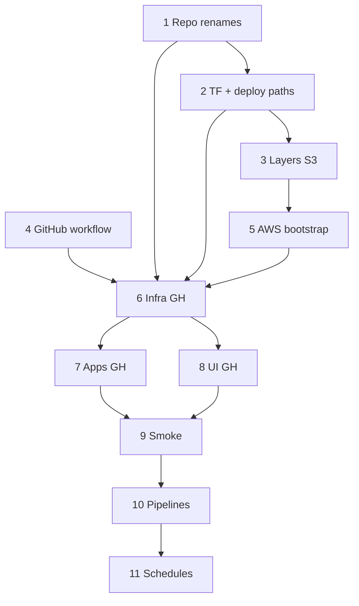

# UIF Echo dev rollout — phased plan

**Goal:** Stand up a greenfield **`uif-echo-dev-*`** stack beside the live
`echo-dev-*` stack, then register pipelines and run ingestion on UIF naming —
**without** migrating legacy configs or data in this programme.

**Deploy rule:** Phases **6–8** and Terraform applies in **11** run **only** via
GitHub Actions — **Deploy uif-echo — Dev**
(`.github/workflows/deploy-uif-echo-dev.yml`). Do not run deploy scripts locally.

**Rename rule:** All repo, Terraform, and S3 path alignment (Phases **1–2**) completes
**before** any AWS deploy. First deploy uses `jobs/` and kebab-case script names.

**References:**

- Artifact names: [`artifact-name-mapping.md`](artifact-name-mapping.md) §A.3, §E
- Terraform: `infrastructure/terraform/envs/dev-uif.tfvars`
- Backend: `infrastructure/terraform/backends/dev-uif.hcl`
- Workflow: `.github/workflows/deploy-uif-echo-dev.yml`

**Branch:** `feature/UIFPE-355-echo-stack-migration`

**UAT:** Phase **12** — deferred until dev Phases **1–11** complete.

---

## Phase summary

Confirm each phase before starting the next.

| Phase | Name | Type | Depends on |
|---|---|---|---|
| **1** | Pipeline repo renames | Code PR | — |
| **2** | Terraform & deploy path alignment | Code PR | 1 |
| **3** | Lambda layers → S3 | Code PR + one-time AWS | 2 |
| **4** | GitHub workflow on `develop` | Code PR + repo config | — |
| **5** | AWS bootstrap (state + layers) | One-time AWS | 3 |
| **6** | Infrastructure deploy | **GitHub** `infra=apply` | 1, 2, 3, 4, 5 |
| **7** | Apps deploy | **GitHub** `apps=apply` | 6 |
| **8** | UI deploy | **GitHub** `deploy_ui=true` | 6 |
| **9** | Platform smoke test | Manual verification | 7, 8 |
| **10** | Pipeline registration | API / CLI | 9 |
| **11** | Enable schedules & validate | Code PR + **GitHub** apply | 10 |
| **12** | UAT greenfield | *later* | 11 |
| **13** | Legacy retirement | *future* | 12 |



Phases **1** and **4** can start in parallel.

### Status (2026-09-10)

| Phase | Status |
|---|---|
| 1 | **Complete** |
| 2 | **Complete** |
| 3–13 | Not started |
| Monorepo layout (`stacks/echo/src/apps/*`) | Done |
| Docs, tfvars, backend, deploy scripts, draft workflow | Done |

### Locked decisions

| Topic | Decision |
|---|---|
| Renames | **Before deploy** — Phases 1–2 complete before Phase 6 |
| Deploy path | **GitHub Workflow only** for Phases 6–8, 11 |
| S3 script prefix | `jobs/` from first deploy |
| Repo script names | kebab-case per [`artifact-name-mapping.md`](artifact-name-mapping.md) §A.3 |
| DynamoDB | `uif-echo-dev-pipeline-config`, `uif-echo-dev-pipeline-metrics` |
| Silver Glue DBs | `uif_echo_dev_silver_tep`, `uif_echo_dev_silver_mdm` only |
| Push to `develop` | `UIF_ECHO_DEV_INFRA=plan` only — never unattended `apply` |
| Secrets (UIF dev) | `uif/echo/dev/db/tep`, `.../mdm`, `.../cloud/gcp-rp-pdh`, `.../ui/login`; tag `app=echo` |
| Unchanged (legacy) | live `echo-dev-*` keeps `echo/dev/gip/...` until Phase 13 |

---

## Repo structure alignment — scope

Top-level monorepo layout (§E) is **already done**. Phases **1–2** finish the
remaining alignment before any AWS resource is created.

| Area | Current | Target (Phase 1–2) |
|---|---|---|
| Pipeline entry scripts | ~~`generic_*.py`~~ | **`bronze-ingest.py`, …** *(Phase 1)* |
| DQ package | ~~`dq_kinds/`~~ | **`dq-kinds/`** *(Phase 1)* |
| S3 sync prefix | ~~`glue_jobs/`~~ | **`jobs/`** *(Phase 2)* |
| TF `aws_s3_object` keys | ~~`glue_jobs/…`~~ | **`jobs/…`** *(Phase 2)* |
| Glue `ScriptLocation` | ~~`glue_jobs/…`~~ | **`jobs/…`** *(Phase 2)* |
| DynamoDB table slugs | ~~`glue-job-config`~~ | **`pipeline-config`** *(UIF only, Phase 2)* |
| Silver Glue DBs (TF) | `silver_product`, `silver_fipm` *(legacy)* | `silver_tep`, `silver_mdm` *(UIF only)* |
| `stack_naming.py` / qe | legacy slugs on live envs | UIF slugs on `uif-echo-*` |

**Not in scope:** pipeline draft JSON files (DynamoDB is source of truth).

**Python note:** kebab-case filenames are not valid `import` identifiers. Phase 1
updates runtime and test loading (Glue executes scripts by path; tests use
file-path helpers / `importlib` where needed). The `dq-kinds` package gets the
same treatment.

---

## GitHub Workflow — how deploy phases run

**Workflow:** Actions → **Deploy uif-echo — Dev** → **Run workflow**

| Repo variable | Safe default | Used in phase |
|---|---|---|
| `UIF_ECHO_DEV_INFRA` | `skip` | 6, 11 |
| `UIF_ECHO_DEV_APPS` | `skip` | 7 |
| `UIF_ECHO_DEV_UI` | `false` | 8 |
| `UIF_ECHO_API_URL_DEV` | *(unset)* | 8 — optional |

Dispatch inputs override variables for that run.

Job graph: `resolve → tests → infra → apps` and `resolve → tests → infra → ui`

---

## Phase 1 — Pipeline repo renames

**Type:** Code PR  
**Purpose:** On-disk files match UIF kebab-case names before Terraform references them.

**File renames** (`src/apps/pipeline/` — full table in [`artifact-name-mapping.md`](artifact-name-mapping.md) §A.3):

| From | To |
|---|---|
| `generic_bronze_ingest.py` | `bronze-ingest.py` |
| `generic_silver_transform.py` | `silver-transform.py` |
| `analyze_table.py` | `analyze-table.py` |
| `generic_gold_transform.py` | `gold-transform.py` |
| `generic_gold_reconcile.py` | `gold-reconcile.py` |
| `generic_silver_reconcile.py` | `silver-reconcile.py` |
| `generic_silver_transform_gcp_iceberg.py` | `silver-transform-gcs-iceberg.py` |
| `generic_silver_reconcile_gcp.py` | `silver-reconcile-gcs.py` |
| `generic_silver_transform_gcp_bq.py` | `silver-transform-bq.py` |
| `generic_silver_reconcile_gcp_bq.py` | `silver-reconcile-bq.py` |
| `generic_silver_bq_native.py` | `silver-transform-bq-native.py` |
| `generic_silver_quality_check.py` | `silver-quality-check.py` |
| `_phase0_iceberg_gcp_probe.py` | `iceberg-gcs-probe.py` |
| `dq_kinds/` | `dq-kinds/` |
| `dq_kinds/null_rate.py` | `dq-kinds/null-rate.py` |

**Work items:**

- [x] Git rename all pipeline scripts and `dq-kinds/` package
- [x] `_module_loader.py` + `qe/pipeline/job_loader.py` for kebab-case imports
- [x] Update `silver-quality-check.py` dispatch via `_module_loader`
- [x] Update `qe/conftest.py` and `qe/pipeline/test_*.py`
- [x] Update `echo-component-diagram.md` script column
- [x] `py -m pytest stacks/echo/qe` — 472 passed

**Exit criteria:** Full qe suite green; no `generic_*.py` or `dq_kinds/` on disk under `src/apps/pipeline/`. **Met.**

**Note:** Terraform still references old paths until **Phase 2**.

---

## Phase 2 — Terraform & deploy path alignment

**Type:** Code PR  
**Depends on:** Phase 1  
**Purpose:** Terraform, deploy scripts, and naming helpers reference renamed files and UIF AWS names.

**Work items:**

- [x] **DynamoDB:** `local.config_table_slug` / `metrics_table_slug` — UIF gets `pipeline-*`
- [x] **Silver DBs:** `silver_tep`, `silver_mdm` gated on `local.is_uif_stack`; legacy DBs gated off UIF
- [x] **glue.tf / data_quality.tf:** `jobs/` paths + kebab-case sources; `_module_loader.py` in extra-py-files
- [x] **variables.tf** comments updated
- [x] **Deploy:** `_uif-echo-deploy-common.sh` + legacy `deploy-echo-dev.yml` → `jobs/`
- [x] **stack_naming.py** + tests — UIF prefix → `pipeline-config` / `pipeline-metrics`
- [x] **qe/pipeline/test_dq_infra.py** — `jobs/` assertions
- [x] `terraform fmt` + `terraform validate` — success
- [x] `py -m pytest stacks/echo/qe` — 477 passed

**Exit criteria:** No `glue_jobs/` in TF or deploy scripts; plan-ready code; tests green. **Met.**

**Note:** Live `echo-dev-*` keeps `glue-job-config` DynamoDB names; only `uif-echo-*` uses `pipeline-config`.

---

## Phase 3 — Lambda layers → S3

**Type:** Code PR  
**Depends on:** Phase 2  
**Purpose:** GitHub runners can `terraform plan` without local layer zips.

**Work items:**

- [x] Change `aws_lambda_layer_version` in `lambda.tf` to `s3_bucket` / `s3_key`
- [x] Remove `filemd5()` on local `filename` paths (deleted four `aws_s3_object` uploads)
- [x] Remove `uif_echo_preflight_layers`; add `uif_echo_upload_layers` for `BUILD_LAYERS=1`
- [x] Update `deploy/layers/README.md`, `deploy-echo-dev.yml` preflight guard

**Exit criteria:** TF references `s3://{artifacts_bucket}/lambda-layers/*.zip`. **Met** (keys in `local.lambda_layer_keys`).

**Note:** Zip upload happens in Phase **5** (artifacts bucket pre-created). Live `echo-dev-*` apply should `terraform state rm` the old `aws_s3_object.*_layer` resources first (see layers README).

---

## Phase 4 — GitHub workflow on `develop`

**Type:** Code PR + repo configuration  
**Purpose:** Deploy path exists before AWS apply.

**Work items:**

- [x] Commit `.github/workflows/deploy-uif-echo-dev.yml`
- [x] Update `deploy-echo-dev.yml` header (live `echo-dev-*` only)
- [ ] Merge to `develop` — [PR #230](https://github.com/pearson-dnt-coe/universal-Integration-framework/pull/230)
- [x] Set repo variables: `UIF_ECHO_DEV_INFRA=skip`, `UIF_ECHO_DEV_APPS=skip`, `UIF_ECHO_DEV_UI=false`

**Exit criteria:** Workflow visible; no-op run completes (all skip).

**Repo variables** (Settings → Actions → Variables):

| Variable | Value | Effect |
|---|---|---|
| `UIF_ECHO_DEV_INFRA` | `skip` | No Terraform on push |
| `UIF_ECHO_DEV_APPS` | `skip` | No apps deploy on push |
| `UIF_ECHO_DEV_UI` | `false` | No UI deploy on push |

Push to `develop` touching `stacks/echo/**` runs only the **resolve** job when all three are skip.

---

## Phase 5 — AWS bootstrap (state + layers)

**Type:** One-time AWS operations  
**Depends on:** Phase 3  
**Purpose:** Backend and layer artifacts exist before Phase 6.

**Work items:**

- [x] Run bootstrap (`aws-runas -e dev` + script or equivalent CLI) — 2026-09-10
- [x] S3 bucket `uif-echo-dev-data` (versioning, encryption) — holds `tfstate/`, `code/`, `configs/`
- [x] Four layer zips under `code/lambda-layers/`
- [x] Confirm `backends/dev-uif.hcl`: bucket `uif-echo-dev-data`, key `tfstate/infra-terraform.tfstate`, `use_lockfile`

**Note:** Backend uses S3 native locking (`use_lockfile`) — no DynamoDB lock table.

**Exit criteria:** State bucket, artifacts bucket, and layer zips exist in S3. **Met.**

**Phase 6 heads-up:** `uif-echo-dev-data` may be pre-created in Phase 5; first `terraform apply` auto-imports
via `uif-echo-infra-deploy.sh`. If you created `uif-echo-dev-artifacts` under an earlier naming pass, delete
or ignore it — the bucket name is now `uif-echo-dev-data`.

---

## Phase 6 — Infrastructure deploy

**Type:** GitHub Workflow only  
**Depends on:** Phases 1, 2, 3, 4, 5  

**Run** (workflow_dispatch on **Deploy uif-echo — Dev**, branch `develop`):

1. `infra=plan`, `apps=skip`, `deploy_ui=false` — review plan in log  
2. `infra=apply`, `apps=skip`, `deploy_ui=false` — create platform resources  

Or set repo variable `UIF_ECHO_DEV_INFRA=plan` then `apply` and re-run on push.

**Creates:** S3 buckets, DynamoDB, Glue jobs (pointing at `jobs/`), Lambdas, API Gateway,
CloudFront, EventBridge rules (**DISABLED**), IAM, LF grants, Silver/Gold catalog DBs.

**Note:** `uif-echo-infra-deploy.sh` auto-imports pre-created `uif-echo-dev-data` on apply.

**CI IAM (before first plan):**

1. Apply bucket policy (grants `echo-dev-github-actions` access to tfstate + code):
   ```bash
   aws-runas -E dev aws s3api put-bucket-policy --bucket uif-echo-dev-data \
     --policy file://stacks/echo/infrastructure/deploy/uif-echo-dev-data-bucket-policy.json
   ```
2. Update live managed policy `echo-dev-deploy-2` with `uif-echo-dev-*` S3 ARNs
   (`capabilities/infrastructure/echo-dev-deploy-2.policy.json` — the bucket grants
   moved there when `echo-dev-deploy` was split at UIFPE-360) — requires IAM admin apply.

**Exit criteria:** `api_endpoint` exists; rules DISABLED; Glue `ScriptLocation` uses `code/`.

---

## Phase 7 — Apps deploy

**Type:** GitHub Workflow only  
**Depends on:** Phase 6  

**Run:** `infra=skip`, `apps=apply`

**Does:** Sync `src/apps/pipeline/` → `s3://uif-echo-dev-data/code/`; TF apply for Lambdas.

**Exit criteria:** All kebab-case scripts listed in S3 under `jobs/`; Lambdas updated.

---

## Phase 8 — UI deploy

**Type:** GitHub Workflow only  
**Depends on:** Phase 6  

**Run:** `infra=skip`, `apps=skip`, `deploy_ui=true`

**Exit criteria:** CloudFront URL loads; UI calls UIF API; login works.

---

## Phase 9 — Platform smoke test

**Type:** Manual verification  
**Depends on:** Phases 7, 8  

**Checks:**

- [ ] `GET /connections` — Oracle/GCP secrets
- [ ] `POST /auth/login`
- [ ] Glue connection + Oracle path
- [ ] Lake Formation on `uif_echo_dev_silver_tep`

**Exit criteria:** No 500s on read-only API paths.

---

## Phase 10 — Pipeline registration

**Type:** API / CLI (greenfield)  
**Depends on:** Phase 9  

**Work items:**

- [ ] Register pilot pipeline(s) against UIF API
- [ ] `silver.database` = `uif_echo_dev_silver_tep` or `uif_echo_dev_silver_mdm`
- [ ] Rows in `uif-echo-dev-pipeline-config`

**Exit criteria:** At least one pipeline config per source system for pilot.

---

## Phase 11 — Enable schedules & validate runs

**Type:** Code PR + GitHub Workflow  
**Depends on:** Phase 10  

**Work items:**

- [ ] `event_rule_state = "ENABLED"` in `dev-uif.tfvars`; merge to `develop`
- [ ] GitHub: `infra=apply`
- [ ] Ad-hoc Bronze run; metrics in `uif-echo-dev-pipeline-metrics`

**Exit criteria:** Pilot pipeline succeeds on schedule or ad-hoc.

**Rollback:** `DISABLED` + GitHub `infra=apply`.

---

## Phase 12 — UAT greenfield *(later)*

Repeat Phases **1–11** for UAT.

---

## Phase 13 — Legacy retirement *(future)*

Out of scope until UIF dev and UAT validated.

---

## Workflow dispatch cheat sheet

| Phase | Dispatch inputs |
|---|---|
| 6 plan | `infra=plan`, `apps=skip`, `deploy_ui=false` |
| 6 apply | `infra=apply`, `apps=skip`, `deploy_ui=false` |
| 7 | `infra=skip`, `apps=apply`, `deploy_ui=false` |
| 8 | `infra=skip`, `apps=skip`, `deploy_ui=true` |
| 11 | `infra=apply`, `apps=skip`, `deploy_ui=false` |

---

*Next: reply **proceed Phase 3** for Lambda layers → S3 (unblocks CI).*
